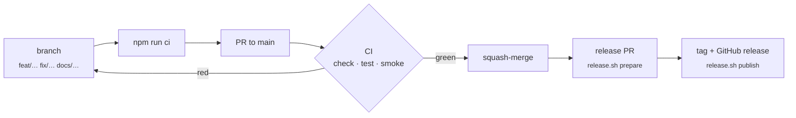

# Contributing to Optica Viva

Thank you for helping. New laboratories, more lens prescriptions, validations against measured data, physics corrections, translations and performance work are all welcome. Check [ROADMAP.md](ROADMAP.md) first, because your idea may already be planned.

## Ground rules

1. **Physics first.** Use the most exact model that runs interactively. Name every approximation on the page, and cite a primary reference in the theory section.
2. **Verifiable.** Every quantitative claim gets an assertion in `test/` and, if user-facing, a row in the README validation table.
3. **Zero install.** Static files, vanilla ES modules, no build step, no runtime dependencies (KaTeX is vendored). Must work offline.
4. **Respect low-power devices.** Debounce heavy work, and check the page on a slow machine if you can (the reference device is a Raspberry Pi 4).

## Workflow

1. **Branch** from `main`: `feat/<topic>`, `fix/<topic>`, `docs/…`, `ci/…` or `chore/…`. `main` is protected; changes land only through pull requests with green CI.
2. **Develop** with `npm start` (serves on <http://localhost:8000>).
3. **Check locally** with `npm run ci`:
   - `npm run check`: syntax of every module, plus every relative link, image and heading anchor in the Markdown files
   - `npm test`: physics and blur test suites (`node --test`, no dependencies)
   - `npm run smoke`: every page in headless Chrome must load without errors, and a shared URL must restore its controls
4. **Document** under `## [Unreleased]` in [CHANGELOG.md](CHANGELOG.md) (Keep a Changelog). Tick or add items in [ROADMAP.md](ROADMAP.md), and update the [README](README.md) where affected. Regenerate screenshots if visuals changed: `python3 scripts/screenshots.py <page>`.
5. **Commit** with [Conventional Commits](https://www.conventionalcommits.org/), e.g. `feat(polarisation): add Malus and Brewster lab`. Open a pull request; the template has the checklist.
6. **Releases** also go through a pull request. `scripts/release.sh prepare X.Y.Z "summary"` opens a `release/vX.Y.Z` PR that dates the changelog and bumps the versions. Once it is merged with green CI, `scripts/release.sh publish X.Y.Z` pushes only the tag and creates the GitHub release. Nothing is ever pushed to `main` directly. Versions follow [SemVer](https://semver.org/): a new lab or feature is a minor release, and fixes and docs are patch releases.

## Adding a laboratory

1. Create `js/modules/<id>.js` exporting `default function mount(root, meta)`. Build it from `header`, `lab`, `theory`, `references` and `liveCalc` (`js/lib/page.js`), plus `controls`, `stage` and `readouts` (`js/lib/ui.js`), and return a cleanup function.
2. Register it in `MODULES` and `READY` in [`js/app.js`](js/app.js).
3. Link it from the matching entries in [`js/lib/phenomena.js`](js/lib/phenomena.js).
4. Put reusable physics in `js/lib/` (pure functions) and test it in `test/`.
5. Add a crop entry in [`scripts/screenshots.py`](scripts/screenshots.py) and a gallery tile in the README.

Controls created with `controls()` are automatically shareable through the URL, and on phones they slide into a bottom sheet; there is nothing extra to do.

## Style

- Match the surrounding code: 2-space indent, single quotes, compact functional helpers.
- Theory text goes in `String.raw` templates, with `\( … \)` and `\[ … \]` for math (never `$`).
- Never put a `//` comment inside a one-line `{ … }` block; it swallows the closing brace.

## Reporting problems

Use the issue templates: **Bug report**, **Physics or accuracy error** (with a reference) or **Feature or new laboratory**. If a laboratory crashes, the error panel has a pre-filled "Report this issue" link.
