<div align="center">

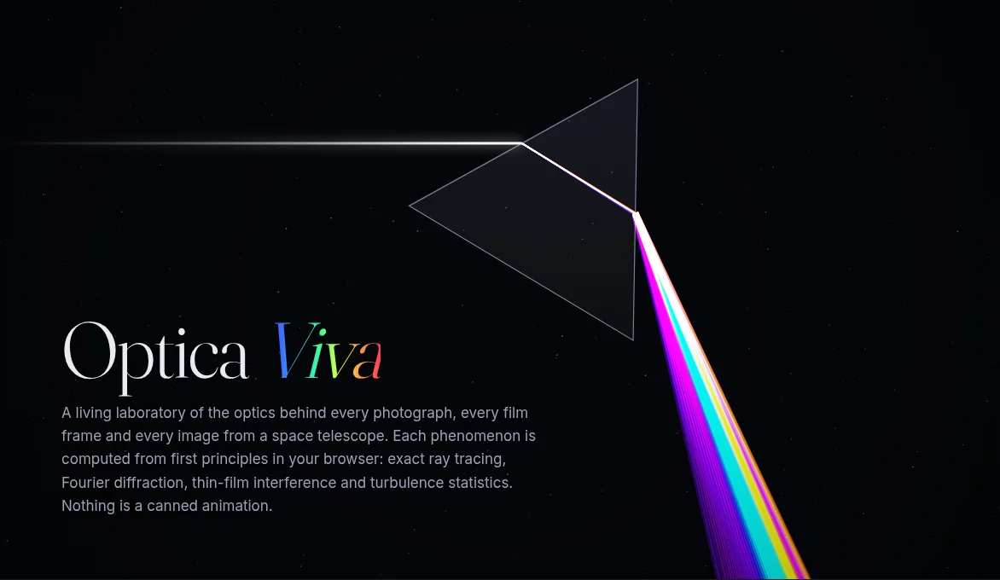

# Optica Viva

**A living laboratory of the optics behind photography, cinematography and space telescopes.**

Thirty-nine interactive simulations, a physics primer and a catalogue of 228 phenomena.
Everything is computed from first principles, live in your browser.

[](https://iiogurt.github.io/Optica_Viva/)
[](https://github.com/iiogurt/Optica_Viva/actions/workflows/ci.yml)
[](https://github.com/iiogurt/Optica_Viva/releases)
[](https://github.com/iiogurt/Optica_Viva/commits/main)
-6be3a4)


[](https://www.conventionalcommits.org/)
[](CHANGELOG.md)
[](LICENSE)

**[▶ Open the live demo](https://iiogurt.github.io/Optica_Viva/)** · [Quick start](#-quick-start) · [Laboratories](#-the-laboratories) · [Physics](#-physical-models) · [Architecture](#-architecture) · [Accuracy](#-validation) · [Roadmap](ROADMAP.md) · [Contributing](#-contributing)

</div>

---

## Table of contents

- [Why Optica Viva?](#-why-optica-viva)
- [Quick start](#-quick-start)
- [The laboratories](#-the-laboratories)
  - [Geometric optics](#geometric-optics)
  - [Wave optics](#wave-optics)
  - [Light, sensor & time](#light-sensor--time)
  - [Astronomy & space](#astronomy--space)
  - [Reference pages](#reference-pages)
- [Physical models](#-physical-models)
- [Architecture](#-architecture)
- [Project structure](#-project-structure)
- [Validation](#-validation)
- [Approximations and limits](#-approximations-and-limits)
- [Browser support and performance](#-browser-support-and-performance)
- [Roadmap](#-roadmap)
- [Contributing](#-contributing)
- [Versioning and releases](#-versioning-and-releases)
- [References](#-references)
- [Acknowledgements and licence](#-acknowledgements-and-licence)

---

## ✨ Why Optica Viva?

Most optics demonstrations are canned animations. Optica Viva instead **solves the physics** every time you move a slider:

- **Real lenses, really traced.** Vector Snell refraction through spherical surfaces of five historical prescriptions, with glass dispersion from manufacturer Sellmeier coefficients.
- **Real diffraction.** Fraunhofer PSFs by 2-D FFT of anti-aliased pupils, including Hubble, JWST, Keck and the 798-segment ELT, with a separate FFT per wavelength for colour.
- **Real coatings.** Thin-film interference by the characteristic-matrix method, at oblique incidence and for both polarisations.
- **Real turbulence.** von Kármán phase screens with subharmonics, frozen flow and a deformable mirror.
- **Real sensors.** Poisson photon statistics, two-stage read noise (ISO invariance), PRNU, Bayer mosaics and demosaicing.

Each page is built in three layers:

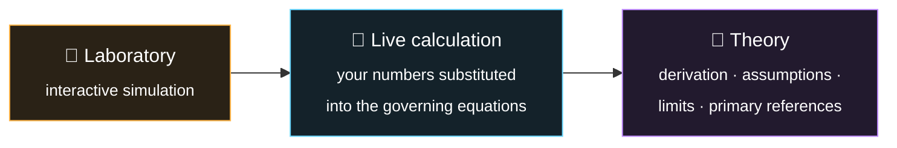

**From the simple idea to the full model.** Readers come with very different backgrounds, so a page climbs from simple to exact instead of offering a beginner/expert switch. ① *The idea* explains the phenomenon in plain words, without symbols, and suggests two or three things to try (predict first, then check). Then comes the simulation, whose live calculation starts with the result in a sentence. ② *Rule of thumb* gives the one formula worth remembering, a worked number and where it stops working. ③ *Full model* is the derivation, and ④ the references. A strip under the title jumps between the steps, so experts can go straight to the derivation. Every laboratory and the physical-foundations page use this ladder, and ten laboratories add a "Check your intuition" question about a common misconception, answered before the explanation appears. New to optics? The home page's **Start here** path suggests 17 laboratories in order, from why selfies distort faces to how we could photograph another Earth. Technical terms are explained where they first appear: hover over or tap a dotted-underlined word for a one-sentence definition and a link to the laboratory that simulates it.

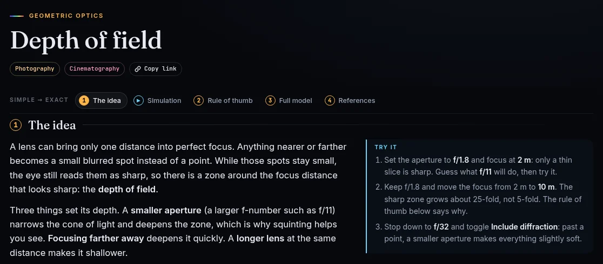

It covers three domains (📷 photography, 🎬 cinematography and 🔭 astronomy and space), and every phenomenon is tagged with the ones it affects.

Every setting is **shareable**. Controls are mirrored into the URL, so a link like [`#/psf?preset=hubble&band=white`](https://iiogurt.github.io/Optica_Viva/#/psf?preset=hubble&band=white) opens that exact configuration. Use **Copy link** in any page header. **Guided tours** (listed on the home page) move a laboratory's controls step by step and say what to look at; a link like `#/mtf?tour=stop-down` starts one. **Save settings** downloads the page state as JSON, and every figure has **PNG** and (for charts) **CSV** export buttons. On phones each lab's controls slide up from a bottom sheet next to the live result. Canvases are labelled for screen readers, keyboard focus is visible, and animations respect *reduce motion*.

---

## 🚀 Quick start

**No install needed:** open the live demo at **<https://iiogurt.github.io/Optica_Viva/>**. It is deployed automatically from `main` by GitHub Actions.

To run it locally: Optica Viva is plain HTML, CSS and ES modules. There is **no build step and nothing to install**. ES modules must be served over HTTP, so start any static server in the project folder:

```bash
git clone https://github.com/iiogurt/Optica_Viva.git
cd Optica_Viva
npm start                    # same as: python3 -m http.server 8000
```

Then open **<http://localhost:8000>**.

<details>
<summary>Other ways to serve it</summary>

```bash
npx serve .                  # Node
php -S localhost:8000        # PHP
caddy file-server --listen :8000
```

Any static host works too (GitHub Pages, Netlify, an S3 bucket). The app uses hash routing (`#/raytracer`), so no server rewrites are needed.

</details>

KaTeX is vendored in `vendor/katex/`, so the app runs **fully offline**. Web fonts (Fraunces, Inter, JetBrains Mono) load from Google Fonts when a connection exists and fall back to system fonts otherwise.

---

## 🔬 The laboratories

Every image below is a screenshot of the running app. Each one is a simulation result, not an illustration. Regenerate them with [`scripts/screenshots.mjs`](scripts/screenshots.mjs).

### Missions

Missions are real tasks. Enter your equipment and situation (or pick a real camera body, planetary camera or telescope from the presets), and the page combines several laboratory models into a plan with the reason for every setting.

**Photograph the Milky Way** · `#/mission-milkyway`<br>
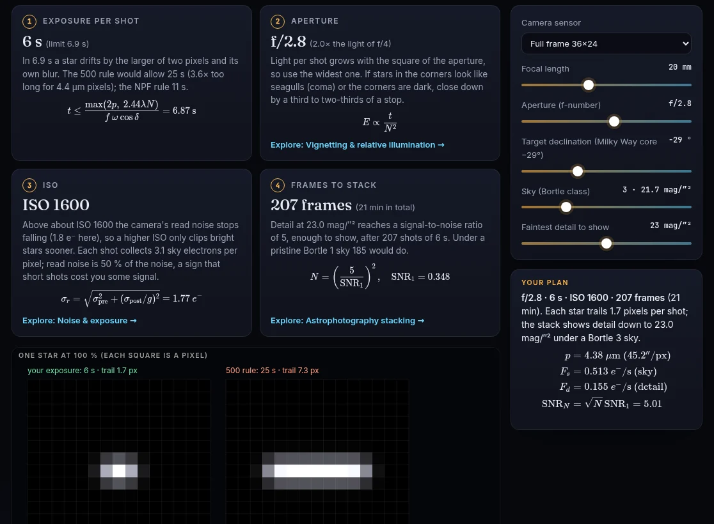

The longest exposure before stars trail (sidereal drift f ω cos δ against two pixels or the Airy disk, compared with the 500 and NPF rules), the ISO-invariance point of a two-stage read-noise model, sky and detail electrons from the Bortle class, and the number of frames for a signal-to-noise ratio of 5 on the faintest detail you choose.

**Image Jupiter from your garden** · `#/mission-jupiter`<br>
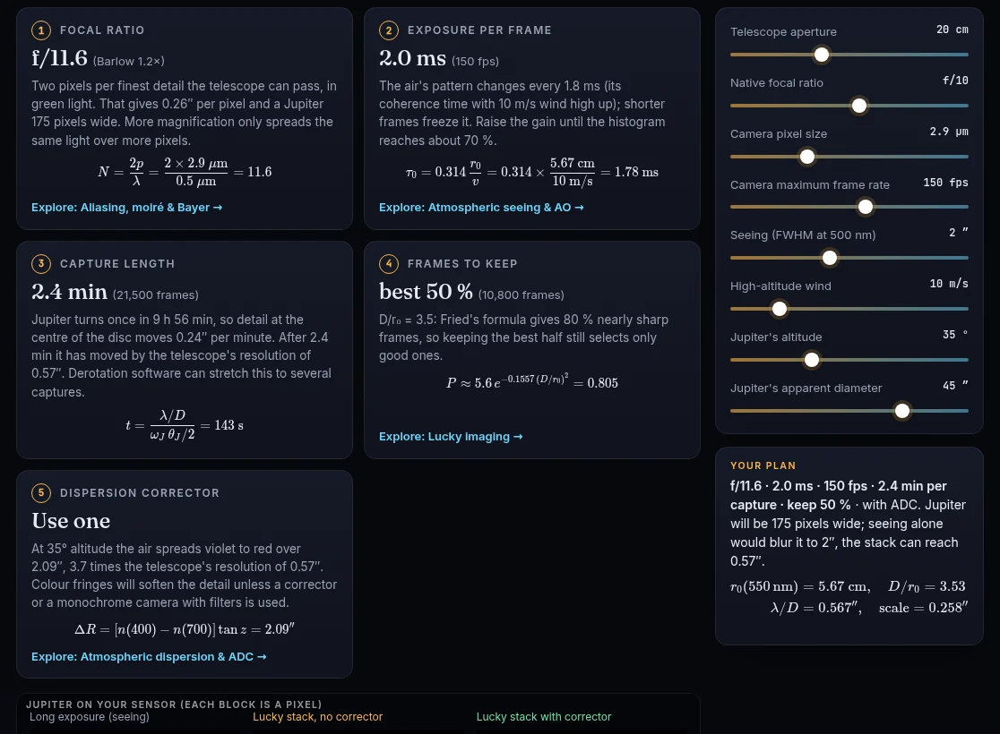

The Nyquist focal ratio for your pixels, frames short enough to freeze the seeing, the capture length before Jupiter's rotation blurs detail, Fried's share of lucky frames, and when atmospheric dispersion calls for a corrector.

**Portrait session** · `#/mission-portrait`<br>
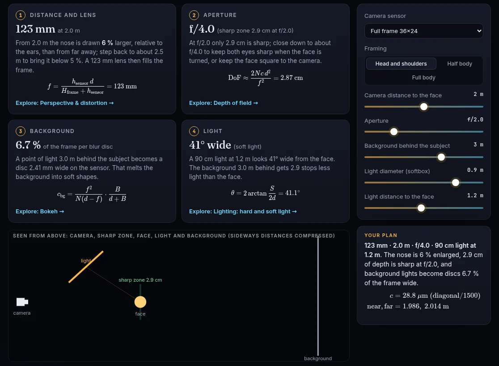

Where to stand and which lens fills the frame without enlarging the nose, the widest aperture that keeps both eyes sharp, how much the background blurs, and how big and close the light should be.

**Photograph a total solar eclipse** · `#/mission-eclipse`<br>
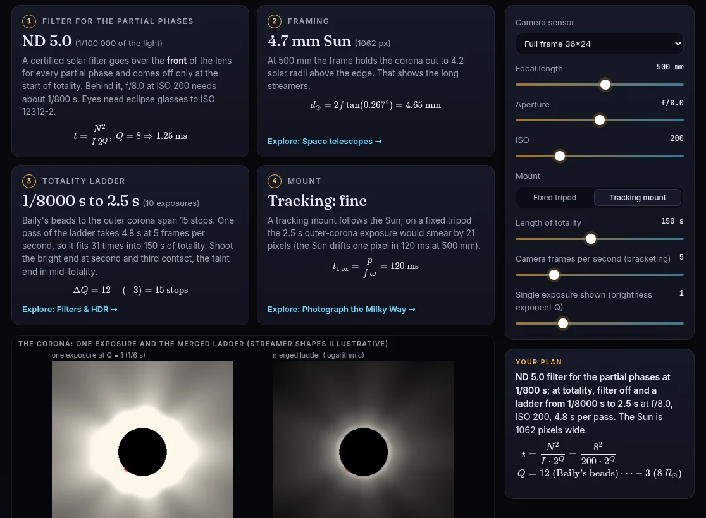

Safe filters for the partial phases, framing for the corona, a 15-stop totality ladder from NASA's exposure guide, and when a tracking mount is needed.

**Film under LED light** · `#/mission-led`<br>
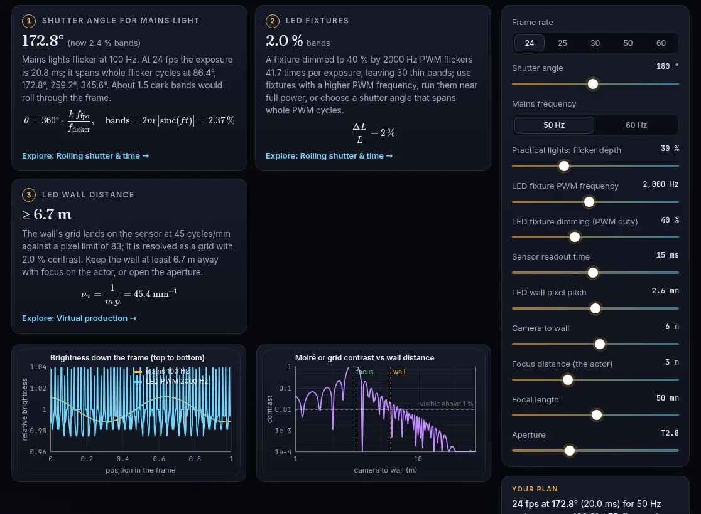

Shutter angles that cancel mains flicker, which dimmed LED fixtures band on a rolling shutter, and how far an LED wall must be to keep its grid invisible.

**Choose a camera or telescope** · `#/mission-choose`<br>
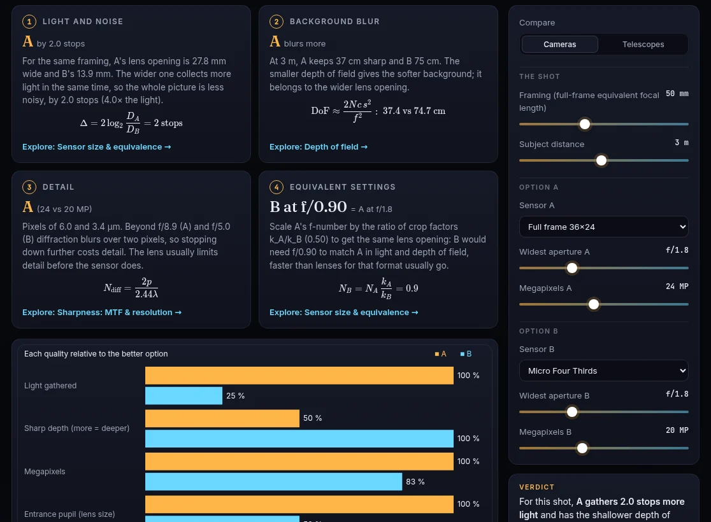

Two cameras for the same shot, or two telescopes: which gathers more light, blurs the background more or shows finer detail, and which settings make them equivalent.

**Design an Earth-observation satellite** · `#/mission-satellite`<br>
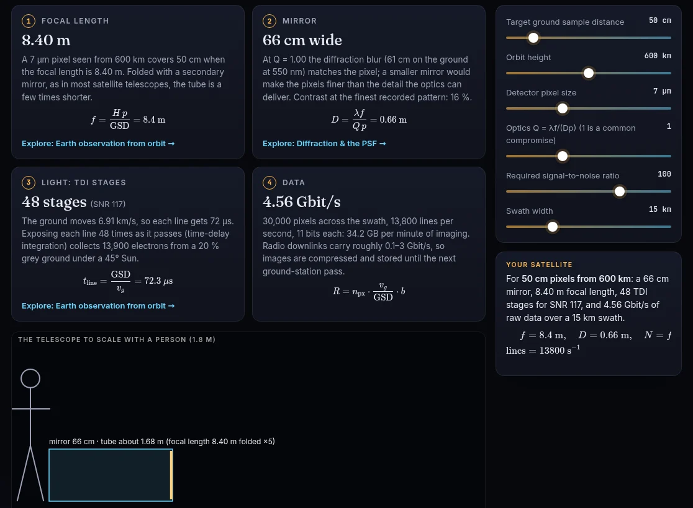

From the ground resolution you want to the focal length, mirror, TDI stages and data rate.

**Plan an exoplanet observation** · `#/mission-exoplanet`<br>
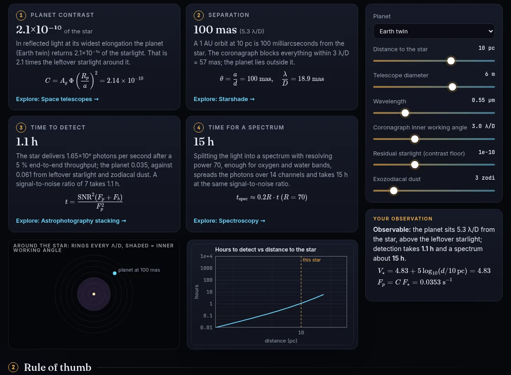

Can a telescope photograph an Earth or a Jupiter around a nearby star: contrast, separation against the inner working angle, and the hours to detect it and take its spectrum.

**Security camera or drone survey** · `#/mission-survey`<br>
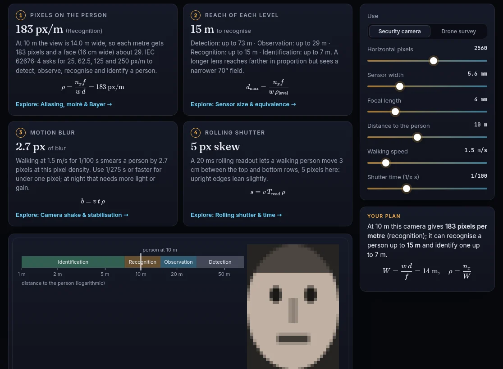

Pixels on a person for detecting, recognising or identifying them (IEC 62676-4), or ground sample distance, shutter and photo interval for a mapping drone.

### Your own gear

**Test your lens** · `#/gear`<br>
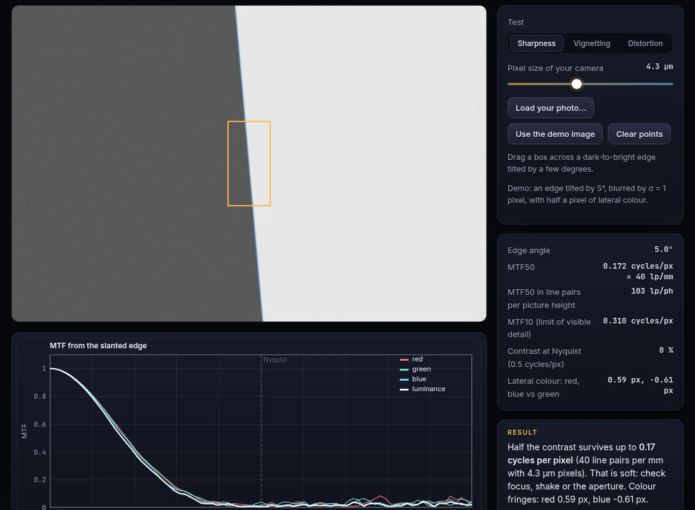

Measure your own lens from your own photographs, analysed only in your browser: sharpness by the ISO 12233 slanted-edge method (MTF per colour channel, MTF50, lateral colour), vignetting from a flat field, and distortion from points on a straight line. Demo images with known answers show how each test works.

### Phenomena in the wild

**Phenomena in the wild** · `#/gallery`<br>


Real photographs explained by the laboratories: Hubble before and after its repair, Webb's diffraction spikes and lensed arcs, the black hole in M87 and the green flash. Images are public domain or CC BY 4.0 (see [THIRD_PARTY_NOTICES.md](THIRD_PARTY_NOTICES.md)).

### Geometric optics

<table>
<tr>
<td width="50%" valign="top">

**Real-lens ray tracing** · `#/raytracer`<br>
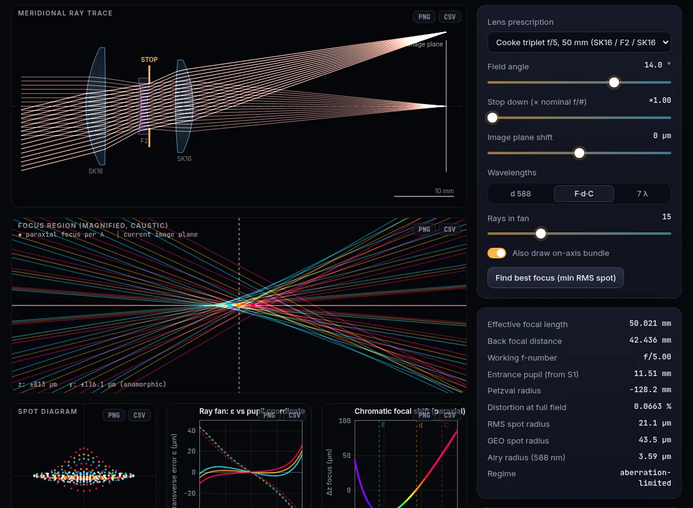

Exact 3-D ray tracing through a plano-convex singlet (both orientations), an **aspheric** plano-hyperbolic singlet with zero spherical aberration, a BK7/F2 achromat designed for this project, the Cooke triplet and the Double-Gauss. Includes real-ray aiming at the stop, a magnified caustic, spot diagram, ray fans, chromatic focal shift, best-focus search, and the **diffraction PSF of the traced wavefront** (OPD → FFT). Seidel sums per surface, exact field curves and **MTF across the field** show where image quality is won and lost. A **prescription editor** lets you modify any design surface by surface, **optimise** it (damped least squares), run a **Monte-Carlo tolerance analysis**, or import a Zemax `.zmx`; custom lenses are shareable by link.

</td>
<td width="50%" valign="top">

**Depth of field** · `#/dof`<br>
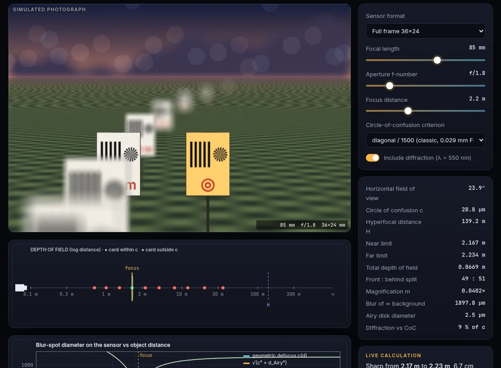

A synthetic photograph framed by the real camera geometry. Ground texture is attenuated by the exact defocus OTF 2J₁(πcν)/(πcν), which goes negative and produces contrast reversal. Cards and lights are convolved with a true disk kernel. Hyperfocal distance and near/far limits update live.

</td>
</tr>
<tr>
<td valign="top">

**Sensor size & equivalence** · `#/sensor`<br>
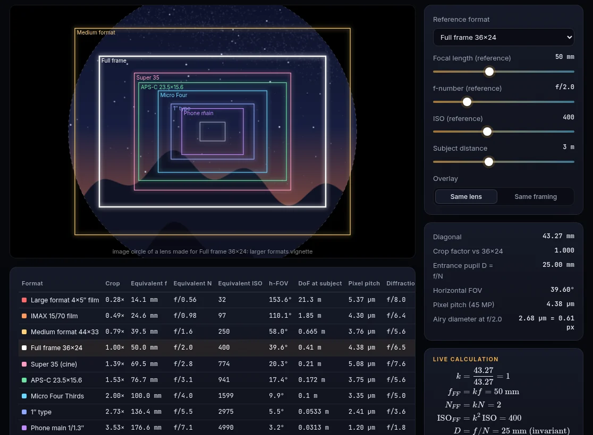

Ten formats from phone to IMAX inside a real image circle. The equivalence table gives f, N, ISO, field of view, depth of field, pixel pitch, diffraction-limited aperture and light gathered. Charts show field of view and shot-noise SNR against sensor area.

</td>
<td valign="top">

**Fisheye vs rectilinear** · `#/projection`<br>
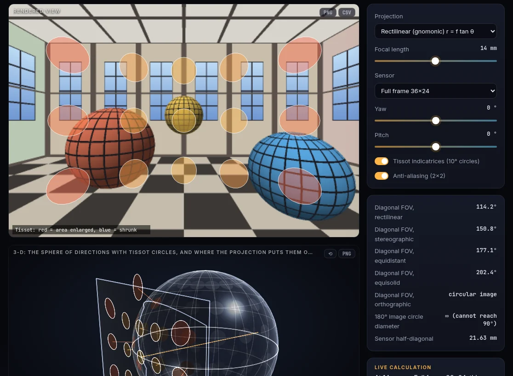

Per-pixel inverse ray casting into a 3-D hall through seven projections: gnomonic, stereographic, equidistant, equisolid, orthographic, Panini and equirectangular. **Exact Tissot indicatrices** show local distortion.

</td>
</tr>
<tr>
<td valign="top">

**Perspective & distortion** · `#/perspective`<br>
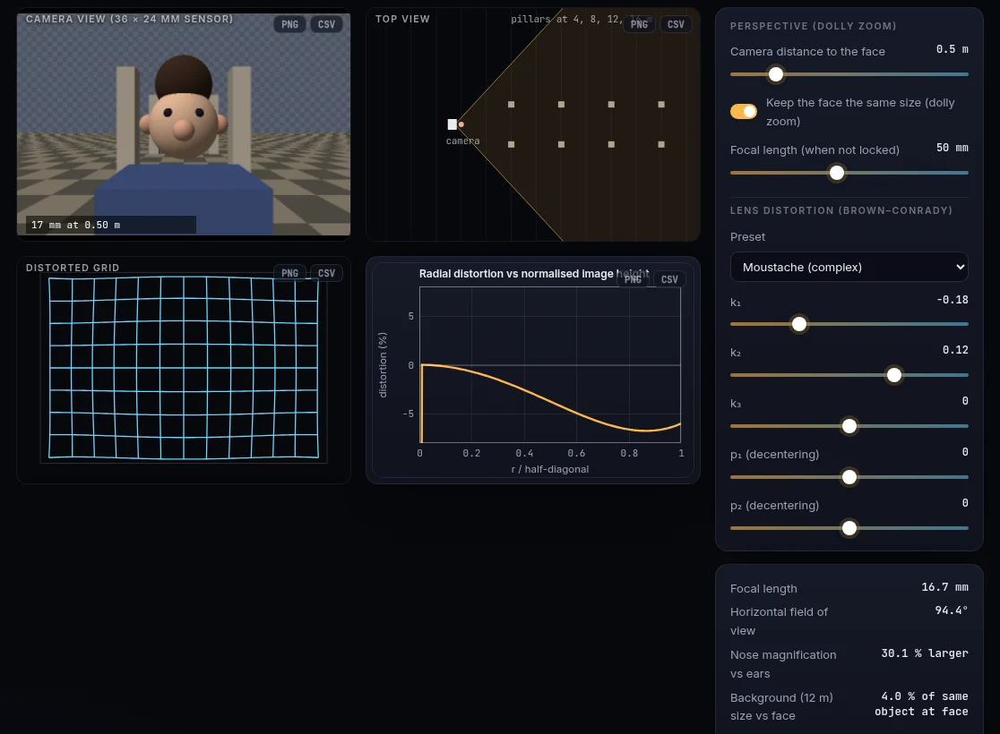

A dolly zoom on a ray-cast portrait shows that perspective depends only on camera distance (the nose is 30 % larger at 0.5 m). Brown–Conrady k₁–k₃, p₁ and p₂ distortion is shown with barrel, pincushion and moustache presets, plus TV distortion.

</td>
<td valign="top">

**Tilt–shift & Scheimpflug** · `#/tiltshift`<br>
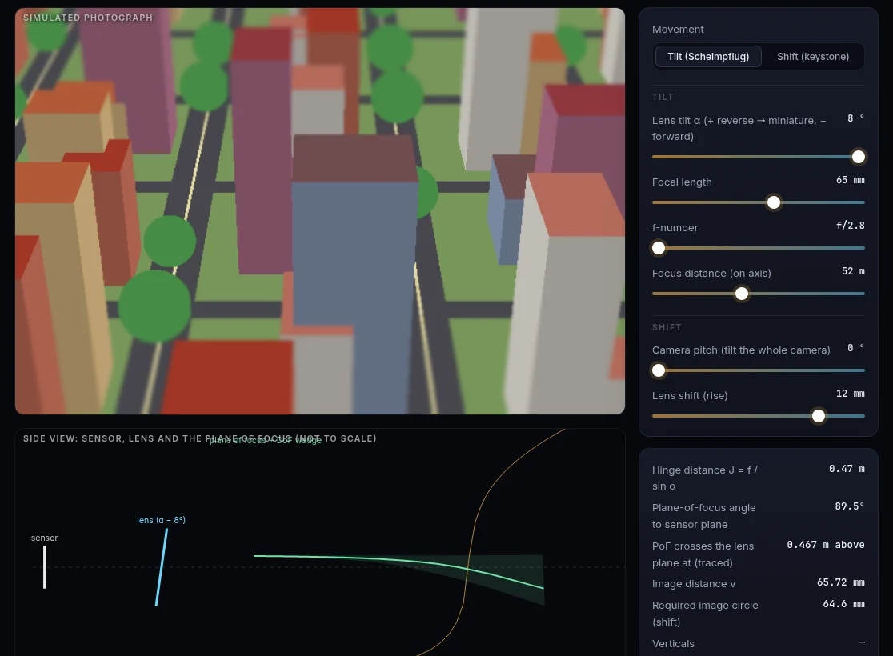

Exact tilted-thin-lens imaging, verified against the hinge rule J = f/sin α. Each pixel's defocus is computed through the tilted lens to produce the **miniature effect**. The DoF wedge appears in the side view. Shift mode demonstrates keystone correction.

</td>
</tr>
<tr>
<td valign="top">

**Vignetting & relative illumination** · `#/vignetting`<br>
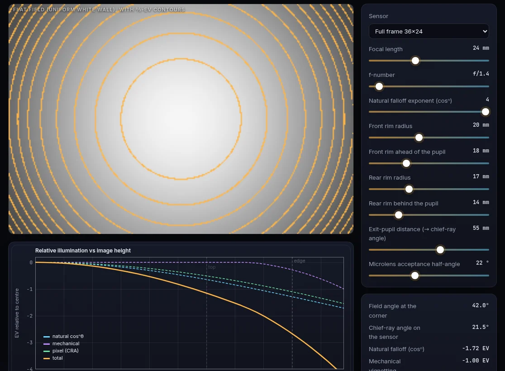

Three independent causes, each computed: natural falloff cosⁿθ; mechanical vignetting from the **exact three-circle overlap** of the pupil and the barrel rims; and pixel vignetting from chief-ray angle against microlens acceptance.

</td>
<td valign="top">

**Macro & magnification** · `#/macro`<br>
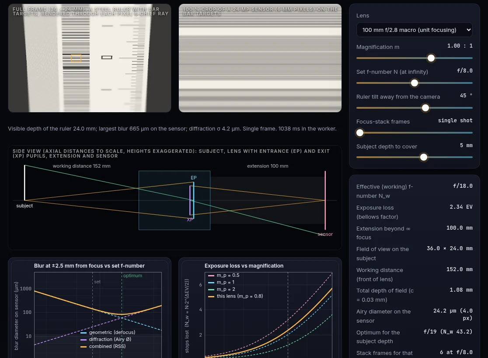

Close-up optics with **pupil magnification**: effective f-number N(1 + m/m<sub>p</sub>), bellows factor, extension and working distance for symmetric, macro, retrofocus, **reversed** and telephoto lenses. A tilted steel ruler is rendered through each pixel's chief ray with exact per-point defocus and Airy-width diffraction, in full frame and as a **100 % crop of bar targets**. The page finds the **optimum aperture** where defocus and diffraction blur balance, and simulates **focus stacking**.

</td>
</tr>
<tr>
<td valign="top" colspan="2">

**Panorama & parallax** · `#/panorama`<br>
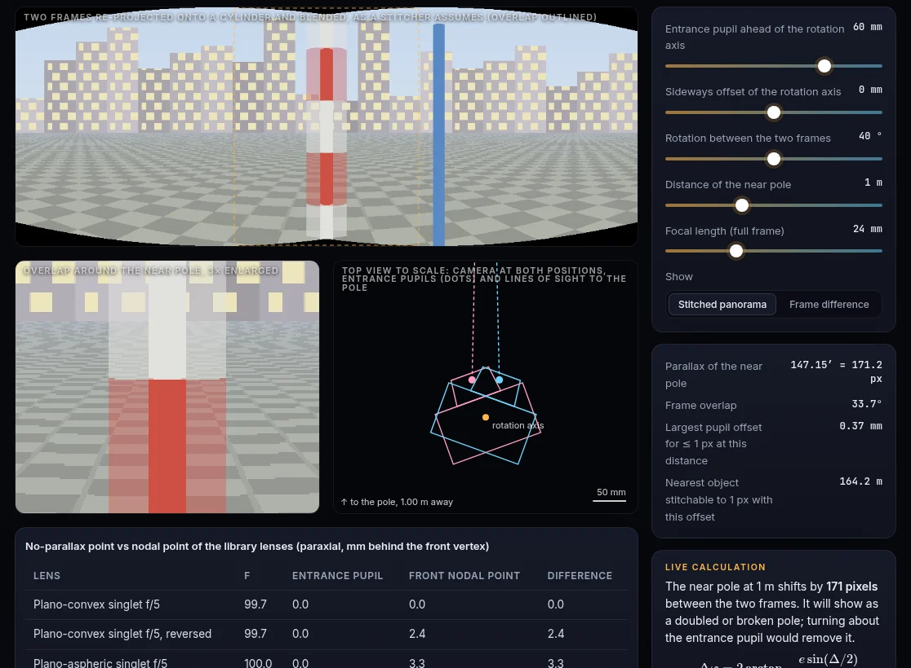

Two frames are **ray-cast from their real entrance-pupil positions** and stitched onto a cylinder as a panorama tool would, assuming pure rotation. With the pivot behind the pupil, near objects double in the overlap; with the pivot at the pupil, the seam vanishes. Readouts give the exact parallax 2 atan[e sin(Δ/2)/(d − e cos(Δ/2))] in pixels and the pivot tolerance. A table computes the **entrance pupil and the nodal point** of the library lenses from their paraxial matrices; they differ by 8 mm in the Double-Gauss.

</td>
</tr>
<tr>
<td valign="top" colspan="2">

**The human eye** · `#/eye`<br>
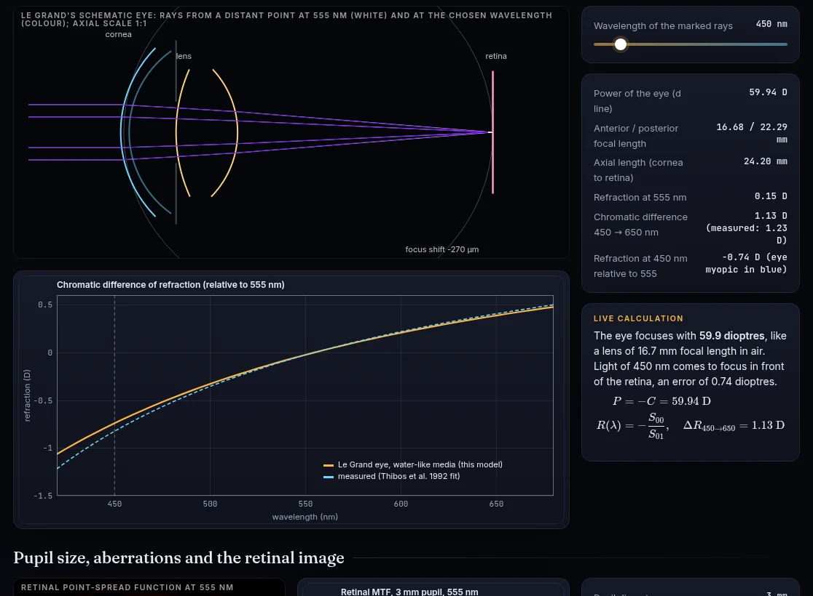

**Le Grand's schematic eye** (59.94 D) with water-like media: its **chromatic difference of refraction** matches the measured "chromatic eye" of Thibos et al. within 10 % without fitting. **Pupil size vs retinal image quality** (FFT MTF with typical higher-order aberrations and Stiles–Crawford apodisation) reproduces the classic optimum near 3 mm and the match to the foveal cone Nyquist frequency. The page also derives the **circle of confusion** from visual acuity.

</td>
</tr>
</table>

### Wave optics

<table>
<tr>
<td width="50%" valign="top">

**Diffraction & the PSF** · `#/psf`<br>
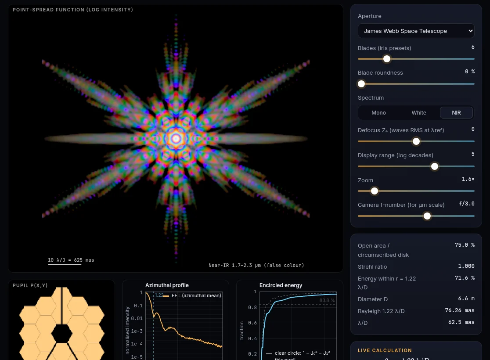

FFT PSFs for 13 apertures, from 5/6/7/9-blade irises to Hubble, **JWST**, Keck and the **798-segment ELT**. Includes white-light and NIR rendering, defocus, an azimuthal profile compared with the analytic Airy pattern, encircled energy and Strehl ratio.

</td>
<td width="50%" valign="top">

**Wavefront aberrations** · `#/zernike`<br>
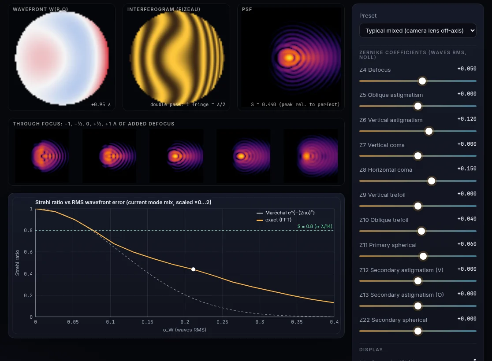

Eleven Noll Zernike modes with a wavefront map, Fizeau interferogram, through-focus series, and exact Strehl against Maréchal. Also simulates **JWST's segment phasing**: deployed, stacked, then coarse- and fine-phased.

</td>
</tr>
<tr>
<td valign="top">

**Sharpness: MTF & resolution** · `#/mtf`<br>
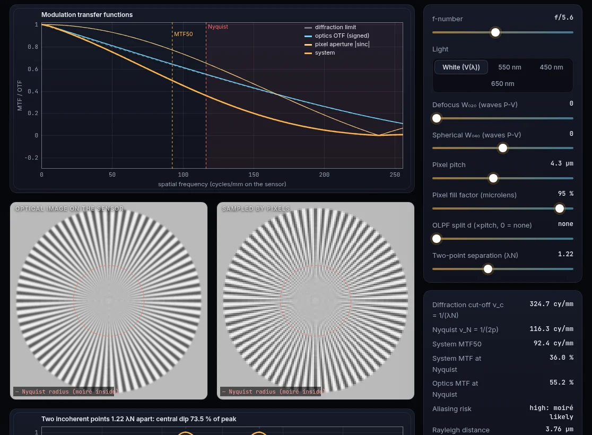

The optics OTF is computed numerically (pupil → PSF → OTF) and keeps its sign. It is cascaded with the pixel-aperture sinc and a four-spot OLPF. A Siemens star is shown before and after sampling, alongside Rayleigh and Sparrow two-point profiles.

</td>
<td valign="top">

**Chromatic aberration** · `#/chromatic`<br>
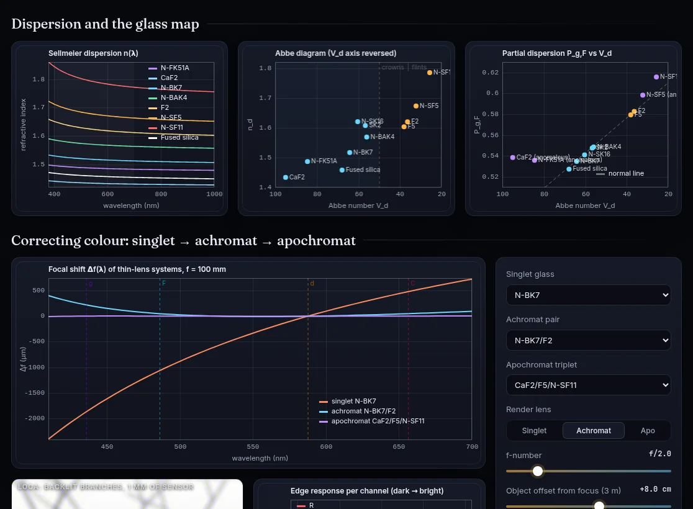

Sellmeier dispersion, the Abbe diagram and the partial-dispersion normal line. Thin-lens singlet, achromat and **solved apochromat** designs are compared. The LoCA render integrates 15 wavelengths through the defocus OTF, and a LaCA grid shows lateral colour.

</td>
</tr>
<tr>
<td valign="top" colspan="2">

**Bokeh** · `#/bokeh`<br>
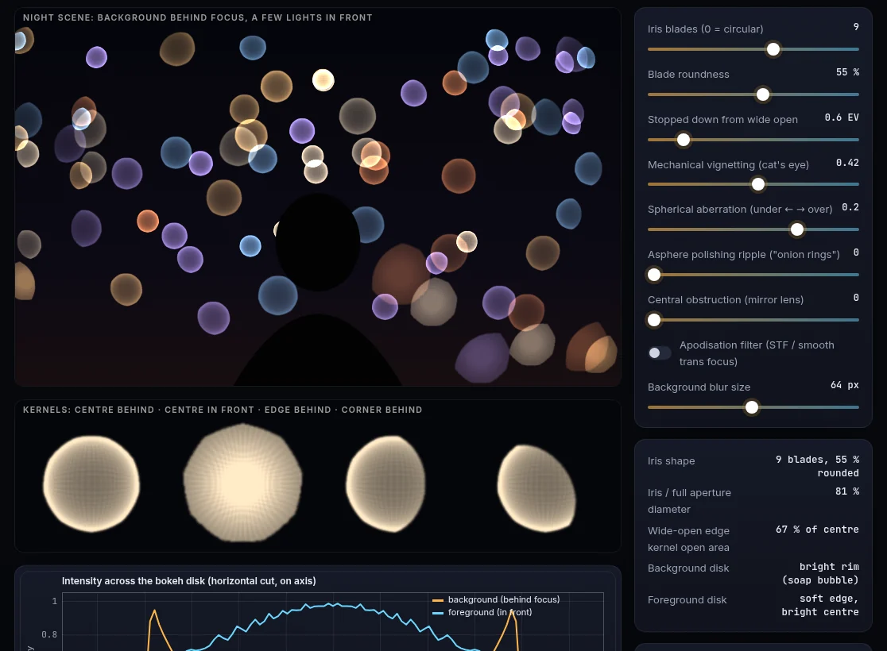

**Traced from the real lens**: defocus kernels come from exact rays through the chosen prescription at 8 wavelengths, at their physical size. The lens's own spherical aberration gives soft-edged backgrounds and bright-rimmed foregrounds, and its secondary spectrum gives the classic **magenta foreground and green background** fringes. The clear apertures cut **cat's eyes** off axis. For small disks, an FFT panel shows the **Fresnel rings** of the defocused pupil (on-axis intensity sinc²(W₀₂₀/λ)). A phenomenological mode keeps sliders for over-correction (**soap-bubble** disks), mirror-lens obstruction, apodisation and onion-ring ripple.

</td>
</tr>
<tr>
<td valign="top" colspan="2">

**Polarisation** · `#/polarisation`<br>
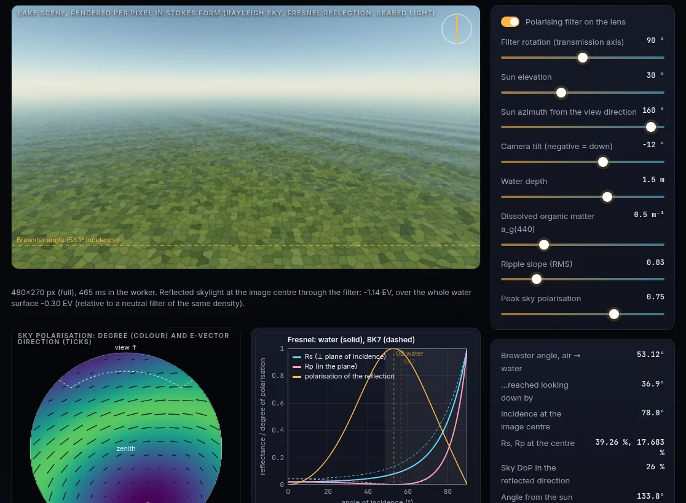

A lake scene **rendered per pixel in Stokes vectors**. Skylight from a single-scattering **Rayleigh sky** (spectral radiance and E-vector), Fresnel reflection off rippled water in Mueller form, and light from the pebbles below (pure-water and CDOM absorption) all pass through a rotating **polarising filter** with a real extinction ratio. At **Brewster's angle** the glare vanishes and the bottom appears, and the sky darkens 90° from the sun. Also includes an all-sky map of the degree and angle of polarisation, Fresnel curves for water and glass, and a **polariser and wave-plate chain** (Malus's law, the three-polariser paradox, λ/4 and λ/2 plates). **Photoelasticity**: a disk in diametral compression (Hertz stress field) between circular or plane polarisers, with white-light Michel-Lévy colours, isochromatics and isoclinics, for plastics and optical glass. **Birefringent OLPF**: walk-off in quartz, lithium niobate and calcite, and the four-spot pattern on Bayer pixels.

</td>
</tr>
</table>

### Light, sensor & time

<table>
<tr>
<td width="50%" valign="top">

**Flare, ghosts & coatings** · `#/flare`<br>
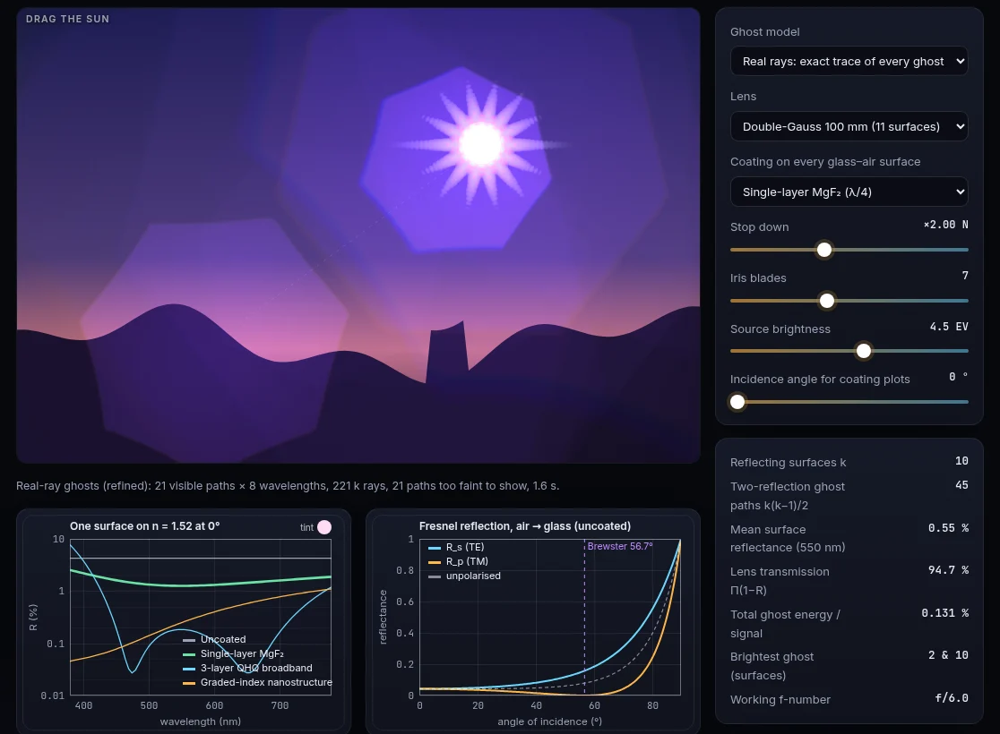

**Real-ray ghost tracing** (Hullin et al.'s full method) of every two-reflection path through the real Double-Gauss and Cooke lenses, at 8 wavelengths: aberrated, vignetted ghosts with caustics, with angle-dependent coating reflectance and total internal reflection. Runs in the worker, with an instant paraxial preview while you drag. Coatings are solved by the transfer-matrix method (uncoated, MgF₂, QHQ and graded-index moth-eye). Drag the sun.

</td>
<td width="50%" valign="top">

**Aliasing, moiré & Bayer** · `#/sampling`<br>
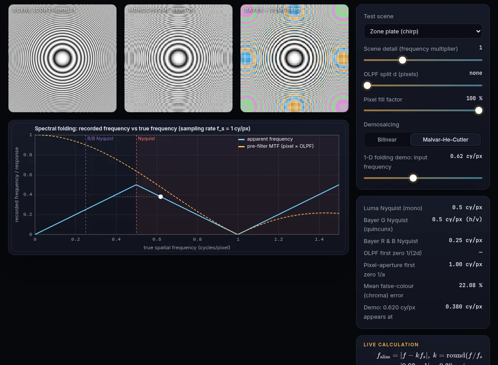

Zone plate, fabric, stripes and bricks sampled through pixel apertures and a birefringent OLPF. RGGB mosaics are demosaiced with bilinear or **Malvar–He–Cutler** interpolation, with measured false colour and a spectral-folding chart.

</td>
</tr>
<tr>
<td valign="top">

**Noise & exposure** · `#/noise`<br>
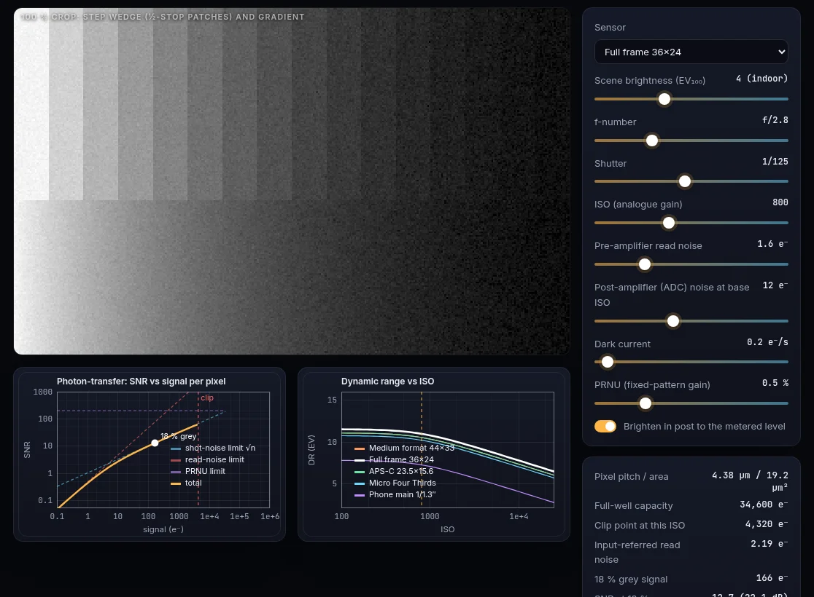

A full photon-transfer chain from scene EV to photoelectrons, with Poisson shot noise, two-stage read noise (**ISO invariance**), dark current, PRNU, clipping and 14-bit quantisation. Charts show the PTC and dynamic range against ISO for five formats.

</td>
<td valign="top">

**Rolling shutter & time** · `#/motion`<br>
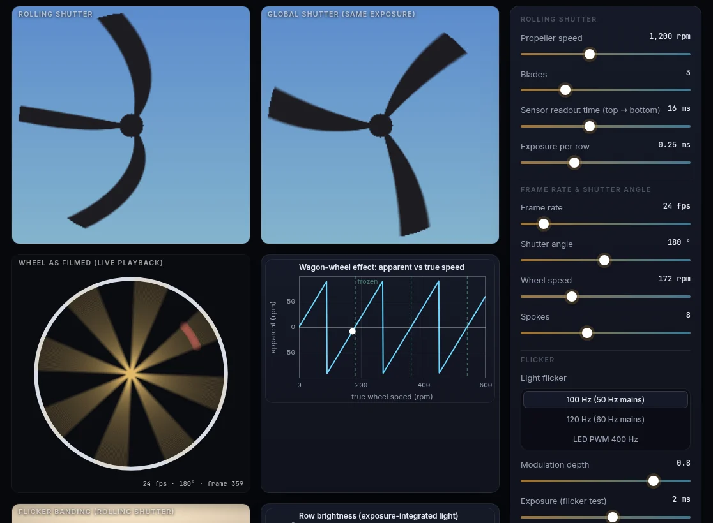

Row-timed propeller rendering with exposure integration, comparing rolling and global shutters. Live wagon-wheel playback at your frame rate and **shutter angle**. Flicker banding from mains and PWM LED lighting.

</td>
</tr>
<tr>
<td valign="top" colspan="2">

**Colour science** · `#/colour`<br>
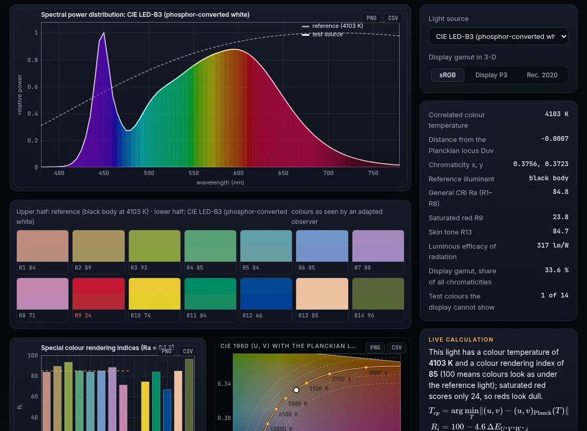

Colorimetry from **CIE tables** (1931 observer, D-series, A, FL, HP and the CIE 15:2018 **LED** illuminants): tristimulus values, correlated colour temperature and **Duv** by search along the Planckian locus. The page computes the **CIE 13.3 colour rendering index** R1–R14 and Ra, reproducing the CIE's own values for the FL series, and shows the 14 test colours side by side under the reference and the test source with Bradford adaptation. It is clear why phosphor LEDs fail **R9**. A camera section models **spectral sensitivities** (typical CMOS, narrow-band, broad, Luther–Ives ideal), **white balance** and a white-preserving **colour matrix** fitted by least squares, with CIEDE2000 errors per patch. A **metamerism** demo builds a metamer that matches exactly in daylight and splits under other lamps and for the camera.

</td>
</tr>
<tr>
<td valign="top" colspan="2">

**Anamorphic & cinema lenses** · `#/cinema`<br>
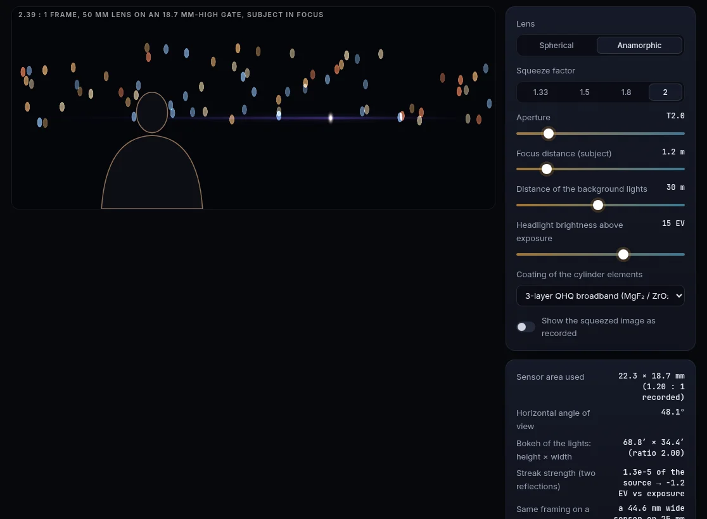

**Anamorphic squeeze** (1.33–2×) with **oval bokeh** from the s-times narrower horizontal entrance pupil, and the **horizontal streak flare**, coloured by the twice-reflected spectrum R(λ)² of the chosen coating. Also: **focus breathing** of unit-focusing, paraxial internal-focus and compensated designs, with frame overlays, and **T-stops** from photopic surface reflectance and the number of air–glass surfaces.

</td>
</tr>
<tr>
<td valign="top" colspan="2">

**Filters & HDR** · `#/hdr`<br>
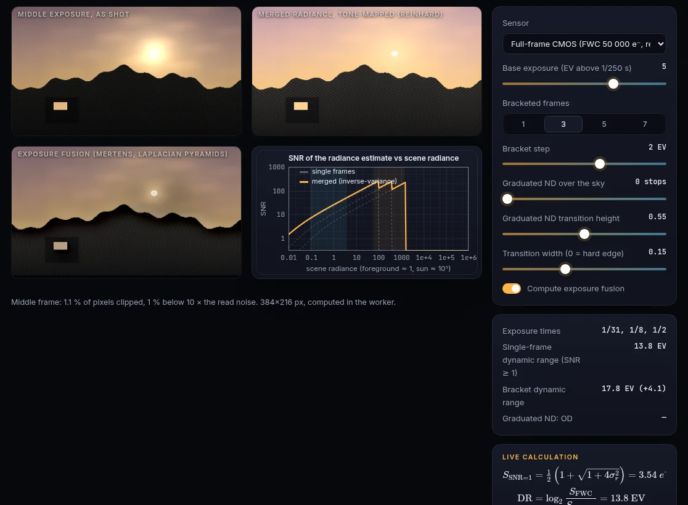

A 20-stop sunset through a photon-transfer camera model (full well, shot and read noise, ADC). **Graduated ND filters** with hard or soft edges, and **exposure bracketing**. Frames are merged into radiance with **inverse-variance weights** and tone-mapped (Reinhard), or blended by **exposure fusion** (Mertens, Laplacian pyramids), all in the worker. SNR curves show exactly where each frame contributes and how far bracketing extends the dynamic range.

</td>
</tr>
<tr>
<td valign="top" colspan="2">

**Camera shake & stabilisation** · `#/shake`<br>
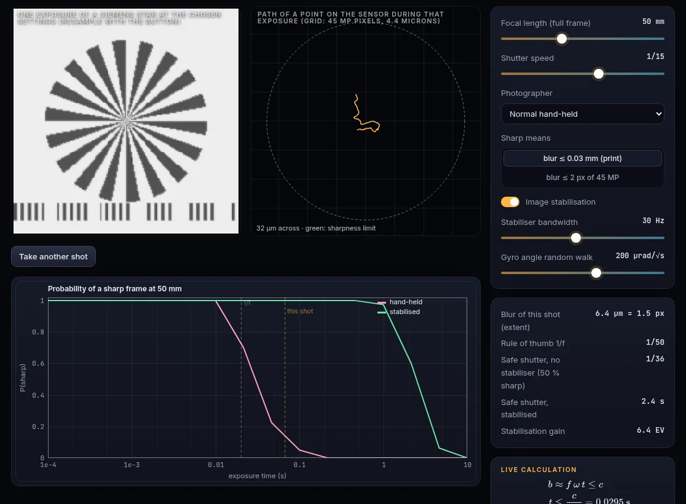

Hand-held motion is simulated as drift plus physiological tremor. Each exposure's blur path is its PSF, shown on a Siemens star. A Monte-Carlo **probability of a sharp frame** vs shutter speed shows the **1/f rule** emerging. A **type-2 stabiliser servo** follows the gyro: its residual falls as (f/f<sub>c</sub>)², and the gyro's **angle random walk** limits the gain to the familiar 4–8 stops.

</td>
</tr>
<tr>
<td valign="top" colspan="2">

**Film & grain** · `#/film`<br>
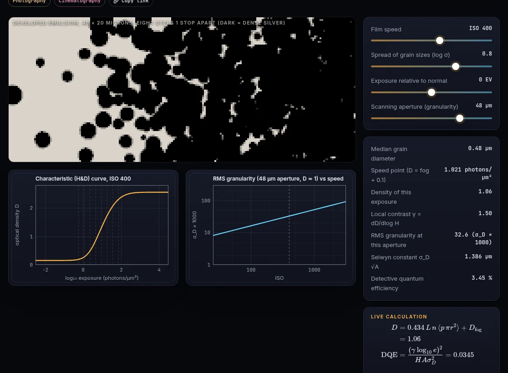

Film as a **Boolean model** of randomly placed silver-halide grains with a log-normal size distribution, each developable after a few absorbed photons. The **H&D curve** (toe, γ, shoulder) emerges from it, along with Nutting's law, grain that grows with speed, **Selwyn granularity** computed exactly from the overlap integral, film's few-per-cent **DQE**, and Schwarzschild **reciprocity failure**.

</td>
</tr>
<tr>
<td valign="top" colspan="2">

**Virtual production** · `#/vp`<br>
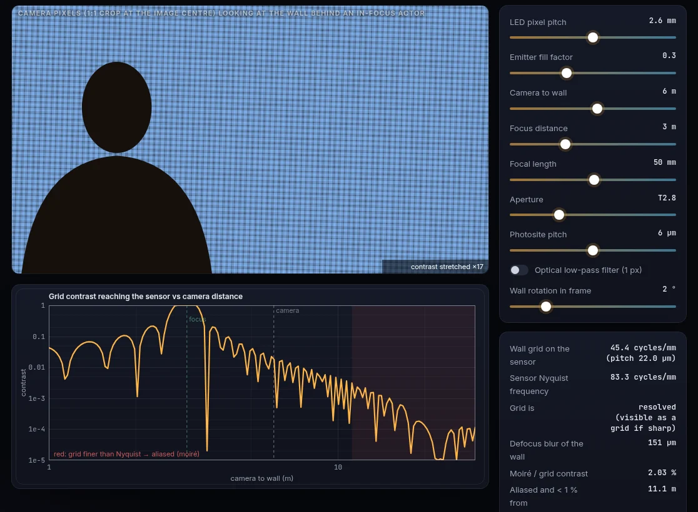

**LED-wall moiré**: the wall's pixel grid imaged at ν = 1/(mp), filtered by the defocus disk, the lens's diffraction MTF, the photosite aperture and an optional OLPF, then aliased by the sensor, with a safe distance and a rendered camera view. **PWM refresh banding**: the exact band amplitude of a rolling shutter vs shutter angle and genlock phase.

</td>
</tr>
<tr>
<td valign="top" colspan="2">

**Lighting: hard and soft light** · `#/lighting`<br>
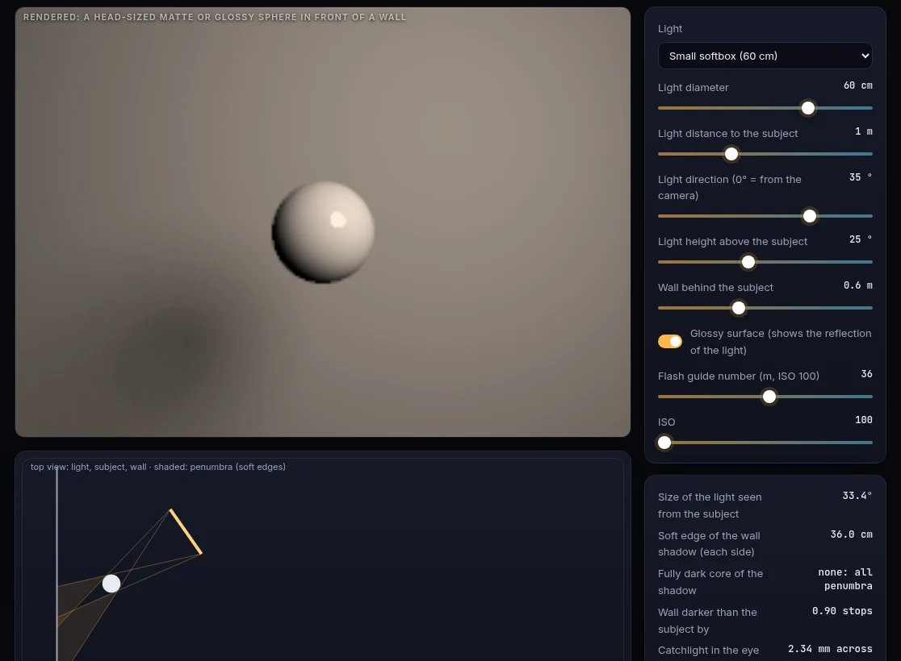

A round area light, from a bare flash to a window, rendered with shadow rays: shadow softness from the light's size (penumbra S b/d), inverse-square falloff to the background, catchlights and flash exposure from the guide number.

</td>
</tr>
<tr>
<td valign="top" colspan="2">

**Underwater photography** · `#/underwater`<br>
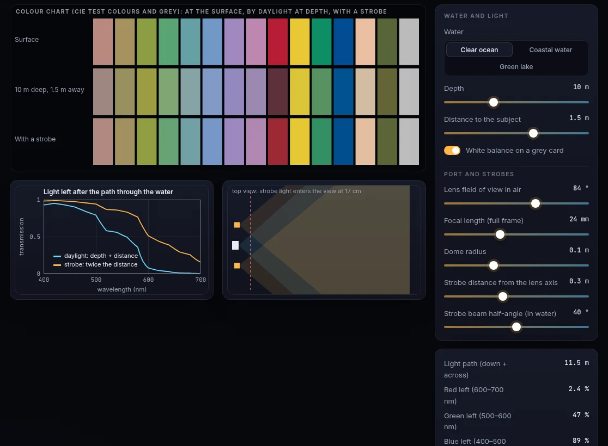

Water swallows red light on the way down and across: colour with depth and distance, white balance and strobes, flat and dome ports, and where strobe light enters the view.

</td>
</tr>
<tr>
<td valign="top" colspan="2">

**Autofocus** · `#/autofocus`<br>
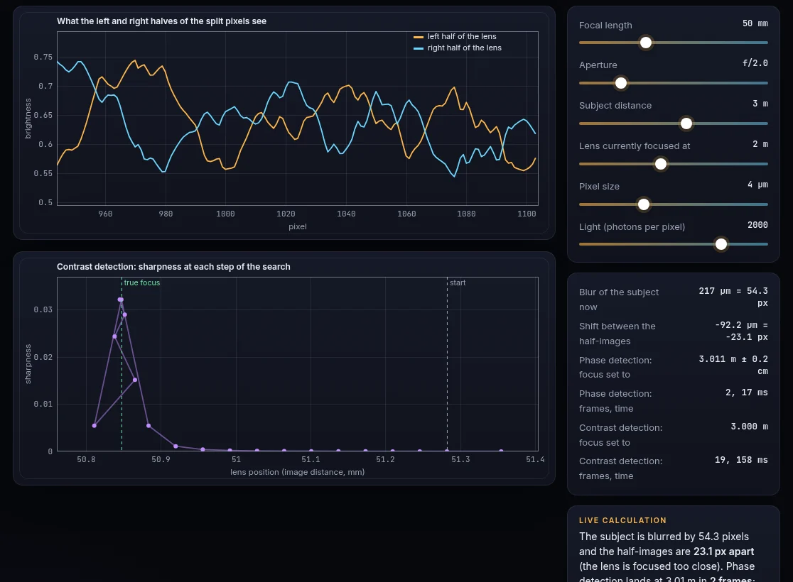

Phase detection with split pixels against contrast detection: why one look tells which way and how far to focus, while the other has to search.

</td>
</tr>
<tr>
<td valign="top" colspan="2">

**Computational photography** · `#/computational`<br>
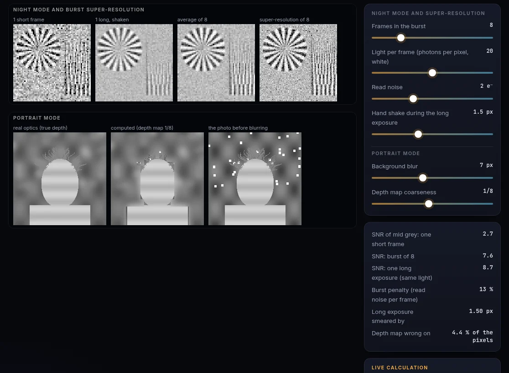

Night mode from a burst of short frames, detail beyond the pixel grid from hand shake, and portrait blur computed from a coarse depth map against real optics.

</td>
</tr>
</table>

### Astronomy & space

<table>
<tr>
<td width="50%" valign="top">

**Atmospheric seeing & AO** · `#/seeing`<br>
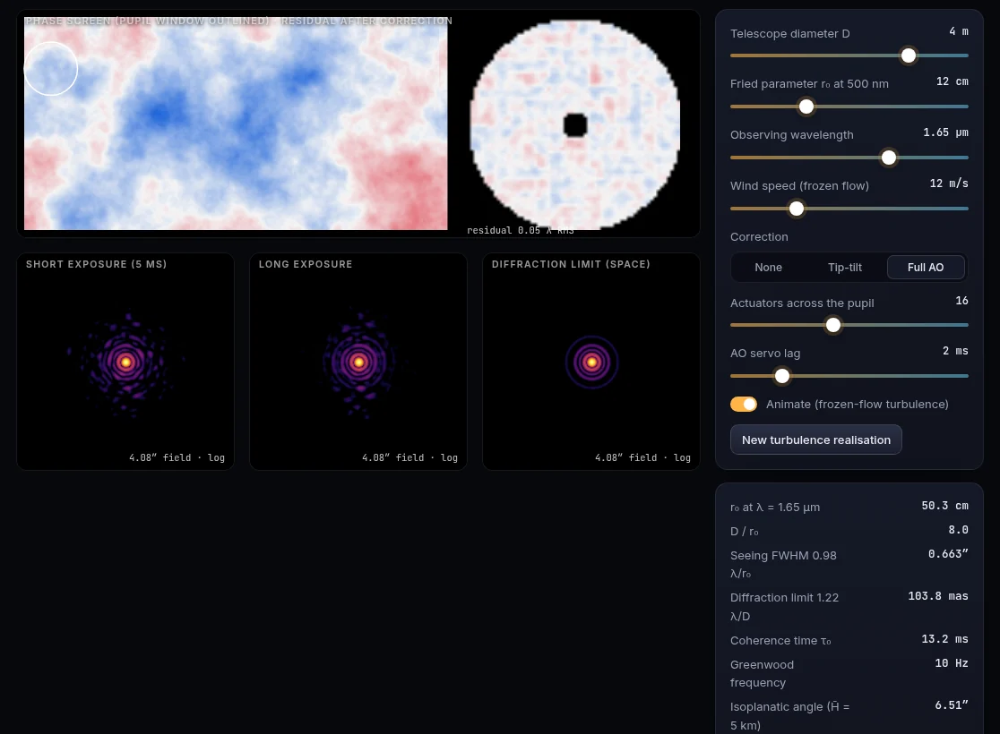

von Kármán phase screens built by FFT with **Lane subharmonics**, under Taylor frozen flow. Short-exposure speckle and long-exposure PSFs are shown with no correction, tip-tilt only, or a **deformable mirror** with servo lag, together with the full error budget.

</td>
<td width="50%" valign="top">

**Space telescopes** · `#/telescope`<br>
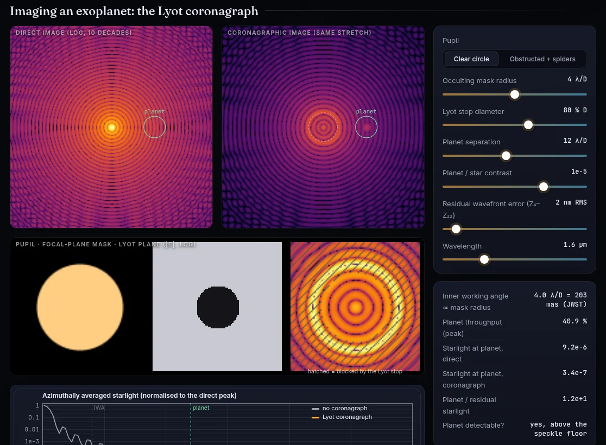

Resolution and Nyquist sampling for eight real cameras, Planck thermal emission, and collecting area. A **Lyot coronagraph** (pupil → mask → Lyot stop) images an exoplanet against a wavefront-error speckle floor.

</td>
</tr>
<tr>
<td valign="top">

**Gravitational lensing** · `#/lensing`<br>
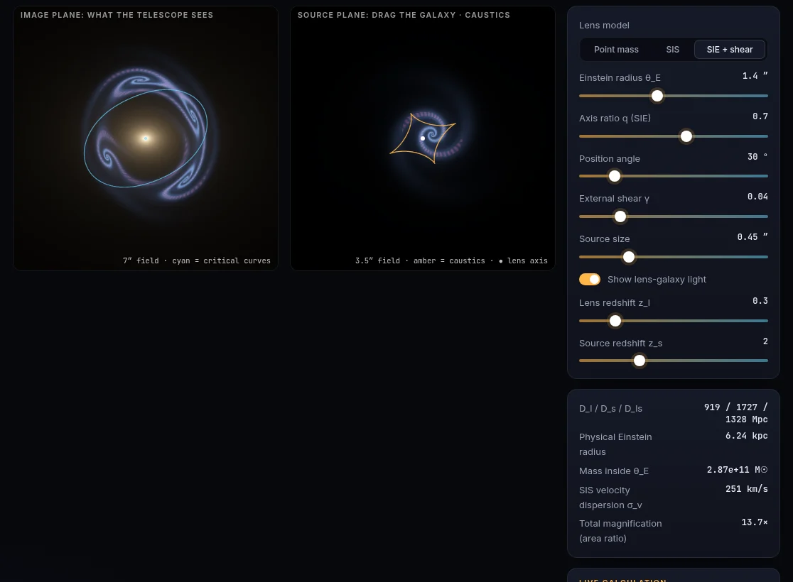

Inverse ray-shooting through point-mass, SIS and **SIE + shear** lenses. Critical curves are found by marching squares and mapped to caustics. Flat ΛCDM distances give the Einstein radius, enclosed mass and velocity dispersion. Drag the source galaxy across the caustics.

</td>
<td valign="top">

**Wavefront sensing & AO loop** · `#/wfs`<br>
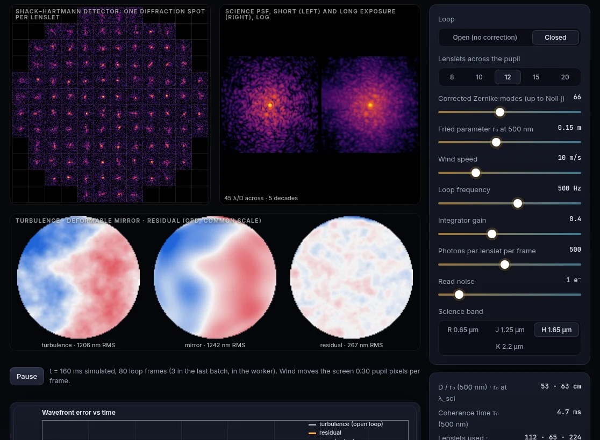

A **diffraction model of the Shack–Hartmann sensor**: one FFT spot per lenslet, photon and read noise, thresholded centroids and an interaction matrix calibrated through the sensor. A **least-squares Zernike reconstructor** drives a modal deformable mirror with an **integrator** against frozen-flow turbulence on an 8 m telescope. Plots show the residual against an analytic **error budget** (Noll fitting, Greenwood temporal, propagated noise), the modal rejection and short- and long-exposure PSFs. It runs in the compute worker. A **pyramid sensor** section (FFT through a four-faced pyramid, with circular modulation) shows the four pupil images, the slope maps and the response curve against the geometric arcsine law.

</td>
</tr>
<tr>
<td valign="top" colspan="2">

**Spectroscopy** · `#/spectro`<br>
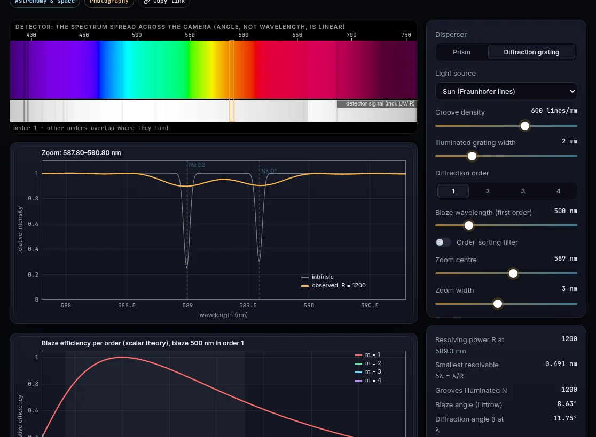

**Prisms and gratings** side by side: the grating equation in a Littrow mount, **blaze** efficiency per order, the **resolving power** R = mN or R = b|dn/dλ|, and overlapping orders on the detector, with or without an order-sorting filter. Spectra of the **Sun** (Fraunhofer lines and telluric bands) and of Hg, Ne, H and Na lamps are convolved with the diffraction-limited instrument profile, and a zoom shows when the sodium D or mercury yellow doublets are resolved. An **astronomical échelle spectrograph** section renders the **échellogram** of the Sun (an R2 or R4 échelle cross-dispersed by a prism on a 4k × 4k detector). It computes the **slit-limited resolving power** 2 tan θ<sub>B</sub> D<sub>col</sub>/(φ D<sub>tel</sub>) and the slit losses for a seeing disk.

</td>
</tr>
<tr>
<td valign="top" colspan="2">

**Interferometry & aperture synthesis** · `#/interferometry`<br>
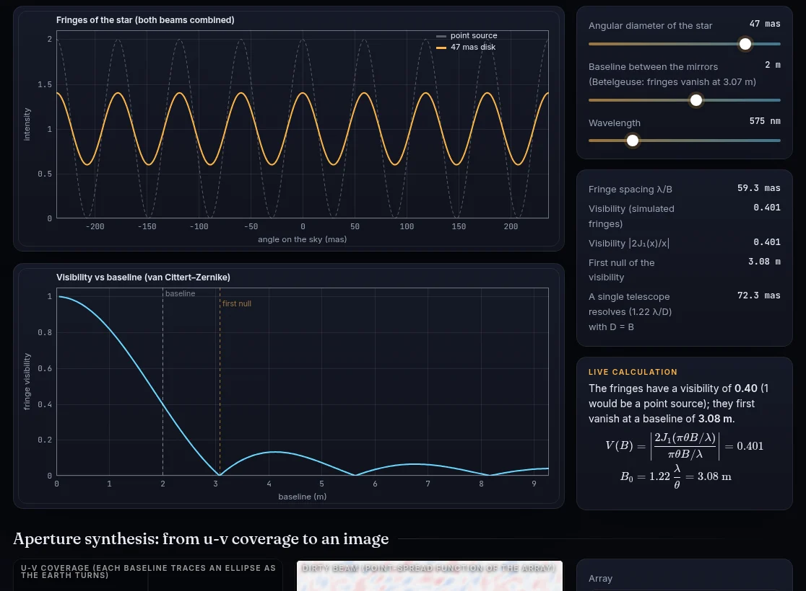

**Michelson's stellar interferometer**: fringes of a disk star summed point by point reproduce the van Cittert–Zernike visibility |2J₁(x)/x|, including **Betelgeuse's 47 mas** from the 3.07 m null of 1920. **Earth-rotation synthesis** with VLA-like, VLTI and **EHT** layouts (elevation-limited stations) produces u-v coverage, the dirty beam, the dirty image and **Högbom CLEAN** of a black-hole ring, a binary or a jet, computed in the worker.

</td>
</tr>
<tr>
<td valign="top" colspan="2">

**Detector physics in space** · `#/detectors`<br>
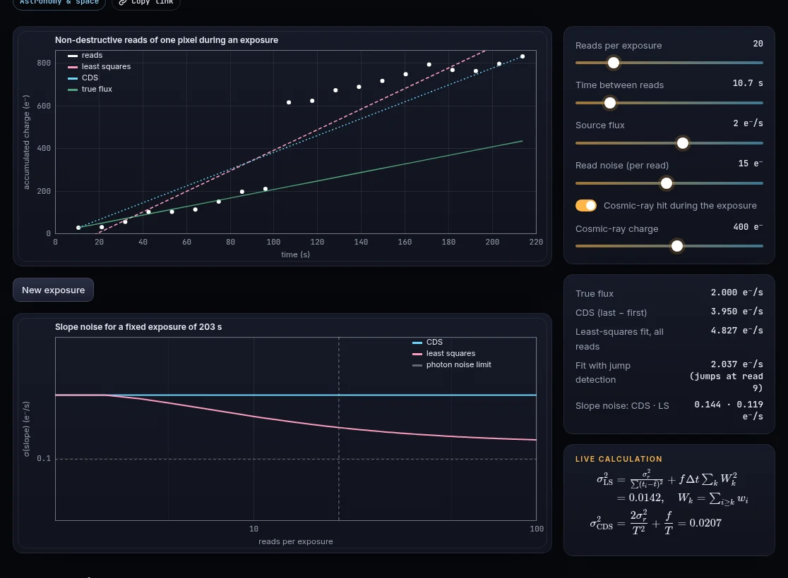

**Up-the-ramp sampling** of infrared arrays: CDS vs least-squares slopes with the exact correlated-noise variance, and **cosmic-ray jump detection**. Also **inter-pixel capacitance** (charge conserved, variance hidden, gain biased), **charge-transfer inefficiency** trails in a radiation-damaged CCD, and **persistence**.

</td>
</tr>
<tr>
<td valign="top" colspan="2">

**Atmospheric dispersion & ADC** · `#/adc`<br>


**Edlén's refractive index of air** at real site pressures and temperatures, **refraction and dispersion** vs zenith angle, and a white star rendered as the short vertical spectrum the atmosphere makes of it. A two-doublet **atmospheric dispersion corrector** (choice of glass pairs) is rotated to cancel the dispersion, leaving only its secondary spectrum.

</td>
</tr>
<tr>
<td valign="top" colspan="2">

**Lucky imaging** · `#/lucky`<br>


Short exposures through frozen-flow Kolmogorov turbulence are ranked by Strehl, re-centred and added. The page compares the long exposure, shift-and-add of all frames and **lucky selection**, and checks the simulated probability of a lucky frame against **Fried's 5.6·exp(−0.1557 (D/r₀)²)**.

</td>
</tr>
<tr>
<td width="50%" valign="top">

**Astrophotography stacking** · `#/stacking`<br>


The **CCD equation for stacks**: a faint galaxy behind a sky set by the **Bortle class**, with dark current and read noise. The page compares one sub-exposure with the full stack and shows SNR vs sub length (the **sky-limited sub** t = 10σ²/F<sub>sky</sub>) and vs total time (**√T**), with the 2.5× time penalty per magnitude of brighter sky.

</td>
<td width="50%" valign="top">

**Starshade** · `#/starshade`<br>


**Fresnel diffraction behind an occulter** tens of thousands of kilometres in front of the telescope. A round screen has a **Poisson–Arago spot** as bright as the unobstructed star; **Cash's hypergaussian petals** cancel it to below 10⁻¹⁰. Shadow profiles, an aperture-averaged suppression spectrum, the Fresnel number and the inner working angle.

</td>
</tr>
<tr>
<td valign="top" colspan="2">

**Field-dependent PSF** · `#/fieldpsf`<br>


**Seidel sums traced mirror by mirror** for Cassegrain, **Ritchey–Chrétien** and Dall–Kirkham telescopes, with FFT PSFs on a 5 × 5 grid across the field. A decentred or tilted secondary shows **nodal aberration theory** at work: field-constant coma and binodal astigmatism. The despace and conic-error sliders reproduce **Hubble's 1990 spherical aberration** (K₁ = −1.0139).

</td>
</tr>
<tr>
<td valign="top" colspan="2">

**Narrowband filters on fast optics** · `#/filters`<br>


Interference filters pass bluer light at an angle: why a 3 nm hydrogen-alpha filter loses most of its own line at f/2, and how a pre-shifted filter wins it back.

</td>
</tr>
<tr>
<td valign="top" colspan="2">

**Exoplanet transits** · `#/transits`<br>


The dip in starlight as a planet crosses its star: depth (R_p/R★)², limb darkening, duration from Kepler's law, transit probability, and the signal-to-noise ratio a backyard telescope, TESS, Kepler or JWST would reach.

</td>
</tr>
<tr>
<td valign="top" colspan="2">

**Earth observation from orbit** · `#/earthobs`<br>


Ground sample distance, push-broom scanning at 7 km/s, time-delay integration, diffraction against pixel size (Q) and the system MTF, with a city block rendered as a CubeSat, a mapping satellite or a very-high-resolution satellite records it.

</td>
</tr>
</table>

### Reference pages

<table>
<tr>
<td width="50%" valign="top">

**Physical foundations** · `#/foundations`<br>


From Maxwell to Fourier optics: the electromagnetic → scalar → geometric hierarchy, aberration theory, the PSF/OTF formalism, radiometry and the camera equation.

</td>
<td width="50%" valign="top">

**Catalogue of phenomena** · `#/catalogue`<br>


**228 phenomena in 13 groups**, browsed by group from a navigator or searched across all groups, with domain and "only simulated" filters. Each entry opens, from simple to exact, to a **worked example with real numbers**, a fuller explanation and its governing equation, a link to its laboratory and related entries. Every group, entry and search has its own link (`#/catalogue?g=…&e=…`).


</td>
</tr>
</table>

<details>
<summary><b>The 13 catalogue groups</b></summary>

| # | Group | Examples |
|---|---|---|
| 1 | Geometrical image formation (24) | thin-lens imaging, pupils, étendue, depth of field, projections, Scheimpflug, telecentricity, Fermat, Lagrange invariant, pinhole camera |
| 2 | Monochromatic aberrations (18) | Seidel sums, Zernike polynomials, Petzval curvature, sine condition, Coddington equations, stop shift, Strehl, aspheres |
| 3 | Chromatic effects (12) | Sellmeier, Abbe number, LoCA/LaCA, secondary spectrum, partial dispersion, the eye's chromatic aberration |
| 4 | Diffraction and wave optics (25) | Airy disk, encircled energy, spikes, segmented PSF, OTF, Poisson spot, interferometry, Gaussian beams, zone plates, Talbot effect |
| 5 | Radiometry and illumination (16) | camera equation, EV, T-stops, cos⁴, flat fields, photometric units, metering, blackbodies, magnitudes |
| 6 | Stray light (11) | Fresnel reflection, ghosts, coatings, veiling glare, sensor red-dot flare, TIS, total internal reflection, hoods |
| 7 | Polarisation (10) | Brewster, Malus, Fresnel equations, Stokes and Mueller, waveplates, circular polarisers, birefringence |
| 8 | Sensors, sampling and noise (26) | Nyquist, moiré, Bayer, OLPF, shot/read/dark noise, photon transfer, DQE, dual gain, EMCCD, TDI, drizzle |
| 9 | Time and motion (11) | motion blur, shutter angle, rolling shutter, flicker, wagon wheel, 3:2 pulldown, star trails, jitter |
| 10 | Atmosphere and environment (19) | seeing, Fried parameter, scintillation, AO, laser guide stars, Rayleigh and Mie scattering, green flash |
| 11 | Space telescopes and astronomy (27) | phasing, coronagraphy, starshades, exoplanet contrast, nulling, échelle spectrographs, detectors, lensing |
| 12 | Lens design and manufacturing (11) | retrofocus, Double-Gauss symmetry, ED glass, floating elements, anamorphics, optimisation, field flatteners |
| 13 | Rendering and perception (18) | bokeh, micro-contrast, CoC viewing standard, tone mapping, contrast sensitivity, metamerism, ΔE₀₀, Purkinje shift |

</details>

---

## 🧪 Physical models

Every simulation descends from one of four nested models of light. Each arrow below is a limiting approximation, and each lab states which level it uses.


| Model | Implementation | Used by |
|---|---|---|
| Glass dispersion | Three-term Sellmeier with Schott catalogue coefficients (12 glasses) and Malitson (1965) for fused silica and CaF₂ | ray tracer, chromatic, flare |
| Exact ray tracing | 3-D vector Snell refraction through spherical and even-aspheric surfaces (conic + polynomial, Newton intersection), clear-aperture vignetting, Newton ray aiming at the stop | ray tracer |
| First-order optics | y–nu paraxial matrices: EFL, BFD, entrance and exit pupils, Petzval sum | ray tracer, flare |
| Third-order aberrations | Seidel sums S_I–S_V, C_I, C_II per surface (Welford), including aspheric terms; validated against exact rays | ray tracer |
| Wavefront | OPD against the exit-pupil reference sphere, sampled on a 41 × 41 pupil grid | ray tracer |
| Diffraction | Fraunhofer integral by radix-2 2-D FFT of a 4 × 4-supersampled pupil, zero-padded (Q = 4); one FFT per wavelength when aberrated | PSF, Zernike, MTF, seeing, telescope |
| Colour | CIE 1931 2° colour-matching functions (tabulated CIE data, 5 nm, interpolated) → linear sRGB → sRGB transfer curve | all spectral renders |
| Spectroscopy | Grating equation, scalar blaze envelope, R = mN; prism R = b\|dn/dλ\| from Sellmeier; sinc² instrument profile convolved with line lists | spectro |
| Colorimetry | Tabulated CIE data at 5 nm (1931 observer, S₀/S₁/S₂, A, FL, HP, LED); CCT by golden-section search in (u, v); CIE 13.3 CRI; Bradford adaptation; CIEDE2000; camera raw → WB → constrained least-squares 3×3 matrix; metameric blacks by projection | colour |
| Thin films | Characteristic-matrix method, s and p polarisation, oblique incidence | flare |
| Polarisation | Stokes vectors and Mueller matrices (diattenuators, retarders, frame rotations); Fresnel reflection and transmission in Mueller form | polarisation |
| Birefringence | Stress-optic law with the Hertz/Frocht disk stress field, white-light interference colours from 61 wavelengths; extraordinary-ray walk-off in uniaxial crystals | polarisation |
| Skylight | Single-scattering Rayleigh slab (Chandrasekhar), optical depth after Hansen & Travis (1974), 16 wavelengths, 5778 K sun; DoP sin²γ/(1+cos²γ) | polarisation |
| Bokeh | Exact rays of the direct path from point sources (∞ and near) to the defocused sensor, same flux-conserving rasteriser | bokeh |
| Lens flare | Exact ray tracing of all k(k−1)/2 two-reflection paths per wavelength, rasterised as flux-conserving triangles with a per-pixel aperture gauge; paraxial ghost matrices as the preview | flare |
| Turbulence | von Kármán PSD, FFT screens plus 3-level subharmonics, frozen flow, bilinear-influence DM | seeing, wfs |
| Interferometry | Point-by-point fringe sums vs van Cittert–Zernike; ENU/ECEF baselines with hour angle and elevation limits; nearest-cell gridding, uniform/natural weights, Högbom CLEAN | interferometry |
| Adaptive optics | Shack–Hartmann spots by FFT per lenslet (photon + read noise, thresholded windowed centroids, calibrated gains); regularised least-squares Zernike reconstructor; integrator with one frame of delay; Noll/Greenwood/noise-propagation budget; pyramid sensor by focal-plane FFT with a four-face phase mask and circular modulation | wfs |
| Sensor | Poisson photon statistics, two-stage read noise, PRNU, dark current, FWC, quantisation | noise, sampling |
| Gravitational lensing | Thin-lens equation, SIE (Kormann et al. 1994) + shear, flat ΛCDM distances | lensing |

Here is how the core computation runs, using the polychromatic PSF as the example:


---

## 🏗 Architecture

The app is a dependency-free single-page application. A small hash router lazily imports one module per laboratory, and every module draws on a shared numerical core.


Heavy FFT and ray work (PSF, Zernike and JWST phasing, MTF, coronagraph, the ray tracer's wavefront PSF, the real-ray flare ghosts and the traced bokeh kernels) runs in a **module Web Worker** (`js/workers/compute.js`), so the page stays responsive: the longest main-thread freeze during a 5-wavelength JWST PSF dropped from about 1 s to 16 ms. `latest(channel)` drops superseded requests while you drag, and the PSF lab shows a 256² preview before the 512² render.

Each laboratory module exports a single `mount(root, meta)` function. It builds controls, canvases, live calculations and theory, and returns a cleanup function. The router calls that cleanup when you navigate away, to stop animations and disconnect `ResizeObserver`s.

```js
// js/modules/example.js (shape of every laboratory)
export default function mount(root, meta) {
  root.append(header(meta));                          // title, lede, domain tags
  const ctl = controls({ /* sliders, selects */ }, update);
  const view = stage({ aspect: 1.5, draw: render });  // responsive hi-DPI canvas
  root.append(lab([view.el], [ctl.el, calc.el]));     // main column + sticky side panel
  root.append(theory('…', String.raw`…\[ KaTeX \]…`));
  return () => view.destroy();                        // cleanup on navigation
}
```

---

## 📁 Project structure

```
Optica_Viva/
├── index.html                 App shell (sidebar, main, KaTeX includes)
├── css/style.css              Design system: dark theme, lab layout, controls
├── img/gallery/               Photographs for Phenomena in the wild (public domain and CC BY 4.0)
├── js/
│   ├── app.js                 Laboratory registry, hash router, navigation
│   ├── lib/                   Numerical core (pure functions, no DOM unless noted)
│   │   ├── detectors.js       Up-the-ramp slopes and jump detection, IPC, CTI trails, persistence
│   │   ├── eye.js             Le Grand schematic eye, ocular chromatic aberration, retinal MTF vs pupil, CoC from acuity
│   │   ├── film.js            Boolean-model emulsion: development probability, H&D curve, Selwyn granularity, DQE, reciprocity
│   │   ├── fieldpsf.js        Two-mirror telescopes: Seidel sums through mirrors, RC/DK conics, nodal aberrations, PSFs across the field
│   │   ├── earthobs.js        Earth observation: GSD, push-broom and TDI, Q, MTF, rendered ground
│   │   ├── eclipse.js         Eclipse mission: Espenak's exposure guide, framing, drift
│   │   ├── equipment.js       Camera bodies, planetary cameras and telescopes for the missions
│   │   ├── esfr.js            Slanted-edge MTF (ISO 12233 e-SFR) and synthetic test edges
│   │   ├── exoimaging.js      Exoplanet mission: reflected-light contrast, separation, integration time
│   │   ├── fft.js             Radix-2 complex FFT, 2-D FFT, fftshift
│   │   ├── adc.js             Edlén air index, atmospheric refraction/dispersion, two-doublet ADC
│   │   ├── autofocus.js       Phase and contrast autofocus on a defocused scene strip
│   │   ├── blur.js            Safari-safe blurs: Gaussian (3 box passes) and exact disk (pillbox), premultiplied alpha
│   │   ├── optics.js          DoF, tilted-lens (Scheimpflug) and ΛCDM formulas
│   │   ├── turbulence.js      Seeded Gaussian noise and von Kármán phase screens (FFT + subharmonics)
│   │   ├── shake.js           Hand-held shake model, type-2 stabiliser servo with gyro random walk, Monte-Carlo sharpness
│   │   ├── stacking.js        CCD equation for stacks, sky brightness from Bortle class, sky-limited sub length
│   │   ├── starshade.js       Fresnel shadow of an apodised occulter (Filon quadrature, Bessel J₀), suppression spectrum
│   │   ├── spectro.js         Gratings, blaze, prisms, resolving power, line lists, instrument profile
│   │   ├── virtual.js         LED-wall moiré (grid frequency, MTFs, aliasing) and PWM refresh banding
│   │   ├── wfs.js             Shack–Hartmann sensor, modal reconstructor, Noll residuals, closed AO loop
│   │   ├── tasks.js           Heavy pure computations (PSF, Zernike, OTF) for the worker
│   │   ├── tours.js           Guided tours: narrated steps that set a laboratory's controls
│   │   ├── computational.js   Burst merging, super-resolution and synthetic portrait blur
│   │   ├── compute.js         Worker API: run(task) and latest-only channels, main-thread fallback
│   │   ├── cinema.js          Anamorphic aspect, streak colour, focus breathing models, T-stops
│   │   ├── colordata.js       CIE tables at 5 nm: 1931 observer, daylight basis, illuminants, CRI test colours
│   │   ├── colorsci.js        CCT/Duv, CIE 13.3 CRI, Bradford adaptation, CIELAB, CIEDE2000
│   │   ├── choose.js          Comparison mission: camera equivalence, telescope limits
│   │   ├── color.js           CIE 1931 CMFs (tabulated), sRGB, colormaps (inferno, viridis, magma)
│   │   ├── gallery.js         Real photographs with explanations, credits and laboratory links
│   │   ├── gear.js            Your photos: linear decoding, flat-field vignetting, division-model distortion
│   │   ├── glass.js           Sellmeier catalogue, Abbe number, partial dispersion
│   │   ├── glossary.js        Plain definitions of technical terms and their popovers
│   │   ├── transit.js         Transit light curves with limb darkening, orbits, photometric noise
│   │   ├── ledset.js          LED mission: flicker-free shutter angles, PWM banding, safe wall distance
│   │   ├── lighting.js        Area lights with shadow rays, penumbra, falloff, catchlights, flash
│   │   ├── jupiter.js         Jupiter mission: Nyquist focal ratio, coherence time, rotation limit, dispersion
│   │   ├── misconceptions.js  Predict-then-reveal questions on common misconceptions
│   │   ├── milkyway.js        Milky Way mission: trailing limit, ISO invariance, frames to stack
│   │   ├── path.js            The home page's "Start here" path
│   │   ├── portrait.js        Portrait mission: perspective, focal length, depth of field, background blur, light
│   │   ├── random.js          Seeded random numbers for every simulation (mulberry32, Box–Muller, Poisson)
│   │   ├── raytrace.js        Exact ray tracer (spheres + even aspheres), paraxial analysis, ray aiming, OPD
│   │   ├── optimise.js        Damped-least-squares (Levenberg–Marquardt) lens optimiser
│   │   ├── tolerance.js       Monte-Carlo tolerancing with refocus compensation
│   │   ├── ghosts.js          Lens-flare ghosts: paraxial matrices and real-ray rasteriser
│   │   ├── bokeh.js           Bokeh kernels traced through a prescription
│   │   ├── lucky.js           Short-exposure frames, tip-tilt-removed variance, frame selection and shift-and-add
│   │   ├── macro.js           Close-up optics (pupil magnification, exact defocus, optimum aperture), ruler renderer
│   │   ├── panorama.js        Cardinal points, parallax between frames, two-frame panorama ray caster
│   │   ├── polar.js           Stokes/Mueller algebra, Fresnel in Mueller form, Rayleigh sky, polarised lake renderer
│   │   ├── hdr.js             HDR scene, ND/graduated filters, camera model, radiance merge, tone mapping, exposure fusion
│   │   ├── ifilter.js         Interference filters in converging beams: angle shift, cone average, pre-shift
│   │   ├── interferometry.js  Visibility of extended sources, array u-v coverage, dirty beam/image, Högbom CLEAN
│   │   ├── lensio.js          Zemax .zmx subset / JSON import-export, model glasses, URL encoding
│   │   ├── pupil.js           Apertures (Hubble/JWST/Keck/ELT), Zernike, PSF, Bessel
│   │   ├── survey.js          Survey mission: DORI pixel densities, drone GSD, shutter and overlap
│   │   ├── thinfilm.js        Fresnel equations, transfer-matrix coatings
│   │   ├── satellite.js       Satellite mission: focal length, mirror, TDI stages, data rate
│   │   ├── sensors.js         Sensor and film formats
│   │   ├── phenomena.js       Catalogue data (228 entries in 13 groups)
│   │   ├── phenomena-details.js  Explanation and worked example for every catalogue entry
│   │   ├── plot.js            Canvas charting (log axes, legends, bands)
│   │   ├── underwater.js      Water absorption, colour at depth, flat and dome ports, backscatter
│   │   ├── ui.js · page.js    DOM builder, controls, canvases, KaTeX helpers, explanation ladder (DOM)
│   ├── workers/compute.js     Module Web Worker running js/lib/tasks.js
│   └── modules/               One file per page (41)
├── vendor/katex/              KaTeX 0.16.11 (MIT), vendored for offline use
├── docs/screenshots/          README images (generated)
├── test/                      Physics and blur test suites (node --test)
├── .github/workflows/
│   ├── ci.yml                 CI: syntax & links, physics tests, browser smoke test
│   └── pages.yml              Deploys main to GitHub Pages
├── scripts/
│   ├── check.mjs              Syntax check + Markdown link/anchor check
│   ├── smoke.mjs              Every page in real-time headless Chrome; labs must render results
│   ├── bench.mjs              Kernel benchmarks (npm run bench)
│   ├── release.sh             prepare: release PR (date changelog, bump) · publish: tag + GitHub release
│   ├── worktree.sh            new / finish: one git worktree per branch, cleanup after merge
│   ├── screenshots.mjs        Regenerates docs/screenshots (CDP, WebP)
│   └── lib/browser.mjs        Dependency-free Chrome DevTools Protocol driver
├── CHANGELOG.md               Keep a Changelog
├── ROADMAP.md                 Completed and planned milestones
├── CLAUDE.md                  Project guide and workflow rules for AI-assisted sessions
├── CONTRIBUTING.md            Workflow, adding a laboratory, style
├── .github/ISSUE_TEMPLATE/    Bug, physics-error and feature templates
└── package.json               Version and `npm start`
```

---

## ✅ Validation

The numerical core was checked against published or analytically known values. Every row below is an assertion in the test suite ([`test/`](test/)) and runs in CI on every push and pull request:

| Quantity | Optica Viva | Reference |
|---|---|---|
| N-BK7 n<sub>d</sub>, V<sub>d</sub> | 1.51680, 64.17 | Schott: 1.51680, 64.17 |
| F2 n<sub>d</sub>, V<sub>d</sub> | 1.62004, 36.37 | Schott: 1.62004, 36.37 |
| CaF₂ n<sub>d</sub>, V<sub>d</sub> | 1.43385, 94.99 | Malitson: 1.4338, 95.0 |
| Cooke triplet EFL | 50.02 mm | design value 50 mm |
| Double-Gauss EFL | 99.50 mm | design value ≈ 100 mm |
| Uncoated crown reflectance | 4.26 % | ((n−1)/(n+1))² = 4.26 % |
| MgF₂ λ/4 on n = 1.52 at 550 nm | 1.26 % | textbook 1.26 % |
| R<sub>p</sub> at Brewster's angle | 0 (to machine precision) | 0 |
| Airy encircled energy at 1.22 λ/D | 83.8 % (clear circle) | 1 − J₀² − J₁² = 83.8 % |
| Rayleigh two-point dip | 73.5 % | 73.5 % |
| Tilt-lens hinge distance (65 mm, 8°) | 0.46704 m traced | f / sin α = 0.46704 m |
| Angular-diameter distance, z = 0.3 | 919 Mpc | flat ΛCDM (H₀ = 70, Ω<sub>m</sub> = 0.3) ≈ 920 Mpc |
| Hyperfocal, 50 mm f/2.8, c = 0.029 mm | 31 m | f²/(Nc) + f = 31.0 m |
| cos⁴ at 37.7° (28 mm FF corner) | −1.35 EV | log₂ cos⁴θ = −1.351 EV |
| Traced bokeh disk at 4 EV down: Ø and flux (3 lenses) | within 1 % and 0.5 % | paraxial 2 r<sub>EP</sub> Δz / f; π r<sub>EP</sub>² |
| Defocused PSF centre, W₀₂₀ = 0.25, 0.5, 1, 1.5, 2 λ | sinc²(W₀₂₀/λ) within 0.03; dark at 1 and 2 λ | Born & Wolf §8.8 |
| Traced bokeh colour fringes | singlet: violet behind, red in front; achromat: green behind, magenta in front | longitudinal colour and secondary spectrum |
| Real-ray flare ghosts, Double-Gauss at f/18, 0.57° (4 paths) | position within 3 %, size within 2 %, flux within 3 % | y–nu ghost matrices: (B − AD/C)θ, \|A/C\| r<sub>stop</sub>, R<sub>i</sub>R<sub>j</sub> π(r<sub>stop</sub>/C)² |
| Brewster angle, water and N-BK7 | 53.12°, 56.60° | arctan n = 53.12°, 56.60° |
| Three ideal polarisers at 0°, 45°, 90° (unpolarised input) | 1/8 | ½ · cos²45° · cos²45° = 0.125 |
| Rayleigh optical depth at 550 nm | 0.0973 | sea-level standard atmosphere ≈ 0.097 |
| Polarised lake render, centre pixel | equals an explicit Mueller chain (rotate · reflect · rotate · polarise) to 10⁻⁶ | independent vector-frame calculation |
| Vertical polariser on a Brewster-angle reflection | < 1 % transmitted | reflection fully s-polarised (R<sub>p</sub> = 0) |
| Disk in diametral compression: centre stresses, force balance | σ<sub>x</sub> = 2P/(πDt), σ<sub>y</sub> = −6P/(πDt); ∫σ<sub>y</sub>t dx = −P | Frocht (1948); free boundary |
| Walk-off: quartz at 45°, calcite maximum | 5.875 µm/mm, 6.26° at tan θ = n<sub>e</sub>/n<sub>o</sub> | (n<sub>e</sub>² − n<sub>o</sub>²)/(2n<sub>o</sub>n<sub>e</sub>) |
| Stack SNR (20 × 60 s, Monte Carlo) | within 3 % of the CCD equation | F<sub>o</sub>Nt / √(N[(F<sub>o</sub>+F<sub>s</sub>+F<sub>d</sub>)t+σ²]) |
| Faint-object SNR, Bortle 4 vs 8 sky | × 3.02 | 10^(0.2 Δμ) |
| Axial intensity behind an opaque disk (Poisson–Arago spot) | 1 to 10⁻⁸ at z = 10, 300, 5000 m | \|e<sup>iπF</sup>\|² = 1 |
| Spot profile behind a disk | J₀²(2πRρ/λz) to 2·10⁻³ | Lommel; Born &amp; Wolf §8.8 |
| Axis of a circular hole (Babinet) | 4 sin²(πF/2) to 10⁻⁶ | complement of the disk |
| Ritchey–Chrétien conics for Hubble's layout (2.4 m, f/24, primary f/2.3, b = 1.5 m) | K₁ = −1.0023, K₂ = −1.497; S<sub>I</sub> = S<sub>II</sub> = 0 | Schroeder (2000); as built |
| Cassegrain coma | S<sub>II</sub> = −y³ū/(2f²), a paraboloid of the same focal length | Schroeder (2000) |
| Secondary despace focus sensitivity | Δz<sub>focus</sub> = (m² + 1) δ to 0.2 % | Wilson, *Reflecting Telescope Optics* |
| Hubble's primary, K = −1.0139 instead of −1.0023 | 2.2 µm too flat at the edge; W₀₄₀ = 2 × sag error | Allen report (1990) |
| Decentred RC secondary | coma constant over the field; two astigmatic nodes | Thompson (2005) |
| FFT Strehl vs Maréchal at Strehl ≈ 0.8 | within 3 % | exp(−σ²) |
| Hypergaussian starshade, a = b = 12.5 m, n = 6, 80 000 km | < 10⁻⁹ within 2 m of the axis at 400–700 nm | Cash (2006) |
| Probability of a lucky frame vs D/r₀ (8 × 300 frames) | slope of ln P vs (D/r₀)² within 30 % of −0.1557 | Fried (1978) |
| Refractivity of standard air at 633 nm | (n − 1)·10⁸ = 27 653 | Edlén (1966) |
| Refraction at z = 45°, sea level, 550 nm | 57.3″ | (n − 1) tan z |
| ADC residual, 400–700 nm at z = 50° (Paranal) | < 10 % of the uncorrected dispersion; ends coincide | zero-deviation doublets |
| Up-the-ramp slope variance, LS and CDS (5000 simulated ramps) | within 6 % of the exact formulas | correlated read + shot noise |
| IPC flat-field variance factor (α = 2 %) | 0.848 | (1 − 4α)² + 4α² = 0.848 |
| CTI: core after 1500 transfers at ε = 2·10⁻⁵ | (1 − ε)ⁿ, charge conserved in the trail | trap model |
| Betelgeuse from the 3.07 m visibility null at 575 nm | 47.1 mas | Michelson & Pease (1921): 47 mas |
| Fringe visibility of a 20 mas disk (numerical sum over the disk) | equals \|2J₁(x)/x\| within 0.002 | van Cittert–Zernike |
| CLEAN of a 1 : 0.6 binary | recovered flux ratio within 0.06 | input model |
| Defocus disk MTF first zero | πbν = 3.8317 | first zero of J₁ |
| PWM banding at a whole number of periods | 0 (row simulation matches the formula within 3 %) | exact integration |
| Simulated emulsion: mean density and granularity | within 5 % / 20 % of the Boolean model; σ√A constant | Nutting and Selwyn laws |
| Film speed vs grain size | 4× grain area → 4× speed | photon-catch scaling |
| Le Grand eye power (d line) | 59.94 D | 59.94 D (Le Grand & El Hage) |
| Ocular chromatic difference 450 → 650 nm | 1.13 D | 1.23 D measured (Thibos et al. 1992) |
| Best pupil for retinal MTF at 30 c/deg | 2.5–4 mm | 2.5–3.5 mm (Campbell & Gubisch 1966) |
| Safe hand-held shutter (50 % sharp, c = 0.03 mm) at 24, 50, 200 mm | f·t between 0.8 and 2.5, nearly constant | reciprocal rule t ≈ 1/f |
| Stabiliser servo residual at f/f<sub>c</sub> = 0.05 | within 2× of (f/f<sub>c</sub>)² | type-2 loop error transfer |
| Single-frame dynamic range (FWC 50 000 e⁻, read 3 e⁻) | 13.79 EV | log₂(FWC / S<sub>SNR=1</sub>), S = (1 + √(1 + 4σ²))/2 |
| Bracket of 5 frames 2 EV apart | +8.0 EV | (n − 1)Δ |
| Fusion of identical frames (Laplacian pyramids) | exact to 10⁻⁵ | identity |
| 2× anamorphic on a 22.3 × 18.66 mm gate | 2.39 : 1 | 2 × 1.195 |
| Unit-focus breathing, 50 mm at 0.45 m | tan(θ/2) × 1/(1 + m) exactly | v = f(1 + m) |
| T-stop of 20 uncoated surfaces (n = 1.6) | τ = (1 − 0.0533)²⁰, T = N/√τ | Fresnel R = ((n − 1)/(n + 1))² |
| Panorama stitched with the pivot at the entrance pupil | frame difference 0 in the overlap | no parallax by construction |
| Parallax between frames (ray-cast geometry vs formula) | identical to 10⁻¹² | 2 atan[e sin(Δ/2)/(d − e cos(Δ/2))] |
| Principal point of a plano-convex lens, flat side first | t/n inside the glass | thick-lens theory |
| Close-up: symmetric lens at 1 : 1 | f/8 → f/16 (−2 EV), object–image 4f | N(1 + m/m<sub>p</sub>); thin-lens conjugates |
| Macro depth of field, 100 mm at 1 : 1, f/8 | exact two-sided blur search within 1 % of the formula | 2N<sub>w</sub>c/m² |
| CCT of illuminant A; D65 chromaticity | 2856 K; (0.3127, 0.3290) | CIE 15:2018 |
| Colour rendering index Ra of CIE FL1, FL2, FL4, FL7, FL8, FL10, FL11, FL12 | 75.8, 64.2, 51.4, 90.2, 95.5, 81.0, 82.8, 83.1 | CIE 13.3 tables: 76, 64, 51, 90, 95, 81, 83, 83 |
| CIEDE2000, Sharma test pairs 1, 3, 7, 17 | 2.0425, 1.0000, 2.3669, 27.1492 | Sharma, Wu & Dalal (2005), same |
| Luther–Ives camera (sensitivities = x̄ȳz̄), matrix fitted under A | ΔE₀₀ < 10⁻⁴ on all 24 patches | colorimetric by construction |
| Constructed metamer of TCS13 (skin) | ΔE₀₀ = 0 in D65; > 5 under FL11 | metameric black ⟂ S x̄, S ȳ, S z̄ |
| Zernike fitting error after 21 modes, D/r₀ = 10 (24 phase screens) | within 15 % of Noll | Δ₂₁ = 0.0208 (D/r₀)^5/3 rad² (Noll 1976) |
| Shack–Hartmann reconstruction of Z₄, Z₇, Z₁₁, Z₂₂ | coefficients within 4 %, cross-talk < 6 % | input mode |
| Closed AO loop (10 × 10 lenslets, 35 modes, bright star) | residual within 0.8–1.6 × the Noll fitting error | σ<sub>fit</sub> = √Δ₃₆ (D/r₀)^5/6 |
| Modulated pyramid sensor (R = 3 λ/D), tilts 0.5 and 1.5 λ/D | within 15 % of (2/π) asin(θ/R); zero signal at zero tilt | geometric optics (Ragazzoni 1996) |
| Two equal lines at the Rayleigh separation λ/R | dip 0.8106 | 8/π² = 0.8106 |
| Grating blaze (Littrow, 600 l/mm, λ_B = 500 nm) | η = 1 at 500 nm (m = 1) and 250 nm (m = 2) | scalar blaze condition |
| Slit-limited R: R4 échelle, 200 mm beam, 1″ slit, 8.2 m telescope | 40 247 | UVES design value ≈ 40 000 (Dekker et al. 2000) |
| Slit transmission, slit width = seeing FWHM | 0.761 | erf(√ln 2) = 0.7610 |

---

## ⚠️ Approximations and limits

Every page states its model's assumptions. The main simplifications are:

| Lab | Approximation | Consequence |
|---|---|---|
| Ray tracer (PSF) | Off-axis pupil treated as circular in normalised stop coordinates | Ignores the ≈ cos θ pupil anamorphosis |
| Flare | Real-ray ghosts at 8 wavelengths on a 33 × 33 ray grid; diffraction at the iris only in the source's starburst | Ghost edges are geometric (no Fresnel ringing); ghosts below 10⁻⁶ of the source irradiance are skipped |
| Bokeh | Geometric optics for the scene kernels; FFT diffraction of the traced pupil for single small disks | Scene disks have no Fresnel ringing; drawn on a 3 × 3 grid of field positions; dispersion of the OPD neglected in the diffraction panel |
| Depth of field, tilt-shift | Thin-lens model; exact disk kernels, blended between 11 radii in tilt-shift | Blur radius interpolated between stack levels in tilt-shift; disks above r = 8 px blurred at reduced resolution (edge softer by ≤ r/4 px) |
| Noise | Representative sensor constants (1800 e⁻/µm², QE 0.5) | Trends exact; absolute values illustrative |
| Seeing | Single frozen-flow layer; screens periodic over 8D | One seam per 8D of travel |
| Spectroscopy | Gaussian (seeing) star in a long slit; slit and diffraction widths added in quadrature; scalar blaze theory; illustrative line strengths (17 solar lines); IFU described, not simulated | No Wood anomalies or polarisation; absolute line depths illustrative |
| Wavefront sensing | One turbulent layer (L₀ = 25 m); modal mirror; centroid windows placed on the noise-free peak; no aliasing term in the analytic budget | Open-loop RMS below the pure Kolmogorov value; no anisoplanatism or multi-conjugate effects |
| Colour science | Camera sensitivities are representative Gaussian filter models with an IR cut, not measured products; 10 synthetic patches extend the 14 CIE samples; TLCI and TM-30 not computed | Absolute ΔE values are illustrative; trends (Luther residual, metamerism, WB errors) are exact for the models |
| Stacking | Gaussian approximation to the Poisson noise of each pixel; perfect calibration and alignment; one broad band | No colour, flat-field errors or satellite trails |
| Field-dependent PSF | Third-order (Seidel) aberrations; secondary misalignment only; monochromatic scalar FFT PSFs, centred (no distortion or pointing); detector flat or on the medial surface | No fifth-order terms, three-mirror designs, segment or polishing errors |
| Starshade | Scalar Fresnel diffraction; petals as an azimuthally averaged transmission (no J<sub>N</sub> petal terms); perfect shape; point star | No edge scattering of sunlight, shape or position errors |
| Lucky imaging | Single frozen screen, monochromatic, no photon or read noise, selection on the true Strehl | Real selection uses a noisy reference star; anisoplanatism ignored |
| ADC | Plane-parallel refraction (≈ 1 % below z = 70°), dry air, thin prisms; Gaussian seeing ∝ λ^−0.2 | No water vapour, curvature or ADC aberrations |
| Detectors | One trap species with exponential release (real CTI depends on signal level); illustrative persistence law | Flux dependence of CTI and detector-specific persistence not modelled |
| Interferometry | Noise-free, perfectly calibrated visibilities on a 128² grid; Högbom CLEAN only | No atmospheric phase, closure quantities or regularised imaging |
| Virtual production | Fundamental and low harmonics of a separable LED grid; single-pulse PWM, no scan multiplexing | Real walls add multiplexing and colour sub-pixel structure |
| Film | Representative B&W emulsion (layers of opaque grains, threshold of 2 photons); no development chemistry or dye clouds | Granularity values illustrative (≈ 3× real films) |
| Eye | Paraxial schematic eye with homogeneous media; population-typical aberrations; monochromatic 555 nm MTF | Individual eyes and the gradient-index lens differ |
| Shake | Angular motion only (no translation or roll); model spectra rather than measured CIPA waveforms | Gains are representative of, not certified to, CIPA DC-011 |
| HDR | Static scene (no ghosting from motion); linear sensor response; Reinhard global operator only | Real merges must align frames and handle moving objects |
| Cinema | Anamorphic scene drawn from analytic blur sizes (not ray-traced); internal-focus breathing from a two-thin-lens paraxial model; streak shape phenomenological, colour from thin-film theory | Real anamorphics add mumps, astigmatic bokeh edges and field-dependent squeeze |
| Panorama | One paraxial entrance pupil per frame (no pupil aberration); stitcher assumes pure rotation and does not re-align | Fisheye pupil walk not modelled |
| Macro | Unit focusing by extension (no floating elements); diffraction as a Gaussian with the Airy core's width at 550 nm; perfectly aligned focus stack | Internal-focus macro lenses change f and m<sub>p</sub> with distance; no Airy rings in the crop |
| Polarisation | Single Rayleigh scattering in a flat atmosphere (peak DoP set by a slider); specular water with sine-wave ripples; grey pebbles; no aerosols or ozone. Photoelasticity: plane stress, dispersion-free retardation | No neutral points (Arago, Babinet), no sun aureole; underwater light scattering ignored; no colour dispersion of the isochromatics |
| Coronagraph | Monochromatic, idealised hard-edged masks | Classic Lyot contrast (~10⁻⁶) rather than state-of-the-art designs |

---

## 💻 Browser support and performance

| | Chrome / Edge | Firefox | Safari |
|---|---|---|---|
| All laboratories | ✅ | ✅ | ✅ |
| Blur in DoF and tilt-shift (in-house disk kernel, no `ctx.filter`) | ✅ | ✅ | ✅ |

The heavier pages run 256²–512² FFTs or ray-cast hundreds of thousands of rays per update: seeing (animated), coronagraph, tilt-shift, PSF and projection. They are fluid on a modern desktop and noticeably slower on low-power devices such as a Raspberry Pi. Computations are debounced while you drag sliders.

---

## 🗺 Roadmap

Completed and planned milestones are tracked in **[ROADMAP.md](ROADMAP.md)**, together with the October 2026 audit that motivates them:

| Milestone | Focus |
|---|---|
| ✅ **v1.1** | Tests, CI, GitHub Pages, Safari-safe blur, shareable URLs, mobile controls, accessibility |
| ✅ **v1.2** | Faster FFT, cached rasters, compute worker, real-time browser testing, PR-based releases |
| ✅ **v1.3** | Aspheres, prescription editor and `.zmx` import, Seidel sums, field curves, vignetted PSF |
| ✅ **v1.4** | MTF across the field, damped-least-squares optimiser, Monte-Carlo tolerancing |
| ✅ **v1.5** | Real-ray flare ghosts, bokeh traced through the lens, exact disk blur, diffraction of small disks |
| ✅ **v1.6** | Polarisation (Stokes-vector scene, photoelasticity, OLPF), macro & magnification, colour science (CRI, camera colour, metamerism) |
| ✅ **v1.7** | Wavefront sensing and closed-loop AO (Shack–Hartmann, pyramid), spectroscopy (gratings, prisms, échelle), MIT licence |
| ✅ **v1.8** | Panorama, anamorphic & cinema lenses, filters & HDR, camera shake, the human eye, film & grain, virtual production |
| ✅ **v1.9** | Interferometry & aperture synthesis, detector physics, atmospheric dispersion & ADC, lucky imaging, stacking, starshade, field-dependent PSF |
| ✅ **v1.10** | Catalogue explorer: groups, details and a worked example for every entry |
| ✅ **v1.11** | From simple to exact: plain idea, rule of thumb and full model on every page; glossary; Start-here path |
| ✅ **v1.12** | Missions: Milky Way, Jupiter, portraits, eclipses, LED sets, choosing gear, satellite design, exoplanet imaging, security and drone surveys |
| ✅ **v1.13** | New laboratories: lighting, exoplanet transits, Earth observation, underwater, narrowband filters, autofocus, computational photography |
| **v1.14** | Test your own gear, real equipment presets, real images explained |
| **v2.0** | Guided tours, exercises, export, installable PWA |

---

## 🤝 Contributing

Contributions are welcome: new laboratories, more lens prescriptions, validations against measured data, translations and performance work. See **[CONTRIBUTING.md](CONTRIBUTING.md)** for the workflow (branches, PRs, CI, changelog), how to add a laboratory, and the style rules. Issues have templates for bugs, **physics or accuracy errors** and new laboratories.

In short: branch from `main` → `npm run ci` → pull request → green CI (`check`, `test`, `smoke`) → squash-merge.

---

## 🏷 Versioning and releases

Version **1.15.0** · [all releases](https://github.com/iiogurt/Optica_Viva/releases) · [changelog](CHANGELOG.md)

The project follows [Semantic Versioning](https://semver.org/): a new laboratory or capability is a **minor** release, and fixes and documentation are **patch** releases. `main` is protected: every change, including the version bump, arrives through a pull request with green CI, and releases only push a tag.


---

## 📚 References

<details>
<summary>Primary literature behind the simulations</summary>

- M. Born & E. Wolf, *Principles of Optics*, 7th ed., Cambridge University Press (1999).
- J. W. Goodman, *Introduction to Fourier Optics*, 4th ed., W. H. Freeman (2017).
- W. T. Welford, *Aberrations of Optical Systems*, Adam Hilger (1986).
- V. N. Mahajan, *Optical Imaging and Aberrations*, SPIE Press (1998–2011).
- R. Kingslake & R. B. Johnson, *Lens Design Fundamentals*, 2nd ed., Academic Press (2010).
- W. J. Smith, *Modern Optical Engineering*, 4th ed., McGraw-Hill (2008).
- H. A. Macleod, *Thin-Film Optical Filters*, 5th ed., CRC Press (2018).
- R. J. Noll, "Zernike polynomials and atmospheric turbulence", JOSA 66, 207 (1976).
- D. L. Fried, "Optical resolution through a randomly inhomogeneous medium", JOSA 56, 1372 (1966).
- R. G. Lane, A. Glindemann & J. C. Dainty, "Simulation of a Kolmogorov phase screen", Waves in Random Media 2, 209 (1992).
- J. D. Schmidt, *Numerical Simulation of Optical Wave Propagation*, SPIE Press (2010).
- M. B. Hullin et al., "Physically-based real-time lens flare rendering", ACM TOG 30(4), 108 (2011).
- H. S. Malvar, L.-W. He & R. Cutler, "High-quality linear interpolation for demosaicing of Bayer-patterned color images", ICASSP (2004).
- J. R. Janesick, *Photon Transfer: DN → λ*, SPIE Press (2007).
- R. Kormann, P. Schneider & M. Bartelmann, "Isothermal elliptical gravitational lens models", A&A 284, 285 (1994).
- B. Lyot, "The study of the solar corona and prominences without eclipses", MNRAS 99, 580 (1939).
- H. M. Merklinger, *Focusing the View Camera* (1996).
- I. H. Malitson, "Interspecimen comparison of the refractive index of fused silica", JOSA 55, 1205 (1965).

Each laboratory page lists its own additional references.

</details>

---

## 🙏 Acknowledgements and licence

- [KaTeX](https://katex.org/) 0.16.11 (MIT licence) is vendored in `vendor/katex/` with its licence file.
- CIE colorimetric tables (1931 observer, daylight, illuminants, test colour samples) were generated from the [colour-science](https://github.com/colour-science/colour) datasets (BSD-3-Clause).
- Glass data from SCHOTT AG optical glass data sheets. Lens prescriptions follow classic textbook forms (Cooke triplet, Double-Gauss).
- Colormap polynomial fits after M. Zucker; matplotlib colormaps by S. van der Walt and N. Smith.

**Licence:** [MIT](LICENSE) © 2026 iiogurt. Third-party components keep their own licences (KaTeX: MIT; CIE tables derived from colour-science: BSD-3-Clause); see [THIRD_PARTY_NOTICES.md](THIRD_PARTY_NOTICES.md).

<div align="center">
<sub>Made with light, Fourier transforms and Snell's law · <a href="https://github.com/iiogurt/Optica_Viva">github.com/iiogurt/Optica_Viva</a></sub>
</div>
