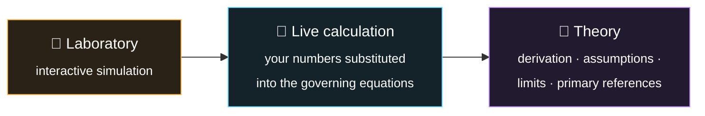
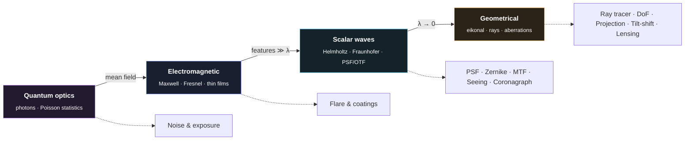
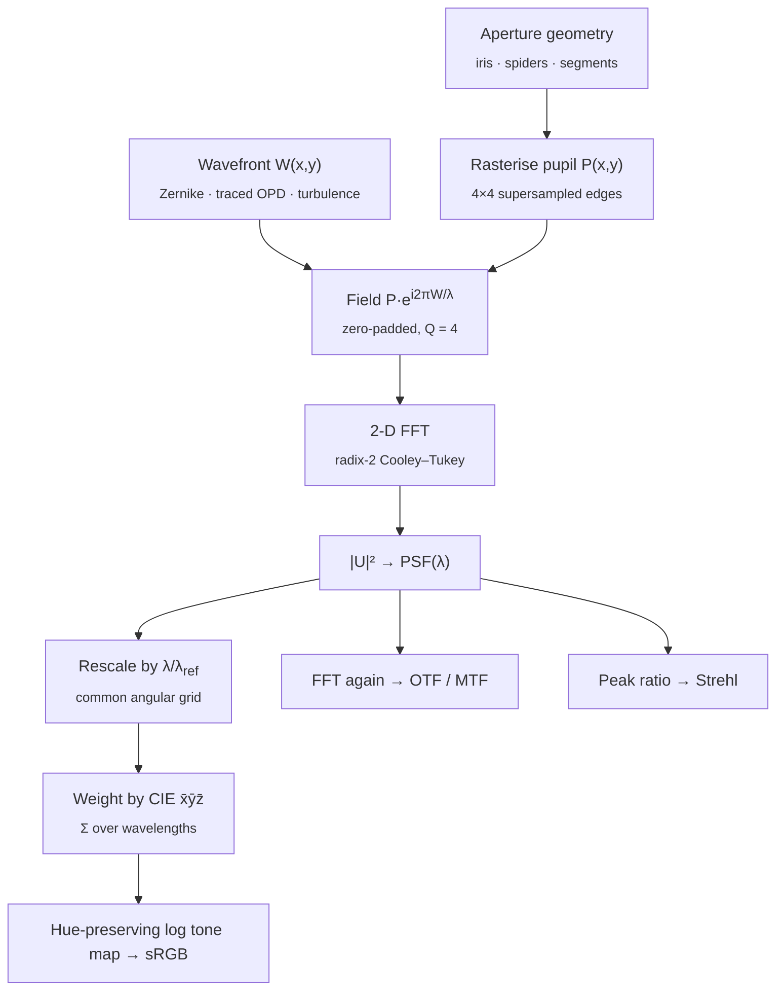
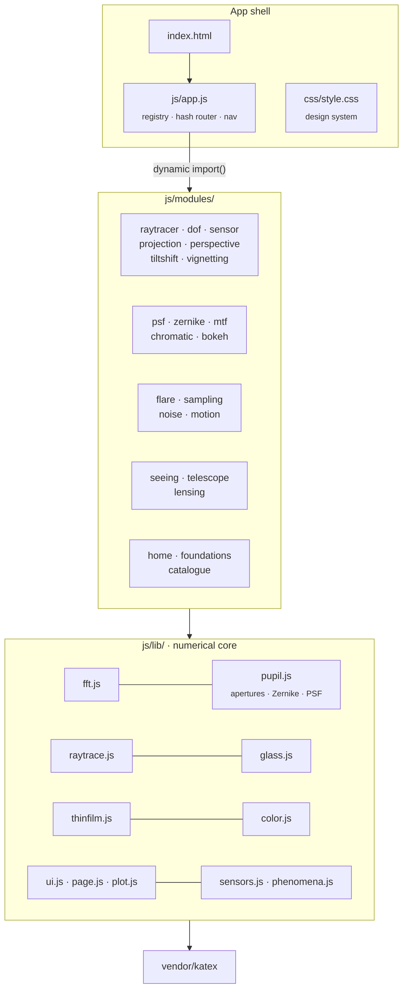
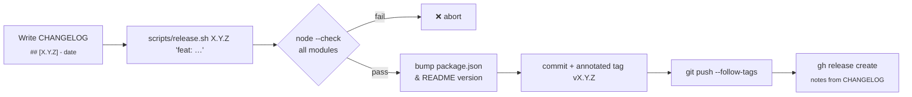

<div align="center">


# Optica Viva

**A living laboratory of the optics behind photography, cinematography and space telescopes.**

Twenty interactive simulations, a physics primer and a catalogue of 148 phenomena.
Everything is computed from first principles, live in your browser.

[](https://iiogurt.github.io/Optica_Viva/)
[](https://github.com/iiogurt/Optica_Viva/actions/workflows/ci.yml)
[](https://github.com/iiogurt/Optica_Viva/releases)
[](https://github.com/iiogurt/Optica_Viva/commits/main)
-6be3a4)


[](https://www.conventionalcommits.org/)
[](CHANGELOG.md)

**[▶ Open the live demo](https://iiogurt.github.io/Optica_Viva/)** · [Quick start](#-quick-start) · [Laboratories](#-the-laboratories) · [Physics](#-physical-models) · [Architecture](#-architecture) · [Accuracy](#-validation) · [Roadmap](ROADMAP.md) · [Contributing](#-contributing)

</div>

---

## Table of contents

- [Why Optica Viva?](#-why-optica-viva)
- [Quick start](#-quick-start)
- [The laboratories](#-the-laboratories)
  - [Geometric optics](#geometric-optics)
  - [Wave optics](#wave-optics)
  - [Light, sensor & time](#light-sensor--time)
  - [Astronomy & space](#astronomy--space)
  - [Reference pages](#reference-pages)
- [Physical models](#-physical-models)
- [Architecture](#-architecture)
- [Project structure](#-project-structure)
- [Validation](#-validation)
- [Approximations and limits](#-approximations-and-limits)
- [Browser support and performance](#-browser-support-and-performance)
- [Roadmap](#-roadmap)
- [Contributing](#-contributing)
- [Versioning and releases](#-versioning-and-releases)
- [References](#-references)
- [Acknowledgements and licence](#-acknowledgements-and-licence)

---

## ✨ Why Optica Viva?

Most optics demonstrations are canned animations. Optica Viva instead **solves the physics** every time you move a slider:

- **Real lenses, really traced.** Vector Snell refraction through spherical surfaces of five historical prescriptions, with glass dispersion from manufacturer Sellmeier coefficients.
- **Real diffraction.** Fraunhofer PSFs by 2-D FFT of anti-aliased pupils, including Hubble, JWST, Keck and the 798-segment ELT, with a separate FFT per wavelength for colour.
- **Real coatings.** Thin-film interference by the characteristic-matrix method, at oblique incidence and for both polarisations.
- **Real turbulence.** von Kármán phase screens with subharmonics, frozen flow and a deformable mirror.
- **Real sensors.** Poisson photon statistics, two-stage read noise (ISO invariance), PRNU, Bayer mosaics and demosaicing.

Each page is built in three layers:



It covers three domains (📷 photography, 🎬 cinematography and 🔭 astronomy and space), and every phenomenon is tagged with the ones it affects.

Every setting is **shareable**. Controls are mirrored into the URL, so a link like [`#/psf?preset=hubble&band=white`](https://iiogurt.github.io/Optica_Viva/#/psf?preset=hubble&band=white) opens that exact configuration. Use **Copy link** in any page header. On phones each lab's controls slide up from a bottom sheet next to the live result. Canvases are labelled for screen readers, keyboard focus is visible, and animations respect *reduce motion*.

---

## 🚀 Quick start

**No install needed:** open the live demo at **<https://iiogurt.github.io/Optica_Viva/>**. It is deployed automatically from `main` by GitHub Actions.

To run it locally: Optica Viva is plain HTML, CSS and ES modules. There is **no build step and nothing to install**. ES modules must be served over HTTP, so start any static server in the project folder:

```bash
git clone https://github.com/iiogurt/Optica_Viva.git
cd Optica_Viva
npm start                    # same as: python3 -m http.server 8000
```

Then open **<http://localhost:8000>**.

<details>
<summary>Other ways to serve it</summary>

```bash
npx serve .                  # Node
php -S localhost:8000        # PHP
caddy file-server --listen :8000
```

Any static host works too (GitHub Pages, Netlify, an S3 bucket). The app uses hash routing (`#/raytracer`), so no server rewrites are needed.

</details>

KaTeX is vendored in `vendor/katex/`, so the app runs **fully offline**. Web fonts (Fraunces, Inter, JetBrains Mono) load from Google Fonts when a connection exists and fall back to system fonts otherwise.

---

## 🔬 The laboratories

Every image below is a screenshot of the running app. Each one is a simulation result, not an illustration. Regenerate them with [`scripts/screenshots.py`](scripts/screenshots.py).

### Geometric optics

<table>
<tr>
<td width="50%" valign="top">

**Real-lens ray tracing** · `#/raytracer`<br>


Exact 3-D ray tracing through a plano-convex singlet (both orientations), a BK7/F2 achromat designed for this project, the Cooke triplet and the Double-Gauss. Includes real-ray aiming at the stop, a magnified caustic, spot diagram, ray fans, chromatic focal shift, best-focus search, and the **diffraction PSF of the traced wavefront** (OPD → FFT).

</td>
<td width="50%" valign="top">

**Depth of field** · `#/dof`<br>


A synthetic photograph framed by the real camera geometry. Ground texture is attenuated by the exact defocus OTF 2J₁(πcν)/(πcν), which goes negative and produces contrast reversal. Cards and lights are convolved with a true disk kernel. Hyperfocal distance and near/far limits update live.

</td>
</tr>
<tr>
<td valign="top">

**Sensor size & equivalence** · `#/sensor`<br>


Ten formats from phone to IMAX inside a real image circle. The equivalence table gives f, N, ISO, field of view, depth of field, pixel pitch, diffraction-limited aperture and light gathered. Charts show field of view and shot-noise SNR against sensor area.

</td>
<td valign="top">

**Fisheye vs rectilinear** · `#/projection`<br>


Per-pixel inverse ray casting into a 3-D hall through seven projections: gnomonic, stereographic, equidistant, equisolid, orthographic, Panini and equirectangular. **Exact Tissot indicatrices** show local distortion.

</td>
</tr>
<tr>
<td valign="top">

**Perspective & distortion** · `#/perspective`<br>


A dolly zoom on a ray-cast portrait shows that perspective depends only on camera distance (the nose is 30 % larger at 0.5 m). Brown–Conrady k₁–k₃, p₁ and p₂ distortion is shown with barrel, pincushion and moustache presets, plus TV distortion.

</td>
<td valign="top">

**Tilt–shift & Scheimpflug** · `#/tiltshift`<br>


Exact tilted-thin-lens imaging, verified against the hinge rule J = f/sin α. Each pixel's defocus is computed through the tilted lens to produce the **miniature effect**. The DoF wedge appears in the side view. Shift mode demonstrates keystone correction.

</td>
</tr>
<tr>
<td valign="top" colspan="2">

**Vignetting & relative illumination** · `#/vignetting`<br>


Three independent causes, each computed: natural falloff cosⁿθ; mechanical vignetting from the **exact three-circle overlap** of the pupil and the barrel rims; and pixel vignetting from chief-ray angle against microlens acceptance.

</td>
</tr>
</table>

### Wave optics

<table>
<tr>
<td width="50%" valign="top">

**Diffraction & the PSF** · `#/psf`<br>


FFT PSFs for 13 apertures, from 5/6/7/9-blade irises to Hubble, **JWST**, Keck and the **798-segment ELT**. Includes white-light and NIR rendering, defocus, an azimuthal profile compared with the analytic Airy pattern, encircled energy and Strehl ratio.

</td>
<td width="50%" valign="top">

**Wavefront aberrations** · `#/zernike`<br>


Eleven Noll Zernike modes with a wavefront map, Fizeau interferogram, through-focus series, and exact Strehl against Maréchal. Also simulates **JWST's segment phasing**: deployed, stacked, then coarse- and fine-phased.

</td>
</tr>
<tr>
<td valign="top">

**Sharpness: MTF & resolution** · `#/mtf`<br>


The optics OTF is computed numerically (pupil → PSF → OTF) and keeps its sign. It is cascaded with the pixel-aperture sinc and a four-spot OLPF. A Siemens star is shown before and after sampling, alongside Rayleigh and Sparrow two-point profiles.

</td>
<td valign="top">

**Chromatic aberration** · `#/chromatic`<br>


Sellmeier dispersion, the Abbe diagram and the partial-dispersion normal line. Thin-lens singlet, achromat and **solved apochromat** designs are compared. The LoCA render integrates 15 wavelengths through the defocus OTF, and a LaCA grid shows lateral colour.

</td>
</tr>
<tr>
<td valign="top" colspan="2">

**Bokeh** · `#/bokeh`<br>


Defocus kernels are built by splatting pupil rays through the iris polygon, cat's-eye vignetting, mirror-lens obstruction and apodisation. Spherical aberration flips sign between foreground and background: over-correction gives **soap-bubble** disks. Includes caustic folding and onion-ring ripple.

</td>
</tr>
</table>

### Light, sensor & time

<table>
<tr>
<td width="50%" valign="top">

**Flare, ghosts & coatings** · `#/flare`<br>


**Paraxial ghost tracing** of every two-reflection path through the real Double-Gauss and Cooke lenses, at 8 wavelengths. Coatings are solved by the transfer-matrix method (uncoated, MgF₂, QHQ and graded-index moth-eye). Drag the sun.

</td>
<td width="50%" valign="top">

**Aliasing, moiré & Bayer** · `#/sampling`<br>


Zone plate, fabric, stripes and bricks sampled through pixel apertures and a birefringent OLPF. RGGB mosaics are demosaiced with bilinear or **Malvar–He–Cutler** interpolation, with measured false colour and a spectral-folding chart.

</td>
</tr>
<tr>
<td valign="top">

**Noise & exposure** · `#/noise`<br>


A full photon-transfer chain from scene EV to photoelectrons, with Poisson shot noise, two-stage read noise (**ISO invariance**), dark current, PRNU, clipping and 14-bit quantisation. Charts show the PTC and dynamic range against ISO for five formats.

</td>
<td valign="top">

**Rolling shutter & time** · `#/motion`<br>


Row-timed propeller rendering with exposure integration, comparing rolling and global shutters. Live wagon-wheel playback at your frame rate and **shutter angle**. Flicker banding from mains and PWM LED lighting.

</td>
</tr>
</table>

### Astronomy & space

<table>
<tr>
<td width="50%" valign="top">

**Atmospheric seeing & AO** · `#/seeing`<br>


von Kármán phase screens built by FFT with **Lane subharmonics**, under Taylor frozen flow. Short-exposure speckle and long-exposure PSFs are shown with no correction, tip-tilt only, or a **deformable mirror** with servo lag, together with the full error budget.

</td>
<td width="50%" valign="top">

**Space telescopes** · `#/telescope`<br>


Resolution and Nyquist sampling for eight real cameras, Planck thermal emission, and collecting area. A **Lyot coronagraph** (pupil → mask → Lyot stop) images an exoplanet against a wavefront-error speckle floor.

</td>
</tr>
<tr>
<td valign="top" colspan="2">

**Gravitational lensing** · `#/lensing`<br>


Inverse ray-shooting through point-mass, SIS and **SIE + shear** lenses. Critical curves are found by marching squares and mapped to caustics. Flat ΛCDM distances give the Einstein radius, enclosed mass and velocity dispersion. Drag the source galaxy across the caustics.

</td>
</tr>
</table>

### Reference pages

<table>
<tr>
<td width="50%" valign="top">

**Physical foundations** · `#/foundations`<br>


From Maxwell to Fourier optics: the electromagnetic → scalar → geometric hierarchy, aberration theory, the PSF/OTF formalism, radiometry and the camera equation.

</td>
<td width="50%" valign="top">

**Catalogue of phenomena** · `#/catalogue`<br>


**148 phenomena in 13 groups**, each with a description, governing equation, domain tags and a link to its laboratory. Searchable, with domain filters and an "only simulated" filter.

</td>
</tr>
</table>

<details>
<summary><b>The 13 catalogue groups</b></summary>

| # | Group | Examples |
|---|---|---|
| 1 | Geometrical image formation | thin-lens imaging, pupils, étendue, depth of field, projections, Scheimpflug, telecentricity |
| 2 | Monochromatic aberrations | Seidel terms, Petzval curvature, decentering, Strehl, aspheres |
| 3 | Chromatic effects | Sellmeier, Abbe number, LoCA/LaCA, secondary spectrum, atmospheric dispersion |
| 4 | Diffraction and wave optics | Airy disk, Rayleigh/Sparrow, spikes, segmented PSF, OTF, coherence, thin films |
| 5 | Radiometry and illumination | camera equation, EV, T-stops, cos⁴, flat fields |
| 6 | Stray light | Fresnel reflection, ghosts, coatings, veiling glare, sensor red-dot flare, TIS |
| 7 | Polarisation | Brewster, Malus, sky polarisation, birefringence, polarisation aberrations |
| 8 | Sensors, sampling and noise | Nyquist, moiré, Bayer, OLPF, shot/read/dark noise, DR, QE, drizzle |
| 9 | Time and motion | motion blur, shutter angle, rolling shutter, flicker, wagon wheel, jitter |
| 10 | Atmosphere and environment | seeing, Kolmogorov, scintillation, AO, extinction, haze, mirages |
| 11 | Space telescopes and astronomy | phasing, phase retrieval, coronagraphy, cryogenics, lensing, redshift |
| 12 | Lens design and manufacturing | retrofocus, Double-Gauss symmetry, ED glass, floating elements, anamorphics |
| 13 | Rendering and perception | bokeh, swirl, micro-contrast, CoC viewing standard, tone mapping |

</details>

---

## 🧪 Physical models

Every simulation descends from one of four nested models of light. Each arrow below is a limiting approximation, and each lab states which level it uses.



| Model | Implementation | Used by |
|---|---|---|
| Glass dispersion | Three-term Sellmeier with Schott catalogue coefficients (12 glasses) and Malitson (1965) for fused silica and CaF₂ | ray tracer, chromatic, flare |
| Exact ray tracing | 3-D vector Snell refraction through spherical surfaces, clear-aperture vignetting, Newton ray aiming at the stop | ray tracer |
| First-order optics | y–nu paraxial matrices: EFL, BFD, entrance and exit pupils, Petzval sum | ray tracer, flare |
| Wavefront | OPD against the exit-pupil reference sphere, sampled on a 41 × 41 pupil grid | ray tracer |
| Diffraction | Fraunhofer integral by radix-2 2-D FFT of a 4 × 4-supersampled pupil, zero-padded (Q = 4); one FFT per wavelength when aberrated | PSF, Zernike, MTF, seeing, telescope |
| Colour | CIE 1931 2° colour-matching functions (Wyman–Sloan–Shirley fit) → linear sRGB → sRGB transfer curve | all spectral renders |
| Thin films | Characteristic-matrix method, s and p polarisation, oblique incidence | flare |
| Lens flare | Paraxial ghost tracing of all k(k−1)/2 two-reflection paths, per wavelength | flare |
| Turbulence | von Kármán PSD, FFT screens plus 3-level subharmonics, frozen flow, bilinear-influence DM | seeing |
| Sensor | Poisson photon statistics, two-stage read noise, PRNU, dark current, FWC, quantisation | noise, sampling |
| Gravitational lensing | Thin-lens equation, SIE (Kormann et al. 1994) + shear, flat ΛCDM distances | lensing |

Here is how the core computation runs, using the polychromatic PSF as the example:



---

## 🏗 Architecture

The app is a dependency-free single-page application. A small hash router lazily imports one module per laboratory, and every module draws on a shared numerical core.



Each laboratory module exports a single `mount(root, meta)` function. It builds controls, canvases, live calculations and theory, and returns a cleanup function. The router calls that cleanup when you navigate away, to stop animations and disconnect `ResizeObserver`s.

```js
// js/modules/example.js (shape of every laboratory)
export default function mount(root, meta) {
  root.append(header(meta));                          // title, lede, domain tags
  const ctl = controls({ /* sliders, selects */ }, update);
  const view = stage({ aspect: 1.5, draw: render });  // responsive hi-DPI canvas
  root.append(lab([view.el], [ctl.el, calc.el]));     // main column + sticky side panel
  root.append(theory('…', String.raw`…\[ KaTeX \]…`));
  return () => view.destroy();                        // cleanup on navigation
}
```

---

## 📁 Project structure

```
Optica_Viva/
├── index.html                 App shell (sidebar, main, KaTeX includes)
├── css/style.css              Design system: dark theme, lab layout, controls
├── js/
│   ├── app.js                 Laboratory registry, hash router, navigation
│   ├── lib/                   Numerical core (pure functions, no DOM unless noted)
│   │   ├── fft.js             Radix-2 complex FFT, 2-D FFT, fftshift
│   │   ├── blur.js            Safari-safe Gaussian blur (3 box passes, premultiplied alpha)
│   │   ├── optics.js          DoF, tilted-lens (Scheimpflug) and ΛCDM formulas
│   │   ├── color.js           CIE 1931 CMFs, sRGB, colormaps (inferno, viridis, magma)
│   │   ├── glass.js           Sellmeier catalogue, Abbe number, partial dispersion
│   │   ├── raytrace.js        Exact ray tracer, paraxial analysis, ray aiming, OPD
│   │   ├── pupil.js           Apertures (Hubble/JWST/Keck/ELT), Zernike, PSF, Bessel
│   │   ├── thinfilm.js        Fresnel equations, transfer-matrix coatings
│   │   ├── sensors.js         Sensor and film formats
│   │   ├── phenomena.js       Catalogue data (148 entries)
│   │   ├── plot.js            Canvas charting (log axes, legends, bands)
│   │   ├── ui.js · page.js    DOM builder, controls, canvases, KaTeX helpers (DOM)
│   └── modules/               One file per page (22)
├── vendor/katex/              KaTeX 0.16.11 (MIT), vendored for offline use
├── docs/screenshots/          README images (generated)
├── test/                      Physics and blur test suites (node --test)
├── .github/workflows/
│   ├── ci.yml                 CI: syntax & links, physics tests, browser smoke test
│   └── pages.yml              Deploys main to GitHub Pages
├── scripts/
│   ├── check.mjs              Syntax check + Markdown link/anchor check
│   ├── smoke.sh               Loads every page in headless Chrome
│   ├── release.sh             Checks & tests → version bump → tag → push → GitHub release
│   └── screenshots.py         Regenerates docs/screenshots with headless Chromium
├── CHANGELOG.md               Keep a Changelog
├── ROADMAP.md                 Completed and planned milestones
├── CLAUDE.md                  Project guide and workflow rules for AI-assisted sessions
└── package.json               Version and `npm start`
```

---

## ✅ Validation

The numerical core was checked against published or analytically known values. Every row below is an assertion in [`test/physics.test.mjs`](test/physics.test.mjs) and runs in CI on every push and pull request:

| Quantity | Optica Viva | Reference |
|---|---|---|
| N-BK7 n<sub>d</sub>, V<sub>d</sub> | 1.51680, 64.17 | Schott: 1.51680, 64.17 |
| F2 n<sub>d</sub>, V<sub>d</sub> | 1.62004, 36.37 | Schott: 1.62004, 36.37 |
| CaF₂ n<sub>d</sub>, V<sub>d</sub> | 1.43385, 94.99 | Malitson: 1.4338, 95.0 |
| Cooke triplet EFL | 50.02 mm | design value 50 mm |
| Double-Gauss EFL | 99.50 mm | design value ≈ 100 mm |
| Uncoated crown reflectance | 4.26 % | ((n−1)/(n+1))² = 4.26 % |
| MgF₂ λ/4 on n = 1.52 at 550 nm | 1.26 % | textbook 1.26 % |
| R<sub>p</sub> at Brewster's angle | 0 (to machine precision) | 0 |
| Airy encircled energy at 1.22 λ/D | 83.8 % (clear circle) | 1 − J₀² − J₁² = 83.8 % |
| Rayleigh two-point dip | 73.5 % | 73.5 % |
| Tilt-lens hinge distance (65 mm, 8°) | 0.46704 m traced | f / sin α = 0.46704 m |
| Angular-diameter distance, z = 0.3 | 919 Mpc | flat ΛCDM (H₀ = 70, Ω<sub>m</sub> = 0.3) ≈ 920 Mpc |
| Hyperfocal, 50 mm f/2.8, c = 0.029 mm | 31 m | f²/(Nc) + f = 31.0 m |
| cos⁴ at 37.7° (28 mm FF corner) | −1.35 EV | log₂ cos⁴θ = −1.351 EV |

---

## ⚠️ Approximations and limits

Every page states its model's assumptions. The main simplifications are:

| Lab | Approximation | Consequence |
|---|---|---|
| Ray tracer (PSF) | Off-axis pupil treated as circular in normalised stop coordinates | Ignores the ≈ cos θ pupil anamorphosis |
| Flare | Paraxial ghost tracing (Hullin et al. 2011) | Ghost positions and sizes are first-order; no aberrated ghost shapes |
| Bokeh | Geometric defocus kernels | No Fresnel edge ringing; LoCA rim tint omitted |
| Depth of field, tilt-shift | Thin-lens model; Gaussian blur stack for tilt-shift | Blur magnitudes exact, kernel shape approximate in tilt-shift |
| Noise | Representative sensor constants (1800 e⁻/µm², QE 0.5) | Trends exact; absolute values illustrative |
| Seeing | Single frozen-flow layer; screens periodic over 8D | One seam per 8D of travel |
| Coronagraph | Monochromatic, idealised hard-edged masks | Classic Lyot contrast (~10⁻⁶) rather than state-of-the-art designs |

---

## 💻 Browser support and performance

| | Chrome / Edge | Firefox | Safari |
|---|---|---|---|
| All laboratories | ✅ | ✅ | ✅ |
| Blur in DoF and tilt-shift (in-house Gaussian, no `ctx.filter`) | ✅ | ✅ | ✅ |

The heavier pages run 256²–512² FFTs or ray-cast hundreds of thousands of rays per update: seeing (animated), coronagraph, tilt-shift, PSF and projection. They are fluid on a modern desktop and noticeably slower on low-power devices such as a Raspberry Pi. Computations are debounced while you drag sliders.

---

## 🗺 Roadmap

Completed and planned milestones are tracked in **[ROADMAP.md](ROADMAP.md)**, together with the October 2026 audit that motivates them. Next up:

| Milestone | Focus |
|---|---|
| **v1.1** | Safari-safe blur, physics test suite, CI, GitHub Pages, mobile controls, accessibility, shareable URLs |
| **v1.2** | Web Workers, cached rasters, progressive rendering, WebGPU compute |
| **v1.3** | Aspheric surfaces, prescription editor and `.zmx` import, Seidel sums, through-field analysis |
| **v1.4** | Real-ray ghosts, bokeh from the traced lens, spectral scene rendering |
| **v1.5–v1.6** | 19 proposed laboratories, e.g. polarisation, colour science, wavefront sensing, spectroscopy, interferometry |

---

## 🤝 Contributing

Contributions are welcome: new laboratories, more lens prescriptions, validations against measured data, translations, and performance work.

1. **Fork** the repository and create a feature branch: `git checkout -b feat/polarisation-lab`.
2. **Add a laboratory**: create `js/modules/<id>.js` exporting `mount(root, meta)`, register it in `MODULES` and `READY` in [`js/app.js`](js/app.js), and add catalogue links in [`js/lib/phenomena.js`](js/lib/phenomena.js).
3. **Check** locally with `npm run ci`. This runs `npm run check` (syntax and Markdown links), `npm test` (physics suite) and `npm run smoke` (every page in headless Chrome). The same jobs run in GitHub Actions on your pull request and must pass before merging.
4. **Document** your change under `## [Unreleased]` in [CHANGELOG.md](CHANGELOG.md), and regenerate screenshots if the visuals changed: `python3 scripts/screenshots.py <page>`.
5. **Commit** with [Conventional Commits](https://www.conventionalcommits.org/), e.g. `feat(polarisation): add Malus and Brewster lab`, then open a pull request.

Physics changes should cite a primary reference in the page's theory section and, where possible, add a row to the [validation table](#-validation).

---

## 🏷 Versioning and releases

Version **1.0.3** · [all releases](https://github.com/iiogurt/Optica_Viva/releases) · [changelog](CHANGELOG.md)

The project follows [Semantic Versioning](https://semver.org/): a new laboratory or capability is a **minor** release, and fixes and documentation are **patch** releases. Releases are cut with one command:



---

## 📚 References

<details>
<summary>Primary literature behind the simulations</summary>

- M. Born & E. Wolf, *Principles of Optics*, 7th ed., Cambridge University Press (1999).
- J. W. Goodman, *Introduction to Fourier Optics*, 4th ed., W. H. Freeman (2017).
- W. T. Welford, *Aberrations of Optical Systems*, Adam Hilger (1986).
- V. N. Mahajan, *Optical Imaging and Aberrations*, SPIE Press (1998–2011).
- R. Kingslake & R. B. Johnson, *Lens Design Fundamentals*, 2nd ed., Academic Press (2010).
- W. J. Smith, *Modern Optical Engineering*, 4th ed., McGraw-Hill (2008).
- H. A. Macleod, *Thin-Film Optical Filters*, 5th ed., CRC Press (2018).
- R. J. Noll, "Zernike polynomials and atmospheric turbulence", JOSA 66, 207 (1976).
- D. L. Fried, "Optical resolution through a randomly inhomogeneous medium", JOSA 56, 1372 (1966).
- R. G. Lane, A. Glindemann & J. C. Dainty, "Simulation of a Kolmogorov phase screen", Waves in Random Media 2, 209 (1992).
- J. D. Schmidt, *Numerical Simulation of Optical Wave Propagation*, SPIE Press (2010).
- M. B. Hullin et al., "Physically-based real-time lens flare rendering", ACM TOG 30(4), 108 (2011).
- H. S. Malvar, L.-W. He & R. Cutler, "High-quality linear interpolation for demosaicing of Bayer-patterned color images", ICASSP (2004).
- J. R. Janesick, *Photon Transfer: DN → λ*, SPIE Press (2007).
- R. Kormann, P. Schneider & M. Bartelmann, "Isothermal elliptical gravitational lens models", A&A 284, 285 (1994).
- B. Lyot, "The study of the solar corona and prominences without eclipses", MNRAS 99, 580 (1939).
- C. Wyman, P.-P. Sloan & P. Shirley, "Simple analytic approximations to the CIE XYZ color matching functions", JCGT 2(2) (2013).
- H. M. Merklinger, *Focusing the View Camera* (1996).
- I. H. Malitson, "Interspecimen comparison of the refractive index of fused silica", JOSA 55, 1205 (1965).

Each laboratory page lists its own additional references.

</details>

---

## 🙏 Acknowledgements and licence

- [KaTeX](https://katex.org/) 0.16.11 (MIT licence) is vendored in `vendor/katex/` with its licence file.
- Glass data from SCHOTT AG optical glass data sheets. Lens prescriptions follow classic textbook forms (Cooke triplet, Double-Gauss).
- Colormap polynomial fits after M. Zucker; matplotlib colormaps by S. van der Walt and N. Smith.

**Licence:** no open-source licence has been chosen yet, so all rights are reserved by the author. Contact the repository owner before reusing the code.

<div align="center">
<sub>Made with light, Fourier transforms and Snell's law · <a href="https://github.com/iiogurt/Optica_Viva">github.com/iiogurt/Optica_Viva</a></sub>
</div>
