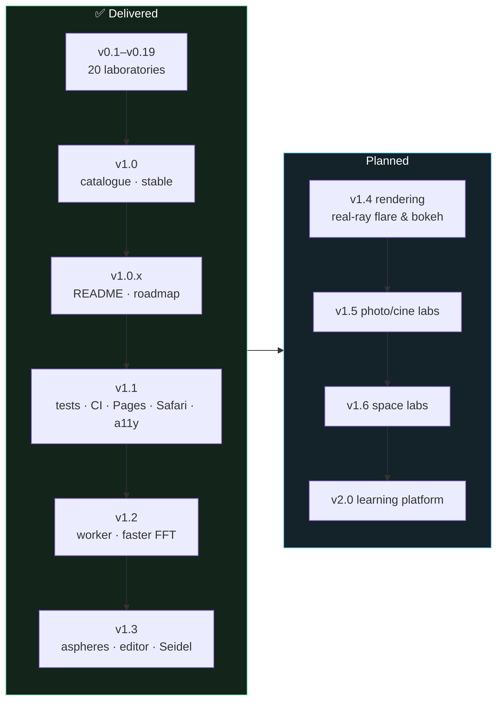

# Roadmap

This file records **what has been delivered** and **what is planned** for Optica Viva. It is the single source of truth for milestones. [CHANGELOG.md](CHANGELOG.md) records what shipped in each release; this file records why and what comes next.

**Legend**

| Mark | Meaning |
|---|---|
| ✅ / `[x]` | done and released |
| 🚧 | in progress |
| `[ ]` | planned |
| **P1 / P2 / P3** | priority: must / should / could |
| **S / M / L / XL** | effort: ≤ ½ day / ≤ 2 days / ≤ 1 week / > 1 week |

> **Maintenance rule:** every release moves its items from *Planned* to *Completed* here, in the same commit as the CHANGELOG entry. New ideas go into the matching milestone, or into the [Backlog](#backlog) if they are unscheduled.

---

## Contents

- [Guiding principles](#guiding-principles)
- [Status at a glance](#status-at-a-glance)
- [Completed milestones](#completed-milestones)
- [Audit findings (October 2026)](#audit-findings-october-2026)
- [Planned milestones](#planned-milestones)
  - [v1.1 Robustness, testing & deployment](#v11-robustness-testing--deployment)
  - [v1.2 Performance](#v12-performance)
  - [v1.3 Lens-design depth](#v13-lens-design-depth)
  - [v1.4 Higher-fidelity rendering](#v14-higher-fidelity-rendering)
  - [v1.5 New laboratories: photography & cinema](#v15-new-laboratories-photography--cinema)
  - [v1.6 New laboratories: astronomy & space](#v16-new-laboratories-astronomy--space)
  - [v2.0 Learning platform](#v20-learning-platform)
- [Backlog](#backlog)
- [Research notes and sources](#research-notes-and-sources)

---

## Guiding principles

1. **Physics first.** Each simulation uses the most exact model that runs interactively. Every approximation is named on its page.
2. **Show the arithmetic.** Each laboratory pairs a visual with live equations and a derivation that cites primary references.
3. **Zero install.** Static files, no build step, works offline. New dependencies need a strong justification.
4. **Verifiable.** Claims of accuracy must be backed by a validation entry, and from v1.1 on, by an automated test.
5. **Beautiful by default.** Visuals must read at a glance in a dark, photographic aesthetic.

---

## Status at a glance

| Area | Delivered | Planned |
|---|---|---|
| Laboratories | 20 | +19 proposed (v1.5, v1.6) |
| Catalogue entries | 148 | link every new lab; add polarisation and colour-science entries |
| Lens prescriptions | 5 | 10+ with aspheres and file import |
| Automated tests | 17 tests (physics + blur) + link check + browser smoke test in CI | more coverage per new lab |
| Deployment | GitHub Pages, deployed from `main` by CI | (none) |

---

## Completed milestones

<b>v1.3.0 Lens-design depth</b> (2026-10-12, PRs #12–#16)

- [x] Even-aspheric surfaces (conic + polynomial, Newton intersection) and an SA-free plano-hyperbolic singlet (#12)
- [x] Prescription editor, Zemax `.zmx` / JSON import-export, model glasses, shareable custom lenses; library achromat fixed (#13)
- [x] Per-surface Seidel sums S_I–S_V, C_I, C_II, validated against exact rays and the Petzval sum (#14)
- [x] Through-field analysis: exact Coddington field curves vs third order, real-ray distortion; smoke test made robust to slow CI (#15)
- [x] Vignetted PSF pupils and editable clear semi-diameters (#16)

<b>v1.2.0 Performance</b> (2026-10-12, PRs #7–#10)

- [x] Releases go through pull requests; `main` requires a PR and green checks, also for admins (#7)
- [x] Transpose-based 2-D FFT (512²: 88 → 66 ms on the Pi), LRU-cached pupil rasters, `npm run bench` and a CI performance report (#8)
- [x] Compute worker for the PSF, Zernike and MTF labs: longest main-thread freeze 1040 ms → 16 ms; progressive 256² → 512² PSF (#9)
- [x] Real-time CDP smoke test and screenshots (virtual time does not run workers); the smoke test fails on labs that render nothing (#9)
- [x] Coronagraph, JWST phasing and ray-tracer PSF moved to the worker, with regression tests (#10)

<b>v1.1.0 Robustness, testing & deployment</b> (2026-10-12, PRs #1–#6)

- [x] Physics test suite (17 tests) + link checker + headless smoke test, run by GitHub Actions on every PR (#1)
- [x] GitHub Pages deployment from `main`; `main` protected by required CI checks (#2)
- [x] Safari-safe Gaussian blur replacing `ctx.filter` (#3)
- [x] Shareable URL state and a "Copy link" button for every lab (#4)
- [x] Mobile bottom-sheet controls and accessibility pass (#5)
- [x] CONTRIBUTING.md, issue/PR templates, error boundary with a pre-filled issue link (#6)
- [x] Bug found by the new tests: cos⁴ corner falloff corrected to −1.35 EV

<b>v1.0.x Stable release & documentation</b> (2026-10-09 → 2026-10-12)

- [x] **v1.0.0** Catalogue of 148 phenomena in 13 groups, with search, domain filter and "only simulated" filter
- [x] **v1.0.0** All labs registered as ready; home page counters
- [x] **v1.0.1** GitHub-style README: banner, badges, gallery of all labs, Mermaid diagrams, validation table, contributing guide
- [x] **v1.0.1** `scripts/screenshots.mjs` for reproducible WebP screenshots
- [x] **v1.0.2** This roadmap, with audit findings and planned milestones
- [x] **v1.0.3** `CLAUDE.md` project guide for consistent future sessions

<b>v0.11–v0.19 Space, sensor & geometry laboratories</b>

- [x] **v0.11** Atmospheric seeing & AO: von Kármán screens + Lane subharmonics, frozen flow, DM with servo lag
- [x] **v0.12** Space telescopes: resolution & sampling of 8 cameras, Planck emission, Lyot coronagraph with speckle floor
- [x] **v0.13** Gravitational lensing: SIE + shear, marching-squares caustics, ΛCDM distances; release-script syntax gate
- [x] **v0.14** Aliasing, moiré & Bayer: OLPF, fill factor, Malvar–He–Cutler demosaicing
- [x] **v0.15** Noise & exposure: photon-transfer chain, ISO invariance, DR vs ISO
- [x] **v0.16** Rolling shutter & time: propeller, wagon wheel, flicker banding
- [x] **v0.17** Vignetting: cosⁿ, three-circle mechanical vignetting, chief-ray-angle pixel vignetting
- [x] **v0.18** Perspective & distortion: dolly zoom, Brown–Conrady, TV distortion
- [x] **v0.19** Tilt–shift & Scheimpflug: traced hinge rule, DDA-accelerated miniature render, shift mode

<b>v0.1–v0.10 Core engine & first laboratories</b>

- [x] **v0.1** App shell, design system, router; numerical core (FFT, colour science, Sellmeier, exact ray tracer, pupils/PSF/Zernike); Introduction, Foundations, Real-lens ray tracing
- [x] **v0.2** Depth of field with defocus-OTF ground and disk-kernel bokeh
- [x] **v0.3** Diffraction & PSF (Hubble, JWST, Keck, ELT)
- [x] **v0.4** Wavefront aberrations, JWST segment phasing; release script
- [x] **v0.5** Chromatic aberration (achromat and apochromat solvers, LoCA/LaCA renders)
- [x] **v0.6** Sensor size & equivalence
- [x] **v0.7** Fisheye vs rectilinear with Tissot indicatrices
- [x] **v0.8** MTF & resolution (numerical OTF, OLPF, Siemens star)
- [x] **v0.9** Bokeh (pupil splatting, SA sign flip, cat's eye)
- [x] **v0.10** Flare, ghosts & coatings (paraxial ghost tracing, transfer-matrix coatings)

---

## Audit findings (October 2026)

An audit of v1.0.1 (code, performance, layout, accessibility and browser compatibility) produced the evidence behind the plan below.

| # | Finding | Evidence | Impact | Addressed in |
|---|---|---|---|---|
| A1 | **Safari ships `CanvasRenderingContext2D.filter` disabled**, so DoF, tilt-shift, bokeh softening and blur-stack renders lose their blur | caniuse lists Safari 18.0–26.5 as "disabled by default"; WebKit bug 275436 still open for OffscreenCanvas | Wrong visuals for all Safari and iOS users | v1.1 |
| A2 | No automated tests; validation figures are checked by hand only | no `test/` folder, no CI | Regressions in physics can ship silently | v1.1 |
| A3 | No CI and no public deployment | no `.github/workflows`; runs only locally | Contributors can't preview, and users must clone the repo | v1.1 |
| A4 | All computation runs on the main thread | Raspberry Pi 4 timings: 2-D FFT 256² = 17 ms, 512² = 88 ms; JWST pupil raster = 184 ms; a defocused 13-λ PSF ≈ 1.3 s | UI freezes while dragging on low-power devices | v1.2 |
| A5 | On phones the controls come after every canvas | 390 px screenshot: the controls appear below all the visuals | You have to scroll back and forth to experiment | v1.1 |
| A6 | Canvases have no text alternative; almost no ARIA | one `aria-` attribute in the codebase | Screen-reader users get no results | v1.1 |
| A7 | No shareable state | no URL parameters | Teachers can't link to a specific configuration | v1.1 |
| A8 | No licence | README states all rights reserved | Blocks contributions and reuse | v1.1 (owner decision) |
| A9 | Known model simplifications (see README) | paraxial ghosts, geometric bokeh, Gaussian blur stack, circular off-axis pupil | Accuracy ceiling for advanced users | v1.3–v1.4 |
| A10 | Spherical surfaces only; prescriptions are hard-coded | `raytrace.js` | Can't model modern aspheric lenses or user lenses | v1.3 |

---

## Planned milestones

### v1.1 Robustness, testing & deployment

✅ **Released as v1.1.0** (see *Completed milestones*). Only the licence decision remains open; it is the owner's call.

*Goal: every user on every browser sees correct results, and every physics claim is guarded by a test.*

- [x] **P1 · M** Replace `ctx.filter` blur with an in-house **separable/disk blur** (summed-area table for the box approximation, or an exact disk via the FFT already in `fft.js`). Fixes Safari (A1). *Done with a three-box Gaussian (`js/lib/blur.js`); the true-disk tilt-shift kernel moves to v1.4.*
- [x] **P1 · M** **Physics test suite** with `node --test` and no dependencies. Turn every row of the README validation table into an assertion: Sellmeier indices, EFLs, Fresnel/MgF₂ reflectance, Brewster, Airy encircled energy, Rayleigh dip, hinge rule, ΛCDM distances, hyperfocal distance, cos⁴.
- [x] **P1 · S** **GitHub Actions CI**: `node --check`, the test suite, Markdown link check, and a headless-browser smoke test of every page. (A Mermaid parse check was dropped; it would need a browser bundle.)
- [x] **P1 · S** **GitHub Pages deployment** from `main`, with a live-demo badge in the README. Live at <https://iiogurt.github.io/Optica_Viva/>; `main` is protected by required CI checks.
- [ ] **P1 · S** **Choose a licence** (owner decision; MIT for code + CC BY 4.0 for text and images is a common pairing).
- [x] **P2 · M** **Mobile controls drawer**: a sticky bottom sheet with the controls next to the main canvas on screens < 860 px (A5).
- [x] **P2 · M** **Accessibility**: `role="img"` and live `aria-label` summaries for canvases (e.g. "Strehl 0.44, spot RMS 21 µm"), visible focus styles, `prefers-reduced-motion` to pause animations, contrast audit (A6).
- [x] **P2 · S** **Shareable state**: serialise controls to the URL hash (`#/psf?preset=jwst&band=nir`) plus a "copy link" button (A7).
- [x] **P3 · S** Per-module error boundary with a "report issue" link, and an issue template with a "physics error" label.
- [x] **P3 · S** `CONTRIBUTING.md` split out of the README, plus issue and PR templates. *A code of conduct is deferred until outside contributors arrive.*

### v1.2 Performance

✅ **Released as v1.2.0.** The remaining worker paths are open below; WebGPU is deferred to v1.4.

*Goal: fluid on a Raspberry Pi 4 and on mid-range phones (A4).*

- [x] **P1 · M** Move FFT/PSF work into **Web Workers** with transferable buffers. *Done for the PSF, Zernike and MTF labs (longest freeze 1 s → 16 ms on the Pi).*
- [x] **P2 · M** Extend the worker to the coronagraph, JWST phasing and the ray tracer's OPD/PSF.
- [ ] **P2 · M** Worker for the remaining paths: the seeing animation (needs a frame-streaming protocol), and the projection, tilt-shift and perspective ray casters (row-band parallelism across several workers).
- [x] **P1 · S** **Cache pupil rasters** per aperture and size; the JWST raster alone costs 184 ms on the Pi.
- [x] **P2 · M** **Progressive rendering**: low-resolution preview while a slider is dragging, full resolution on release. *Done in the PSF lab (256² preview, then 512²); extend alongside the worker migration.*
- [ ] **P2 · L** *(deferred to v1.4)* **WebGPU compute path** for FFTs, phase screens and per-pixel ray casting, with CPU fallback. WebGPU now ships in Chrome, Safari 26 and recent Firefox, but Android coverage is incomplete, so the fallback stays mandatory. *Deferred because it can't yet be verified: neither the reference Raspberry Pi 4 (headless Chromium) nor the GitHub-hosted CI runners expose a WebGPU adapter. The worker and the faster FFT already remove the main-thread freezes.*
- [x] **P2 · M** **Faster FFT**: a cache-blocked transpose replaces strided column passes, 1.4× faster at 512² on the Pi. *A real-input FFT was dropped: nearly every PSF field is complex because of its phase, so the half-complex trick rarely applies.*
- [x] **P3 · S** Performance report in CI: `npm run bench` publishes kernel timings to the run summary. *It is informational rather than a failing budget, because shared runners are too noisy for a 25 % threshold.*

### v1.3 Lens-design depth

✅ **Released as v1.3.0.** The open items below (more designs, optimiser, tolerancing, glass catalogue, MTF vs field) continue as v1.3.x.

*Goal: the ray tracer becomes a credible teaching tool for lens design (A9, A10).*

- [x] **P1 · M** **Aspheric surfaces**: conic plus even polynomial sag, with exact intersection by Newton iteration.
- [x] **P1 · M** **Prescription editor**: an editable table of surfaces (R, t, glass, semi-diameter, conic, stop) with validation and undo.
- [x] **P1 · M** **Prescription import/export**: JSON, simple `.len`, and a subset of Zemax `.zmx` (SURF, CURV, DISZ, GLAS, CONI, PARM). This follows the RayOptics and Open Optical Designer approach.
- [ ] **P2 · M** **More classic designs**: Tessar, Petzval portrait, Biogon (symmetric wide), Distagon-type retrofocus, a telephoto, a Ritchey–Chrétien and a TMA telescope.
- [x] **P2 · M** **Seidel sums per surface** (S_I–S_V and chromatic C_I, C_II) as bar charts. This shows where each aberration originates.
- [x] **P2 · M** **Through-field analysis**: sagittal and tangential field curves and real-ray distortion. *The PSF pupil is now vignetted by the clear apertures (editable Semi-Ø), and MTF vs field (S/T at 10 and 30 lp/mm) is plotted. Traced relative illumination remains open.*
- [ ] **P2 · S** Fix the off-axis pupil anamorphosis in the OPD/PSF path (sample the real exit-pupil shape).
- [ ] **P3 · L** **Optimiser**: damped least squares on a merit function (spot RMS, EFL target, F/C focus), demonstrated on the achromat.
- [ ] **P3 · M** **Monte-Carlo tolerancing**: decenter, tilt and thickness perturbations, with a yield histogram.
- [ ] **P3 · M** Glass catalogue expansion (Schott, Ohara, CDGM subsets) with a glass-map picker.

### v1.4 Higher-fidelity rendering

*Goal: remove the remaining phenomenological shortcuts (A9).*

- [ ] **P1 · L** **Real-ray ghost tracing** for flare: sample pupil rays through each two-reflection path, giving aberrated, vignetted ghosts (Hullin 2011 full method).
- [ ] **P2 · L** **Bokeh from the traced lens**: defocus kernels built from real rays of the chosen prescription, including LoCA rims (magenta and green) and field-dependent cat's eyes.
- [ ] **P2 · M** **Diffraction-aware bokeh**: Fresnel edge ripples for small disks via the defocused-PSF FFT path.
- [ ] **P2 · M** Exact disk kernel in tilt-shift and DoF (shares the v1.1 blur code).
- [ ] **P3 · L** **Spectral scene renderer**: render a whole scene per wavelength through the PSF, the colour-matching functions and the sensor's spectral response.
- [ ] **P3 · M** Polychromatic ghosts with dispersion inside the paraxial and real-ray models.

### v1.5 New laboratories: photography & cinema

| Lab | Content | Priority · effort |
|---|---|---|
| [ ] **Polarisation** | Malus's law, Brewster reflections, polariser on water and glass, sky polarisation map (Rayleigh), birefringent OLPF, stress birefringence | P1 · M |
| [ ] **Macro & magnification** | bellows factor, effective f-number, diffraction at N(1+m), focus stacking, working distance | P1 · M |
| [ ] **Colour science** | sensor spectral sensitivities, white balance, metamerism, CRI/TLCI of LED lighting, colour-matrix fitting | P1 · L |
| [ ] **Panorama & parallax** | entrance pupil as the no-parallax point, stitching errors vs rotation centre | P2 · M |
| [ ] **Anamorphic & cinema lenses** | squeeze factor, oval bokeh, horizontal streak flare, focus breathing metrics, T-stops | P2 · L |
| [ ] **Filters & HDR** | ND and graduated ND, exposure fusion, bracketing, dynamic-range stacking | P2 · M |
| [ ] **Film & grain** | characteristic (H&D) curve, reciprocity failure, grain vs photon noise | P3 · M |
| [ ] **Virtual production** | LED-wall moiré vs camera MTF and pixel pitch, scan-line/refresh interactions with rolling shutter | P3 · M |
| [ ] **Stabilisation & shake** | angular-jitter blur, reciprocal rule, IBIS/OIS correction residuals | P3 · S |
| [ ] **Human eye** | schematic eye, pupil size vs acuity, Stiles–Crawford effect, why the CoC is d/1500 | P3 · M |

### v1.6 New laboratories: astronomy & space

| Lab | Content | Priority · effort |
|---|---|---|
| [ ] **Wavefront sensing** | Shack–Hartmann spots → slopes → reconstructed wavefront; pyramid sensor; closed-loop AO with noise | P1 · L |
| [ ] **Spectroscopy** | prisms vs gratings, resolving power R = mN, blaze, slit and IFU spectrographs, order overlap | P1 · L |
| [ ] **Interferometry & aperture synthesis** | Young fringes → visibility; u-v coverage of VLTI/EHT-like arrays; dirty beam and CLEAN | P2 · L |
| [ ] **Field-dependent PSF** | JWST/Roman-style PSF variation across an instrument field (after the STPSF multifield model) | P2 · M |
| [ ] **Detector physics (space)** | inter-pixel capacitance, persistence, cosmic-ray rejection by up-the-ramp fitting, CTI from radiation damage | P2 · M |
| [ ] **Starshade** | Fresnel diffraction around a petal-shaped occulter; contrast vs Fresnel number | P3 · L |
| [ ] **Astrophotography stacking** | SNR ∝ √N, sky-limited vs read-limited sub-exposures, light pollution | P3 · M |
| [ ] **Atmospheric dispersion & ADC** | elongated stellar images vs zenith angle; Risley-prism corrector | P3 · S |
| [ ] **Lucky imaging** | frame selection by Strehl from the seeing simulator | P3 · S |

### v2.0 Learning platform

- [ ] **P2 · L** **Guided tours**: step-by-step narratives that drive the controls ("Why stopping down stops helping").
- [ ] **P2 · M** **Exercises with checked answers**: compute the hyperfocal distance, predict the ghost count, and so on, using the live calculation engine.
- [ ] **P2 · M** **Export**: PNG of any canvas, CSV of any chart, JSON of lab state.
- [ ] **P3 · M** **Installable PWA** with service-worker caching (fonts included).
- [ ] **P3 · L** **Internationalisation**, starting with the UI strings, then the theory text.
- [ ] **P3 · M** **Embed mode** (`?embed=1`) for courses and blogs.
- [ ] **P3 · L** Lab plugin API and documentation site generated from module metadata.

---

## Backlog

Ideas worth keeping but not yet scheduled:

- Coherent imaging mode (laser/speckle) in the PSF lab.
- Gravitational microlensing light curves and planetary anomalies.
- Zoom-lens animation, showing group motion and parfocality.
- Thermal focus shift lab (dn/dT, housing expansion, athermalisation).
- Aerial perspective and haze with Koschmieder's law in the DoF scene.
- Light-field (plenoptic) refocusing.
- Comparison mode: two lab states side by side.

---

## Research notes and sources

Short notes from the October 2026 review that inform priorities above.

- **WebGPU availability.** WebGPU with compute shaders ships by default in Chromium, in Safari from the 2025 (26.x) releases, and in Firefox on Windows and Apple Silicon. Android coverage is still incomplete, so a CPU/WebGL fallback remains necessary. Sources: [Khronos WebGL & WebGPU update (2026)](https://www.khronos.org/developers/linkto/webgl-and-webgpu-sigg26), [WebGPU adoption overview 2026](https://enterno.io/en/s/research-webgpu-adoption-browsers-2026).
- **Canvas `filter` in Safari.** It is still disabled by default through Safari 26.5, and the OffscreenCanvas variant is unimplemented. This motivates the in-house blur in v1.1. Sources: [caniuse: CanvasRenderingContext2D.filter](https://caniuse.com/mdn-api_canvasrenderingcontext2d_filter), [MDN: CanvasRenderingContext2D.filter](https://developer.mozilla.org/en-US/docs/Web/API/CanvasRenderingContext2D/filter), [WebKit bug 275436](https://bugs.webkit.org/show_bug.cgi?id=275436).
- **Lens-file interoperability.** Open-source projects show the realistic scope. Open Optical Designer (browser, conics, `.len` import) and RayOptics (Python, `.zmx`/CODE V `.seq` import) suggest starting with a `.zmx` subset plus JSON. Sources: [open-optical-designer](https://github.com/alexbock/open-optical-designer), [RayOptics documentation](https://ray-optics.readthedocs.io/), [RayOptics Thorlabs .zmx import example](https://ray-optics.readthedocs.io/en/latest/examples/ThorlabsLensImport/ThorlabsLensImport.html), [Cherry (browser tabletop optics)](https://github.com/kmdouglass/cherry).
- **Field-dependent telescope PSFs.** STScI's STPSF (formerly WebbPSF) models JWST field dependence from a CODE V model plus measured wavefronts, with per-instrument coefficients. This is the reference for the v1.6 field-dependent PSF lab. Sources: [STPSF multifield model](https://stpsf.readthedocs.io/en/stable/field_dependence/multifield_documentation.html), [STPSF for Roman](https://roman-docs.stsci.edu/simulation-tools/stpsf-space-telescope-point-spread-functions-for-roman).
- **Local performance baseline** (Raspberry Pi 4, Node 20, this repo): 2-D FFT 256² 17 ms, 512² 88 ms; 512² mono PSF 103 ms; JWST 512² pupil raster 184 ms; 1000 aimed Cooke rays 35 ms. Re-measure after v1.2.
