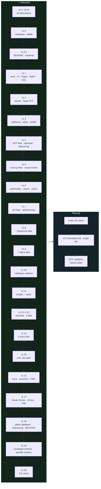

# Roadmap

This file records **what has been delivered** and **what is planned** for Optica Viva. It is the single source of truth for milestones. [CHANGELOG.md](CHANGELOG.md) records what shipped in each release; this file records why and what comes next.

**Legend**

| Mark | Meaning |
|---|---|
| ✅ / `[x]` | done and released |
| 🚧 | in progress |
| `[ ]` | planned |
| **P1 / P2 / P3** | priority: must / should / could |
| **S / M / L / XL** | effort: ≤ ½ day / ≤ 2 days / ≤ 1 week / > 1 week |

> **Maintenance rule:** every release moves its items from *Planned* to *Completed* here, in the same commit as the CHANGELOG entry. New ideas go into the matching milestone, or into the [Backlog](#backlog) if they are unscheduled.

---

## Contents

- [Guiding principles](#guiding-principles)
- [Status at a glance](#status-at-a-glance)
- [Completed milestones](#completed-milestones)
- [Audit findings (October 2026)](#audit-findings-october-2026)
- [Planned milestones](#planned-milestones)
  - [v1.1 Robustness, testing & deployment](#v11-robustness-testing--deployment)
  - [v1.2 Performance](#v12-performance)
  - [v1.3 Lens-design depth](#v13-lens-design-depth)
  - [v1.5 Higher-fidelity rendering](#v15-higher-fidelity-rendering)
  - [v1.6 New laboratories: photography & cinema](#v16-new-laboratories-photography--cinema)
  - [v1.7 New laboratories: astronomy & space](#v17-new-laboratories-astronomy--space)
  - [v1.8 New laboratories: photography & cinema II](#v18-new-laboratories-photography--cinema-ii)
  - [v1.9 New laboratories: astronomy & space II](#v19-new-laboratories-astronomy--space-ii)
  - [v1.11 From simple to exact](#v111-from-simple-to-exact)
  - [v1.12 Missions: optics for real tasks](#v112-missions-optics-for-real-tasks)
  - [v1.13 New laboratories: light, water and worlds](#v113-new-laboratories-light-water-and-worlds)
  - [v1.14 Your own gear and real images](#v114-your-own-gear-and-real-images)
  - [v1.20 3-D views](#v120-3-d-views)
  - [v2.0 Learning platform](#v20-learning-platform)
- [Backlog](#backlog)
- [Research notes and sources](#research-notes-and-sources)

---

## Guiding principles

1. **Physics first.** Each simulation uses the most exact model that runs interactively. Every approximation is named on its page.
2. **Show the arithmetic.** Each laboratory pairs a visual with live equations and a derivation that cites primary references.
3. **Zero install.** Static files, no build step, works offline. New dependencies need a strong justification.
4. **Verifiable.** Claims of accuracy must be backed by a validation entry, and from v1.1 on, by an automated test.
5. **Beautiful by default.** Visuals must read at a glance in a dark, photographic aesthetic.
6. **Simple before exact.** Every reader should get somewhere. Pages climb from a plain-language idea through a rule of thumb to the full model, all visible in that order; there is no beginner/expert switch.

---

## Status at a glance

| Area | Delivered | Planned |
|---|---|---|
| Laboratories | 59 pages, including 9 missions and the reference pages | see Planned milestones |
| Catalogue entries | 228, each with details and a worked example | link every new lab |
| Lens prescriptions | 15: camera lenses from the Petzval to the Biogon, Hubble, a Cassegrain and a three-mirror anastigmat; aspheres, mirrors, model glasses and file import | (none planned) |
| Automated tests | 320 tests (physics, blur, lens I/O, ghosts, bokeh, polarisation, macro, colour, AO) + link check + browser smoke test in CI | more coverage per new lab |
| Deployment | GitHub Pages, deployed from `main` by CI | (none) |

---

## Completed milestones

<b>v1.20.0 3-D views, first four</b> (2026-10-19, PRs #127–#131)

- [x] Dependency-free WebGL 2 engine (`js/lib/gl3d.js`, `js/lib/mesh3d.js`) and the ray tracer's 3-D view with real skew rays (#128)
- [x] Zernike wavefront and PSF reliefs (#129), the electric field along the beam and the Poincaré sphere (#130), Scheimpflug geometry at true scale (#131)
- [x] One-line figure captions clear of the export buttons; staggered glass labels (#127)

<b>v1.19.0 Translated controls and parallel workers</b> (2026-10-19, PRs #123–#125)

- [x] Every control label, option, hint, readout, caption and live-calculation title in German, French and Spanish (#123)
- [x] Parallel row-band ray casters on a pool of up to four workers (#124); the seeing animation streamed from a worker (#125)

<b>v1.18.0 Glass catalogue, decenter/tilt, three languages</b> (2026-10-19, PRs #119–#121)

- [x] 431-glass SCHOTT, OHARA and CDGM catalogue with a glass-map picker (#119)
- [x] Element decenter and tilt, traced exactly, in the tolerance analysis (#120)
- [x] Interface in German, French and Spanish (#121)

<b>v1.17.0 Classic lenses, mirrors, telescopes</b> (2026-10-19, PRs #113–#117)

- [x] Tessar, Petzval, telephoto and retrofocus designs (#113); mirrors, Hubble and a classical Cassegrain (#114)
- [x] Off-axis PSF pupil in Debye direction cosines (#115); a three-mirror anastigmat (#116); the Biogon (#117)

<b>v1.16.0 Learning tools</b> (2026-10-16, PRs #107–#111)

- [x] Export of PNG, CSV and settings JSON (#107), guided tours (#108), exercises with checked answers (#109), embed mode (#110), installable offline app (#111)

<b>v1.15.0 Your own gear and real images</b> (2026-10-16, PRs #100–#105)

- [x] Test your own gear from photographs (#100), real equipment presets (#102), misconception checks (#103), phenomena in the wild (#104)
- [x] CI on Node 24 (#101); `release.sh` runs the test suite (#105)

<b>v1.13 New laboratories: light, water and worlds</b> (released in v1.12.0 and v1.14.0, PRs #81–#83, #94–#97)

- [x] Lighting (#81), exoplanet transits (#82), Earth observation from orbit (#83)
- [x] Underwater photography (#94), narrowband filters on fast optics (#95), autofocus (#96), computational photography (#97)

<b>v1.12 Missions</b> (released in v1.12.0 and v1.13.0, 2026-10-14/15, PRs #78–#91)

- [x] Mission framework and nine missions: Milky Way (#79), Jupiter (#80), portrait (#85), total solar eclipse (#86), LED light and LED walls (#87), choosing a camera or telescope (#88), Earth-observation satellite design (#89), exoplanet imaging (#90), security camera and drone survey (#91)
- [x] From v1.13, released early in v1.12.0: lighting (#81), exoplanet transits (#82) and Earth observation (#83) laboratories
- [x] Smoke test now covers hyphenated page ids and mission pages (#82)

<b>v1.11.0 From simple to exact</b> (2026-10-14, PRs #68–#75)

- [x] Explanation ladder on all 39 pages: the idea in plain words with things to try, the live result in a sentence, a rule of thumb with its limits, then the full model (#68–#72)
- [x] Glossary of 62 terms with definitions on hover or tap (#73)
- [x] "Start here" path of 17 laboratories on the home page (#74)
- [x] Catalogue entries from example to equation (#75)

<b>v1.10.0 Catalogue explorer</b> (2026-10-14, PR #66)

- [x] Groups on their own views, details and a worked example for every entry, 56 new phenomena, deep links (#66)

<b>v1.9.0 New laboratories: astronomy &amp; space II</b> (2026-10-13, PRs #55–#63)

- [x] Interferometry & aperture synthesis: van Cittert–Zernike visibilities, Earth-rotation u-v coverage of the VLA, VLTI and EHT, dirty beam and Högbom CLEAN (#55)
- [x] Detector physics in space: up-the-ramp slopes with jump detection, IPC, CTI trails, persistence (#56)
- [x] Atmospheric dispersion & ADC: Edlén air index, refraction and dispersion vs zenith angle, two-doublet corrector (#57)
- [x] Lucky imaging: frame selection by Strehl against Fried's probability (#58)
- [x] Astrophotography stacking: CCD equation, sky-limited sub length, Bortle sky (#59)
- [x] Starshade: Fresnel shadow of a hypergaussian occulter vs the Poisson–Arago spot (#61)
- [x] Field-dependent PSF: Seidel sums through two-mirror telescopes, nodal aberrations, Hubble's flaw (#63)
- [x] Also: one seeded random-number generator for all simulations (#60); merge-identity check in `worktree.sh` (#62)

<b>v1.8.0 New laboratories: photography &amp; cinema II</b> (2026-10-13, PRs #43–#49)

- [x] Panorama & parallax: ray-cast stitch from real pupil positions; entrance pupil vs nodal point (#43)
- [x] Anamorphic & cinema lenses: oval bokeh, coating-coloured streaks, focus breathing, T-stops (#44)
- [x] Filters & HDR: graduated ND, inverse-variance merge, tone mapping, exposure fusion (#45)
- [x] Camera shake & stabilisation: reciprocal rule from Monte Carlo, type-2 servo with gyro random walk (#46)
- [x] The human eye: Le Grand eye, ocular LoCA vs measurement, best pupil, CoC from acuity (#47)
- [x] Film & grain: Boolean-model emulsion, H&D curve, Selwyn granularity, DQE, reciprocity (#48)
- [x] Virtual production: LED-wall moiré and PWM banding (#49)

<b>v1.7.0 New laboratories: astronomy &amp; space I</b> (2026-10-13, PRs #35–#40)

- [x] Wavefront sensing: diffraction Shack–Hartmann sensor, modal reconstructor and closed AO loop in the worker with an error budget; pyramid sensor with modulation (#37, #38)
- [x] Spectroscopy: prisms and gratings, blaze and orders, resolving power, solar and lamp spectra; slit-limited échelle spectrograph and échellogram (#39, #40)
- [x] MIT licence with third-party notices (#35)

<b>v1.6.0 New laboratories: photography &amp; cinema I</b> (2026-10-13, PRs #28–#32)

- [x] Polarisation: Stokes-vector lake scene with a Rayleigh sky and a rotating polariser, Malus and wave plates, photoelasticity, birefringent OLPF (#28, #29)
- [x] Macro & magnification: pupil magnification, effective f-number, chief-ray ruler render with a 1:1 crop, optimum aperture, focus stacking (#30)
- [x] Colour science: CIE colorimetry, CCT/Duv, CIE 13.3 CRI, camera sensitivities, white balance, colour matrix, metamerism (#31, #32)

<b>v1.5.0 Higher-fidelity rendering</b> (2026-10-12, PRs #22–#25)

- [x] Real-ray flare ghosts (Hullin 2011 full method): every two-reflection path at 8 wavelengths, flux-conserving triangles, per-pixel aperture gauge, angle-dependent coating reflectance and TIR, in the worker (#22)
- [x] Bokeh traced through the real lens: SA rims, secondary-spectrum fringes, cat's eyes, physical disk size; rasteriser bias fixes (#23)
- [x] Exact disk (pillbox) kernel in tilt-shift and depth of field (#24)
- [x] Diffraction of small defocused disks, validated against sinc²(W₀₂₀/λ) (#25)

<b>v1.4.0 Lens design II</b> (2026-10-12, PRs #18–#20)

- [x] MTF across the field (S/T at 10 and 30 lp/mm) from the traced, vignetted pupil, validated against the diffraction MTF (#18)
- [x] Damped-least-squares optimiser; rediscovers Coddington's best-form singlet (q = 0.727 vs 0.740) (#19)
- [x] Monte-Carlo tolerancing with refocus compensation and a yield histogram (#20)
- [x] Robust real-time smoke test: polling for results, browser start-up retry (#15)

<b>v1.3.0 Lens-design depth</b> (2026-10-12, PRs #12–#16)

- [x] Even-aspheric surfaces (conic + polynomial, Newton intersection) and an SA-free plano-hyperbolic singlet (#12)
- [x] Prescription editor, Zemax `.zmx` / JSON import-export, model glasses, shareable custom lenses; library achromat fixed (#13)
- [x] Per-surface Seidel sums S_I–S_V, C_I, C_II, validated against exact rays and the Petzval sum (#14)
- [x] Through-field analysis: exact Coddington field curves vs third order, real-ray distortion; smoke test made robust to slow CI (#15)
- [x] Vignetted PSF pupils and editable clear semi-diameters (#16)

<b>v1.2.0 Performance</b> (2026-10-12, PRs #7–#10)

- [x] Releases go through pull requests; `main` requires a PR and green checks, also for admins (#7)
- [x] Transpose-based 2-D FFT (512²: 88 → 66 ms on the Pi), LRU-cached pupil rasters, `npm run bench` and a CI performance report (#8)
- [x] Compute worker for the PSF, Zernike and MTF labs: longest main-thread freeze 1040 ms → 16 ms; progressive 256² → 512² PSF (#9)
- [x] Real-time CDP smoke test and screenshots (virtual time does not run workers); the smoke test fails on labs that render nothing (#9)
- [x] Coronagraph, JWST phasing and ray-tracer PSF moved to the worker, with regression tests (#10)

<b>v1.1.0 Robustness, testing & deployment</b> (2026-10-12, PRs #1–#6)

- [x] Physics test suite (17 tests) + link checker + headless smoke test, run by GitHub Actions on every PR (#1)
- [x] GitHub Pages deployment from `main`; `main` protected by required CI checks (#2)
- [x] Safari-safe Gaussian blur replacing `ctx.filter` (#3)
- [x] Shareable URL state and a "Copy link" button for every lab (#4)
- [x] Mobile bottom-sheet controls and accessibility pass (#5)
- [x] CONTRIBUTING.md, issue/PR templates, error boundary with a pre-filled issue link (#6)
- [x] Bug found by the new tests: cos⁴ corner falloff corrected to −1.35 EV

<b>v1.0.x Stable release & documentation</b> (2026-10-09 → 2026-10-12)

- [x] **v1.0.0** Catalogue of 148 phenomena in 13 groups, with search, domain filter and "only simulated" filter
- [x] **v1.0.0** All labs registered as ready; home page counters
- [x] **v1.0.1** GitHub-style README: banner, badges, gallery of all labs, Mermaid diagrams, validation table, contributing guide
- [x] **v1.0.1** `scripts/screenshots.mjs` for reproducible WebP screenshots
- [x] **v1.0.2** This roadmap, with audit findings and planned milestones
- [x] **v1.0.3** `CLAUDE.md` project guide for consistent future sessions

<b>v0.11–v0.19 Space, sensor & geometry laboratories</b>

- [x] **v0.11** Atmospheric seeing & AO: von Kármán screens + Lane subharmonics, frozen flow, DM with servo lag
- [x] **v0.12** Space telescopes: resolution & sampling of 8 cameras, Planck emission, Lyot coronagraph with speckle floor
- [x] **v0.13** Gravitational lensing: SIE + shear, marching-squares caustics, ΛCDM distances; release-script syntax gate
- [x] **v0.14** Aliasing, moiré & Bayer: OLPF, fill factor, Malvar–He–Cutler demosaicing
- [x] **v0.15** Noise & exposure: photon-transfer chain, ISO invariance, DR vs ISO
- [x] **v0.16** Rolling shutter & time: propeller, wagon wheel, flicker banding
- [x] **v0.17** Vignetting: cosⁿ, three-circle mechanical vignetting, chief-ray-angle pixel vignetting
- [x] **v0.18** Perspective & distortion: dolly zoom, Brown–Conrady, TV distortion
- [x] **v0.19** Tilt–shift & Scheimpflug: traced hinge rule, DDA-accelerated miniature render, shift mode

<b>v0.1–v0.10 Core engine & first laboratories</b>

- [x] **v0.1** App shell, design system, router; numerical core (FFT, colour science, Sellmeier, exact ray tracer, pupils/PSF/Zernike); Introduction, Foundations, Real-lens ray tracing
- [x] **v0.2** Depth of field with defocus-OTF ground and disk-kernel bokeh
- [x] **v0.3** Diffraction & PSF (Hubble, JWST, Keck, ELT)
- [x] **v0.4** Wavefront aberrations, JWST segment phasing; release script
- [x] **v0.5** Chromatic aberration (achromat and apochromat solvers, LoCA/LaCA renders)
- [x] **v0.6** Sensor size & equivalence
- [x] **v0.7** Fisheye vs rectilinear with Tissot indicatrices
- [x] **v0.8** MTF & resolution (numerical OTF, OLPF, Siemens star)
- [x] **v0.9** Bokeh (pupil splatting, SA sign flip, cat's eye)
- [x] **v0.10** Flare, ghosts & coatings (paraxial ghost tracing, transfer-matrix coatings)

---

## Audit findings (October 2026)

An audit of v1.0.1 (code, performance, layout, accessibility and browser compatibility) produced the evidence behind the plan below.

| # | Finding | Evidence | Impact | Addressed in |
|---|---|---|---|---|
| A1 | **Safari ships `CanvasRenderingContext2D.filter` disabled**, so DoF, tilt-shift, bokeh softening and blur-stack renders lose their blur | caniuse lists Safari 18.0–26.5 as "disabled by default"; WebKit bug 275436 still open for OffscreenCanvas | Wrong visuals for all Safari and iOS users | v1.1 |
| A2 | No automated tests; validation figures are checked by hand only | no `test/` folder, no CI | Regressions in physics can ship silently | v1.1 |
| A3 | No CI and no public deployment | no `.github/workflows`; runs only locally | Contributors can't preview, and users must clone the repo | v1.1 |
| A4 | All computation runs on the main thread | Raspberry Pi 4 timings: 2-D FFT 256² = 17 ms, 512² = 88 ms; JWST pupil raster = 184 ms; a defocused 13-λ PSF ≈ 1.3 s | UI freezes while dragging on low-power devices | v1.2 |
| A5 | On phones the controls come after every canvas | 390 px screenshot: the controls appear below all the visuals | You have to scroll back and forth to experiment | v1.1 |
| A6 | Canvases have no text alternative; almost no ARIA | one `aria-` attribute in the codebase | Screen-reader users get no results | v1.1 |
| A7 | No shareable state | no URL parameters | Teachers can't link to a specific configuration | v1.1 |
| A8 | No licence | README states all rights reserved | Blocks contributions and reuse | ✅ MIT (2026-10-13) |
| A9 | Known model simplifications (see README) | ~~paraxial ghosts~~ (real rays since v1.5), ~~phenomenological bokeh~~ (traced since v1.5), ~~Gaussian blur stack~~ (disk kernels since v1.5), circular off-axis pupil | Accuracy ceiling for advanced users | v1.3–v1.4 |
| A10 | Spherical surfaces only; prescriptions are hard-coded | `raytrace.js` | Can't model modern aspheric lenses or user lenses | v1.3 |

---

## Planned milestones

### v1.1 Robustness, testing & deployment

✅ **Released as v1.1.0** (see *Completed milestones*). The licence (MIT) followed in v1.6.1.

*Goal: every user on every browser sees correct results, and every physics claim is guarded by a test.*

- [x] **P1 · M** Replace `ctx.filter` blur with an in-house **separable/disk blur** (summed-area table for the box approximation, or an exact disk via the FFT already in `fft.js`). Fixes Safari (A1). *Done with a three-box Gaussian (`js/lib/blur.js`); the true-disk tilt-shift kernel moves to v1.4.*
- [x] **P1 · M** **Physics test suite** with `node --test` and no dependencies. Turn every row of the README validation table into an assertion: Sellmeier indices, EFLs, Fresnel/MgF₂ reflectance, Brewster, Airy encircled energy, Rayleigh dip, hinge rule, ΛCDM distances, hyperfocal distance, cos⁴.
- [x] **P1 · S** **GitHub Actions CI**: `node --check`, the test suite, Markdown link check, and a headless-browser smoke test of every page. (A Mermaid parse check was dropped; it would need a browser bundle.)
- [x] **P1 · S** **GitHub Pages deployment** from `main`, with a live-demo badge in the README. Live at <https://iiogurt.github.io/Optica_Viva/>; `main` is protected by required CI checks.
- [x] **P1 · S** **Choose a licence**. *MIT (owner decision), with third-party notices for KaTeX and the colour-science data.*
- [x] **P2 · M** **Mobile controls drawer**: a sticky bottom sheet with the controls next to the main canvas on screens < 860 px (A5).
- [x] **P2 · M** **Accessibility**: `role="img"` and live `aria-label` summaries for canvases (e.g. "Strehl 0.44, spot RMS 21 µm"), visible focus styles, `prefers-reduced-motion` to pause animations, contrast audit (A6).
- [x] **P2 · S** **Shareable state**: serialise controls to the URL hash (`#/psf?preset=jwst&band=nir`) plus a "copy link" button (A7).
- [x] **P3 · S** Per-module error boundary with a "report issue" link, and an issue template with a "physics error" label.
- [x] **P3 · S** `CONTRIBUTING.md` split out of the README, plus issue and PR templates. *A code of conduct is deferred until outside contributors arrive.*

### v1.2 Performance

✅ **Released as v1.2.0.** The remaining worker paths are open below; WebGPU is deferred to v1.5.

*Goal: fluid on a Raspberry Pi 4 and on mid-range phones (A4).*

- [x] **P1 · M** Move FFT/PSF work into **Web Workers** with transferable buffers. *Done for the PSF, Zernike and MTF labs (longest freeze 1 s → 16 ms on the Pi).*
- [x] **P2 · M** Extend the worker to the coronagraph, JWST phasing and the ray tracer's OPD/PSF.
- [x] **P2 · M** **Parallel ray casters**: projection, tilt–shift, perspective, depth of field and lensing render in row bands on a pool of up to four workers; the tilt–shift blur stack is cached per focal length in a worker; live-calculation equations are typeset when a drag pauses. *Median freeze while dragging on the Pi: 3.2 s → 0.12 s (tilt–shift), 1.1 s → 0.27 s (DoF), 0.9 s → 0.1 s (projection, lensing), 0.54 s → 0.1 s (perspective).*
- [x] **P2 · M** **Seeing animation in a worker**: the simulation session (phase screen, servo history, long-exposure sum) lives in a compute worker, which streams display-ready frames one request at a time. *Longest freeze on the Pi 1.1 s → 0.22 s.*
- [x] **P1 · S** **Cache pupil rasters** per aperture and size; the JWST raster alone costs 184 ms on the Pi.
- [x] **P2 · M** **Progressive rendering**: low-resolution preview while a slider is dragging, full resolution on release. *Done in the PSF lab (256² preview, then 512²); extend alongside the worker migration.*
- [ ] **P2 · L** *(deferred to the Backlog)* **WebGPU compute path** for FFTs, phase screens and per-pixel ray casting, with CPU fallback. WebGPU now ships in Chrome, Safari 26 and recent Firefox, but Android coverage is incomplete, so the fallback stays mandatory. *Deferred because it can't yet be verified: neither the reference Raspberry Pi 4 (headless Chromium) nor the GitHub-hosted CI runners expose a WebGPU adapter. The worker and the faster FFT already remove the main-thread freezes.*
- [x] **P2 · M** **Faster FFT**: a cache-blocked transpose replaces strided column passes, 1.4× faster at 512² on the Pi. *A real-input FFT was dropped: nearly every PSF field is complex because of its phase, so the half-complex trick rarely applies.*
- [x] **P3 · S** Performance report in CI: `npm run bench` publishes kernel timings to the run summary. *It is informational rather than a failing budget, because shared runners are too noisy for a 25 % threshold.*

### v1.3 Lens-design depth

✅ **Released as v1.3.0 and v1.4.0** (optimiser, tolerancing and MTF vs field shipped in v1.4.0; classic designs, mirrors, the three-mirror anastigmat and the off-axis pupil in v1.17.0). The glass catalogue and decenter/tilt tolerancing followed in v1.18.0; only traced relative illumination remains, in the Backlog.

*Goal: the ray tracer becomes a credible teaching tool for lens design (A9, A10).*

- [x] **P1 · M** **Aspheric surfaces**: conic plus even polynomial sag, with exact intersection by Newton iteration.
- [x] **P1 · M** **Prescription editor**: an editable table of surfaces (R, t, glass, semi-diameter, conic, stop) with validation and undo.
- [x] **P1 · M** **Prescription import/export**: JSON, simple `.len`, and a subset of Zemax `.zmx` (SURF, CURV, DISZ, GLAS, CONI, PARM). This follows the RayOptics and Open Optical Designer approach.
- [x] **P2 · M** **More classic designs** (#113): Tessar, Petzval portrait, telephoto and retrofocus, designed with the built-in optimiser (new `minBfd` back-focus constraint).
- [x] **P2 · M** **Mirrors in the ray tracer** (#114): reflective surfaces (negative-index convention, Zemax `MIRROR` import); the Hubble Space Telescope as designed and with its 1990 flaw, and a classical Cassegrain.
- [x] **P2 · M** **Three-mirror anastigmat** (Korsch type, JWST layout): flat field, conics solved from S_I = S_II = S_III = 0.
- [x] **P2 · M** **Biogon** symmetric wide angle (f/4.5, ±45°) from Bertele's patent example, with model glasses.
- [x] **P2 · M** **Seidel sums per surface** (S_I–S_V and chromatic C_I, C_II) as bar charts. This shows where each aberration originates.
- [x] **P2 · M** **Through-field analysis**: sagittal and tangential field curves and real-ray distortion. *The PSF pupil is now vignetted by the clear apertures (editable Semi-Ø), and MTF vs field (S/T at 10 and 30 lp/mm) is plotted. Traced relative illumination moved to the Backlog.*
- [x] **P2 · S** **Off-axis pupil shape** in the OPD/PSF path: the pupil is sampled in the direction cosines seen from the image point (Debye), so off-axis PSFs and MTFs include the foreshortened, distorted real exit pupil.
- [x] **P3 · L** **Optimiser**: damped least squares on a merit function (spot RMS, EFL target, F/C focus), demonstrated on the achromat.
- [x] **P3 · M** **Monte-Carlo tolerancing**: radius, thickness and index perturbations with refocus compensation and a yield histogram. *Element decenter and tilt followed in v1.18.0, with surfaces traced in their own frames and a per-element sensitivity chart.*
- [x] **P3 · M** **Glass catalogue** (431 SCHOTT, OHARA and CDGM glasses, checked against the catalogue n_d, V_d) with a **glass-map picker** in the prescription editor.

### v1.5 Higher-fidelity rendering

*Goal: remove the remaining phenomenological shortcuts (A9).*

✅ **Released as v1.5.0.** The two open P3 items (spectral scene renderer, smooth ghost irradiance) move to the Backlog.

- [x] **P1 · L** **Real-ray ghost tracing** for flare: sample pupil rays through each two-reflection path, giving aberrated, vignetted ghosts (Hullin 2011 full method). *Includes angle-dependent coating reflectance, TIR, per-pixel aperture gauge and path culling; runs in the worker with draft and refined passes.*
- [x] **P2 · L** **Bokeh from the traced lens**: defocus kernels built from real rays of the chosen prescription, including LoCA rims (magenta and green) and field-dependent cat's eyes. *Default bokeh model; 18 kernels in the worker; validated for size, flux, SA and colour order.*
- [x] **P2 · M** **Diffraction-aware bokeh**: Fresnel edge ripples for small disks via the defocused-PSF FFT path. *Traced pupil + defocus, 5 wavelengths, compared with pure defocus; validated against sinc²(W₀₂₀/λ).*
- [x] **P2 · M** Exact disk kernel in tilt-shift and DoF (shares the v1.1 blur code). *Anti-aliased pillbox from per-row prefix sums, downsampled above r = 8 px; Vogel taps remain only for very large near cards in DoF.*
- [ ] **P3 · L** **Spectral scene renderer**: render a whole scene per wavelength through the PSF, the colour-matching functions and the sensor's spectral response.
- [x] **P3 · M** Polychromatic ghosts with dispersion inside the paraxial and real-ray models. *Both models trace each of the 8 wavelengths with its own indices and coating reflectance.*
- [ ] **P3 · M** Smooth ghost irradiance: interpolate per-vertex irradiance across the triangles (Hullin's vertex averaging) to remove the < 1 % per-cell steps, and add Fresnel ringing at ghost edges.

### v1.6 New laboratories: photography & cinema

✅ **Released as v1.6.0** with the three P1 laboratories. The P2 and P3 laboratories move to v1.8.

| Lab | Content | Priority · effort |
|---|---|---|
| [x] **Polarisation** | Malus's law, wave plates, Brewster reflections, polariser on water, sky polarisation map (Rayleigh), Stokes-vector scene render, birefringent OLPF, stress birefringence (photoelasticity). *Shipped in PRs #28–#29.* | P1 · M |
| [x] **Macro & magnification** | bellows factor, effective f-number, diffraction at N(1+m), focus stacking, working distance. *Pupil magnification, chief-ray ruler render with a 1:1 crop, optimum aperture (PR #30).* | P1 · M |
| [x] **Colour science** | CIE colorimetry, CCT/Duv, CRI (R1–R14) of CIE LED/FL sources, sensor spectral sensitivities, white balance, colour-matrix fitting, metamerism (PRs #31–#32). *TLCI and TM-30 moved to the Backlog.* | P1 · L |

### v1.7 New laboratories: astronomy & space

✅ **Released as v1.7.0** with the two P1 laboratories. The P2 and P3 laboratories move to v1.9.

| Lab | Content | Priority · effort |
|---|---|---|
| [x] **Wavefront sensing** | Shack–Hartmann spots → slopes → reconstructed wavefront; closed-loop AO with noise and an error budget; pyramid sensor with modulation (PRs #37–#38) | P1 · L |
| [x] **Spectroscopy** | prisms vs gratings, resolving power R = mN, blaze, order overlap, slit-limited échelle spectrograph with échellogram (PRs #39–#40). *IFU explained in theory; its simulation moves to the Backlog.* | P1 · L |

### v1.8 New laboratories: photography & cinema II

✅ **Released as v1.8.0** with all seven laboratories.

| Lab | Content | Priority · effort |
|---|---|---|
| [x] **Panorama & parallax** | entrance pupil as the no-parallax point, stitching errors vs rotation centre. *Ray-cast stitch, pupil vs nodal point table (PR #43).* | P2 · M |
| [x] **Anamorphic & cinema lenses** | squeeze factor, oval bokeh, horizontal streak flare, focus breathing metrics, T-stops (PR #44) | P2 · L |
| [x] **Filters & HDR** | ND and graduated ND, exposure fusion, bracketing, dynamic-range stacking (PR #45) | P2 · M |
| [x] **Film & grain** | characteristic (H&D) curve, reciprocity failure, grain vs photon noise (PR #48) | P3 · M |
| [x] **Virtual production** | LED-wall moiré vs camera MTF and pixel pitch, scan-line/refresh interactions with rolling shutter (PR #49) | P3 · M |
| [x] **Stabilisation & shake** | angular-jitter blur, reciprocal rule, IBIS/OIS correction residuals (PR #46) | P3 · S |
| [x] **Human eye** | schematic eye, pupil size vs acuity, Stiles–Crawford effect, why the CoC is d/1500 (PR #47) | P3 · M |

### v1.9 New laboratories: astronomy & space II

✅ **Released as v1.9.0** with all seven laboratories.

| Lab | Content | Priority · effort |
|---|---|---|
| [x] **Interferometry & aperture synthesis** | Young fringes → visibility; u-v coverage of VLTI/EHT-like arrays; dirty beam and CLEAN (PR #55) | P2 · L |
| [x] **Field-dependent PSF** | PSF variation across the field of two-mirror telescopes, nodal aberrations of a misaligned secondary, Hubble's flaw (PR #63) | P2 · M |
| [x] **Detector physics (space)** | inter-pixel capacitance, persistence, cosmic-ray rejection by up-the-ramp fitting, CTI from radiation damage (PR #56) | P2 · M |
| [x] **Starshade** | Fresnel diffraction around a petal-shaped occulter; contrast vs Fresnel number (PR #61) | P3 · L |
| [x] **Astrophotography stacking** | SNR ∝ √N, sky-limited vs read-limited sub-exposures, light pollution (PR #59) | P3 · M |
| [x] **Atmospheric dispersion & ADC** | elongated stellar images vs zenith angle; Risley-prism corrector (PR #57) | P3 · S |
| [x] **Lucky imaging** | frame selection by Strehl from the seeing simulator (PR #58) | P3 · S |

### v1.11 From simple to exact

✅ **Released as v1.11.0** (see *Completed milestones*).

*Goal: a reader without physics training understands what each laboratory shows, and a specialist still reaches the derivation in one click.* The design follows the research on concreteness fading (Fyfe et al. 2014), the spiral curriculum (Bruner 1960), the expertise-reversal effect (Kalyuga et al. 2003) and PhET's implicit scaffolding (Podolefsky et al. 2013): simple models first and honest about their limits, short enough not to slow experts down, and guidance through the simulation rather than long instructions.

- [x] **P1 · M** **Ladder pilot** (PR #68): `idea()`, `rule()`, `liveCalc().say()` and the jump strip in `js/lib/page.js`; depth of field, diffraction & the PSF and atmospheric seeing; `test/ladder.test.mjs` (no symbols and at most 120 words in the idea, 1–3 things to try, a rule with its limits, the result in words).
- [x] **P1 · L** Ladder for the other 36 laboratories, one PR per sidebar group; the test now requires it on every laboratory.
  - [x] Geometric optics, 9 laboratories (PR #69)
  - [x] Wave optics, 5 laboratories (PR #70)
  - [x] Light, sensor & time, 10 laboratories (PR #71)
  - [x] Astronomy & space, the other 10 laboratories, and the physical foundations (PR #72)
- [x] **P2 · M** **Glossary**: one file of one-sentence definitions; terms such as f-number, PSF, Strehl ratio and MTF show them on hover or tap (PR #73).
- [x] **P2 · S** **"Start here" path** on the home page: laboratories ordered from basic (perspective, exposure, depth of field) to advanced (adaptive optics, exoplanet imaging), as a suggestion, not a lock (PR #74).
- [x] **P3 · S** Catalogue entries in the same order: plain description, example, explanation, equation (PR #75).

### v1.12 Missions: optics for real tasks

✅ **Complete** (released in v1.12.0 and v1.13.0).

*Goal: show why the physics matters by solving real tasks.* A mission is a guided page with a goal: the reader enters their equipment and situation, the page combines several laboratory models, recommends settings with the reason for each, and links to the laboratories involved. It follows the simple-to-exact ladder.

- [x] **P1 · M** Mission framework (`missionStep()` in `js/lib/page.js`, `#/mission-<id>`): inputs, steps that each cite a model and a laboratory, a summary of recommended settings, a "Missions" group in the sidebar and on the home page (PR #79).
- [x] **P1 · M** **Photograph the Milky Way** (PR #79): longest untrailed exposure (500 and NPF rules), aperture vs corner coma and vignetting, ISO invariance, sky brightness, number of frames to stack.
- [x] **P1 · M** **Image Jupiter from your garden** (PR #80): critical f-ratio for the pixel size, seeing and lucky-imaging frame rate, atmospheric dispersion vs altitude, rotation limit on capture length.
- [x] **P2 · M** **Portrait session** (PR #85): flattering distance, focal length, depth of field across the face, background blur, light-source size and shadow softness.
- [x] **P2 · M** **Total solar eclipse** (PR #86): safe filters, exposure ladder from Baily's beads to the outer corona, HDR merge.
- [x] **P2 · S** **Film under LED light and on an LED volume** (PR #87): shutter angle vs flicker, LED-wall moiré distance.
- [x] **P2 · M** **Choose a camera or telescope** (PR #88): compare formats or apertures by resolution, light and depth of field through the equivalence laws.
- [x] **P2 · M** **Design an Earth-observation satellite** (PR #89): orbit, focal length and pixels → ground sample distance, MTF, smear and TDI stages.
- [x] **P3 · M** **Plan an exoplanet observation** (PR #90): contrast, inner working angle, coronagraph or starshade, integration time.
- [x] **P3 · S** **Security camera or drone survey** (PR #91): pixels on target for detection/recognition, motion blur, rolling shutter.

### v1.13 New laboratories: light, water and worlds

✅ **Complete** (released in v1.12.0 and v1.14.0).

| Lab | Content | Priority · effort |
|---|---|---|
| [x] **Lighting** (PR #81) | inverse-square falloff, shadow softness from source size (umbra/penumbra), Lambertian and specular reflection, catchlights, flash guide numbers | P1 · M |
| [x] **Exoplanet transits** (PR #82) | light-curve depth (Rp/R★)², limb darkening, duration, photometric noise budget | P2 · M |
| [x] **Earth observation from orbit** (PR #83) | ground sample distance, push-broom and TDI, atmospheric haze and adjacency, system MTF | P2 · M |
| [x] **Underwater photography** (PR #94) | spectral absorption with depth, flat vs dome ports (magnification, distortion, virtual image), backscatter | P2 · M |
| [x] **Computational photography** (PR #97) | multi-frame night mode and burst super-resolution, synthetic portrait blur from depth and its artefacts | P2 · L |
| [x] **Autofocus** (PR #96) | phase detection with split pixels, contrast detection, focus hunting | P3 · M |
| [x] **Interference filters on fast optics** (PR #95) | narrowband filter blue-shift with angle of incidence, bandpass vs f-ratio | P3 · S |

### v1.14 Your own gear and real images

✅ **Released as v1.15.0** except the validation against manufacturer curves, which waits for a usable data source.

- [x] **P1 · L** **Test your own gear** (PR #100, processed locally, never uploaded): slanted-edge MTF (ISO 12233), vignetting from a flat field, distortion from a grid, lateral colour.
- [x] **P2 · M** **Real equipment presets** (PR #102): sensors, phones and telescopes with focal lengths, apertures and pixel sizes, shared by all laboratories and missions.
- [x] **P2 · M** **Phenomena in the wild** (PR #104): a gallery of real images explained by the laboratories (Hubble before and after 1993, JWST spikes, the EHT ring, rolling-shutter propellers, the green flash), public-domain or CC BY with attribution in THIRD_PARTY_NOTICES.md.
- [x] **P2 · M** **Misconception checks** (PR #103): predict-then-reveal questions built on physics-education research (half-covered lens, f-number and depth of field, ISO and noise).
- [ ] **P3 · M** **Validation against measurements**: simulated MTFs compared with published manufacturer curves for a few lenses.

### v1.20 3-D views

🚧 **In progress**: the engine and four views were released in v1.20.0; the others follow in later releases.

*Goal: show in three dimensions what flat diagrams can only hint at (skew rays, tilted planes, orbits, polarisation states, colour solids), with pleasant, light graphics that stay fluid on a Raspberry Pi 4.*

Engine: `js/lib/gl3d.js`, dependency-free WebGL 2 (orbit camera, glass with a Fresnel rim, glowing anti-aliased lines, labels, PNG export, rendering only on change, a message instead of a view without WebGL 2); geometry in `js/lib/mesh3d.js`. Headless Chromium gets WebGL 2 from SwiftShader for the smoke test and screenshots.

Audit of the existing 2-D spatial views (17 figures): all render without errors. Long captions ran into drawings and under the export buttons (fixed, #127), thin elements' glass names overlapped in the ray tracer (fixed, #127), and the tilt–shift side view mixes a true-scale image space with log object distances, which a 3-D view explains better.

Candidates, in order of how much the third dimension adds:

- [x] **P1 · M** **Ray tracer**: glass elements as solids, mirrors, the stop and the sensor, with real skew rays on axis and at the chosen field (#128). *Next: colour by wavelength, the sagittal and tangential foci, and a vignetted-ray view.*
- [x] **P1 · M** **Tilt–shift / Scheimpflug** (#131): at true scale in the camera, the sensor, lens and focus planes meeting in the Scheimpflug line, with the hinge line at J = f / sin α; and the plane of focus with its depth-of-field wedge over the toy town.
- [x] **P1 · M** **Polarisation** (#130): the electric field along the beam through each polariser and wave plate (flat waves, helices, ellipses, with the unpolarised share as a ring), and the Poincaré sphere with the state after each element.
- [x] **P1 · S** **Wavefronts and PSFs as surfaces** (#129): the Zernike wavefront over a round pupil next to its PSF's log relief, and the PSF laboratory's star image as a relief in its own colours (JWST's six spikes in near-infrared colour). *The seeing phase screen remains.*
- [x] **P2 · M** **Depth of field**: at true scale, the camera's view frustum (the photograph's sensor, height and shifted framing), the plane of focus, the sharp zone as a glass slab and the cards coloured by their blur.
- [x] **P2 · M** **Projections**: the sphere of directions (radius f) with the Tissot circles, the image plane tangent to it at the axis, each circle's image where the projection puts it, and the sensor's field outlined on the sphere.
- [x] **P2 · M** **Gravitational lensing**: the light path of every image (solved from the lens equation) from the source past the lens galaxy to the telescope, the planes at their comoving distances, critical curves and caustics on them, and the Einstein ring as a double cone; angles exaggerated × 40 000.
- [x] **P2 · M** **Interferometry**: the Earth turning under the source (an hour-angle slider), the stations that see it, and each baseline projected onto the u-v plane facing the source, tracing its track; local arrays enlarged. The 3-D projection reproduces the 2-D coverage point for point.
- [x] **P2 · M** **Orbits**: Earth observation (a true-scale patch of the curved Earth with the orbit, the fan of view, the detector line's footprint and the strip imaged in the last minute) and exoplanet transits (the star, the tilted orbit, the cylinder of sight lines through the star, the transit chord and the impact parameter, at true scale).
- [x] **P2 · S** **Colour science**: the colour solid in CIE xyY (the optimal colours under the chosen light, adapted to D65), with the sRGB, Display P3 or Rec. 2020 gamut and the 14 test colours. *A perceptual (CIELAB) version and gamut volumes remain.*
- [ ] **P3 · M** **Starshade and coronagraph**: the telescope–starshade geometry to scale (tens of thousands of kilometres) and the shadow on the pupil. *Starshade done: the petals, the true separation (across the line of sight enlarged by a round factor), the starlight, the line of sight at the inner working angle and the computed shadow on the telescope's plane. The coronagraph (masks and Lyot stop along the beam) is open.*
- [x] **P3 · M** **Bokeh and defocus**: real rays round the iris from a background point on axis and one in the corner through the traced lens, crossing in front of the sensor; the traced footprints (iris shape on axis, cat's eye in the corner) on the sensor and enlarged beside it.
- [x] **P3 · M** **Flare**: real-ray ghost paths bouncing between surfaces inside the lens. *The three brightest ghosts for the sun's position (ranked by mean irradiance from a ray grid through every path), their exact paths, their spots on the sensor and the faint image-forming light.*

### v2.0 Learning platform

- [x] **P2 · M** **Catalogue explorer**: groups on their own views, an explanation and worked example for every entry, 56 new phenomena, deep links to single entries (PR #66).
- [x] **P2 · L** **Guided tours**: step-by-step narratives that drive the controls ("Why stopping down stops helping"); five tours (#108).
- [x] **P2 · M** **Exercises with checked answers**: compute the hyperfocal distance, predict the ghost count, and so on, using the live calculation engine (#109).
- [x] **P2 · M** **Export**: PNG of any canvas, CSV of any chart, JSON of lab state (#107).
- [x] **P3 · M** **Installable PWA** with service-worker caching (fonts included) (#111).
- [ ] **P3 · L** **Internationalisation**, starting with the UI strings, then the theory text. *The interface is done: English, German, French and Spanish for navigation, laboratory titles and descriptions, page chrome, tours, exercises, the home page, and every control label, option, hint, readout name, figure caption and live-calculation title (`js/lib/i18n.js`, `js/locales/`, `test/i18n.test.mjs`). Open: page-specific buttons, chart text drawn on canvases, the live-calculation sentences, then the explanations.*
- [x] **P3 · M** **Embed mode** (`?embed=1`) for courses and blogs (#110).
- [ ] **P3 · L** Lab plugin API and documentation site generated from module metadata.

---

## Backlog

Ideas worth keeping but not yet scheduled:

- *(from v1.2)* **WebGPU compute path** for FFTs, phase screens and per-pixel ray casting, with a mandatory CPU fallback; waits until the Raspberry Pi 4 or the CI runners expose a WebGPU adapter to test it on.
- *(from v1.3)* Traced relative illumination across the field (real-ray pupil area and cos⁴ projection) in the ray tracer.
- *(from v1.5)* **Spectral scene renderer**: render a whole scene per wavelength through the PSF, the colour-matching functions and the sensor's spectral response.
- *(from v1.5)* Smooth ghost irradiance (Hullin's vertex averaging) and Fresnel ringing at ghost edges.

- *(from v1.6 colour science)* TLCI-2012 (EBU camera model) and ANSI/IES TM-30 fidelity and gamut indices (99 colour evaluation samples).
- *(from v1.7 spectroscopy)* Integral-field unit simulation: image slicer reformatting a galaxy field into a long slit and reconstructing the data cube.
- *(from v1.9 starshade)* Petal terms (JN, J2N …) and 2-D shadows of real petal shapes with manufacturing and deployment errors; sunlight scattered by the petal edges; numerically optimised occulter profiles (Vanderbei, Cady & Kasdin).
- *(from v1.9 field-dependent PSF)* Three-mirror anastigmats (JWST, Roman) with fifth-order terms from real-ray tracing through mirrors, and field-dependent Zernike maps in the style of STPSF.
- *(from the catalogue explorer)* Per-entry references and symbol legends for the equations; a printable or PDF export of a catalogue group.
- Coherent imaging mode (laser/speckle) in the PSF lab.
- Gravitational microlensing light curves and planetary anomalies.
- Zoom-lens animation, showing group motion and parfocality.
- Thermal focus shift lab (dn/dT, housing expansion, athermalisation).
- Aerial perspective and haze with Koschmieder's law in the DoF scene.
- Light-field (plenoptic) refocusing.
- Comparison mode: two lab states side by side.
- *(from the October 2026 exploration)* Further phenomena:
  - Photography and cinema: in-camera lens corrections and their resolution cost; infrared and UV photography (Wood effect, IR focus shift); diffusion filters (Pro-Mist) and film halation; stereo 3D (interaxial, convergence, depth budget); HDR display transfer functions (PQ, HLG) and cinema screen luminance.
  - Astronomy and space: satellite trails and their rejection in stacks; radial-velocity precision; planetary-imaging sampling; free-space laser communication link budgets; star trackers; phase angle and sun glint; LIGO as an optical instrument (shot noise vs radiation pressure).
  - Atmosphere and nature: lunar coronas, glories and Brocken spectres; supernumerary rainbows (Airy theory); caustics and apparent depth in water; mirages; extinction and airmass; zodiacal light and airglow.

---

## Research notes and sources

Short notes from the October 2026 review that inform priorities above.

- **WebGPU availability.** WebGPU with compute shaders ships by default in Chromium, in Safari from the 2025 (26.x) releases, and in Firefox on Windows and Apple Silicon. Android coverage is still incomplete, so a CPU/WebGL fallback remains necessary. Sources: [Khronos WebGL & WebGPU update (2026)](https://www.khronos.org/developers/linkto/webgl-and-webgpu-sigg26), [WebGPU adoption overview 2026](https://enterno.io/en/s/research-webgpu-adoption-browsers-2026).
- **Canvas `filter` in Safari.** It is still disabled by default through Safari 26.5, and the OffscreenCanvas variant is unimplemented. This motivates the in-house blur in v1.1. Sources: [caniuse: CanvasRenderingContext2D.filter](https://caniuse.com/mdn-api_canvasrenderingcontext2d_filter), [MDN: CanvasRenderingContext2D.filter](https://developer.mozilla.org/en-US/docs/Web/API/CanvasRenderingContext2D/filter), [WebKit bug 275436](https://bugs.webkit.org/show_bug.cgi?id=275436).
- **Lens-file interoperability.** Open-source projects show the realistic scope. Open Optical Designer (browser, conics, `.len` import) and RayOptics (Python, `.zmx`/CODE V `.seq` import) suggest starting with a `.zmx` subset plus JSON. Sources: [open-optical-designer](https://github.com/alexbock/open-optical-designer), [RayOptics documentation](https://ray-optics.readthedocs.io/), [RayOptics Thorlabs .zmx import example](https://ray-optics.readthedocs.io/en/latest/examples/ThorlabsLensImport/ThorlabsLensImport.html), [Cherry (browser tabletop optics)](https://github.com/kmdouglass/cherry).
- **Field-dependent telescope PSFs.** STScI's STPSF (formerly WebbPSF) models JWST field dependence from a CODE V model plus measured wavefronts, with per-instrument coefficients. The v1.9 field-dependent PSF lab models two-mirror telescopes to third order; per-instrument Zernike maps of this kind are in the Backlog. Sources: [STPSF multifield model](https://stpsf.readthedocs.io/en/stable/field_dependence/multifield_documentation.html), [STPSF for Roman](https://roman-docs.stsci.edu/simulation-tools/stpsf-space-telescope-point-spread-functions-for-roman).
- **Local performance baseline** (Raspberry Pi 4, Node 20, this repo): 2-D FFT 256² 17 ms, 512² 88 ms; 512² mono PSF 103 ms; JWST 512² pupil raster 184 ms; 1000 aimed Cooke rays 35 ms. Re-measure after v1.2.
